# 第 3 章 深度学习基础

本章介绍了深度学习常见的概念，理解这些概念能够帮助我们从不同角度来更好地优化神经网络。要想更好地优化神经网络，首先，要理解为什么优化会失败，收敛在局部极限值与鞍点会导致优化失败。其次，可以对学习率进行调整，使用自适应学习率和学习率调度。最后，批量归一化可以改变误差表面，这对优化也有帮助。

# 3.1 局部极小值与鞍点

我们在做优化的时候经常会发现，随着参数不断更新，训练的损失不会再下降, 但是我们对这个损失仍然不满意。把深层网络（deep network）、线性模型和浅层网络（shallow network）做比较，可以发现深层网络没有做得更好——深层网络没有发挥出它完整的力量，所以优化是有问题的。但有时候，模型一开始就训练不起来，不管我们怎么更新参数，损失都降不下去。这个时候到底发生了什么事情？

# 3.1.1 临界点及其种类

过去常见的一个猜想是我们优化到某个地方，这个地方参数对损失的微分为零，如图 3.1所示。图 3.1 中的两条曲线对应两个神经网络训练的过程。当参数对损失微分为零的时候，梯度下降就不能再更新参数了，训练就停下来了，损失不再下降了。

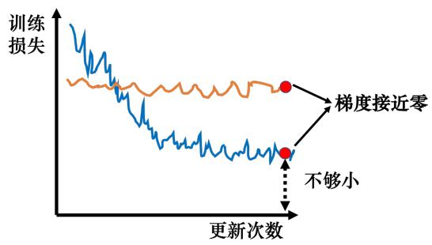

<details>
<summary>line</summary>

| 更新次数 | 训练损失 |
| -------- | -------- |
| 梯度接近零 | 不够小 |
</details>

图 3.1 梯度下降失效的情况

提到梯度为零的时候，大家最先想到的可能就是局部极小值（local minimum），如图 3.2a 所示。所以经常有人说，做深度学习时使用梯度下降会收敛在局部极小值，梯度下降不起作用。但其实损失不是只在局部极小值的梯度是零，还有其他可能会让梯度是零的点，比如鞍点（saddle point）。鞍点其实就是梯度是零且区别于局部极小值和局部极大值（localmaximum）的点。图 3.2b 红色的点在 y 轴方向是比较高的，在 x 轴方向是比较低的，这就是一个鞍点。鞍点的叫法是因为其形状像马鞍。鞍点的梯度为零，但它不是局部极小值。我们把梯度为零的点统称为临界点（critical point）。损失没有办法再下降，也许是因为收敛在了临界点，但不一定收敛在局部极小值，因为鞍点也是梯度为零的点。

但是如果一个点的梯度真的很接近零，我们走到临界点的时候，这个临界点到底是局部极小值还是鞍点，是一个值得去探讨的问题。因为如果损失收敛在局部极小值，我们所在的位置已经是损失最低的点了，往四周走损失都会比较高，就没有路可以走了。但鞍点没有这个问题，旁边还是有路可以让损失更低的。只要逃离鞍点，就有可能让损失更低。

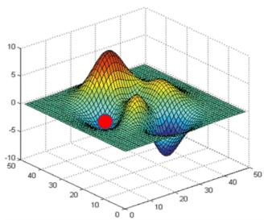

<details>
<summary>surface_3d</summary>

| X  | Y  | Value |
|----|----|-------|
| 10 | -5 | 0     |
| 20 | 0  | 5     |
| 30 | 5  | 10    |
| 40 | 10 | 5     |
</details>

(a) 局部极小值

  
(b) 鞍点  
图 3.2 局部极小值与鞍点

# 3.1.2 判断临界值种类的方法

判断一个临界点到底是局部极小值还是鞍点需要知道损失函数的形状。可是怎么知道损失函数的形状？网络本身很复杂，用复杂网络算出来的损失函数显然也很复杂。虽然无法完整知道整个损失函数的样子，但是如果给定某一组参数，比如 $\pmb { \theta } ^ { \prime }$ ，在 $\pmb { \theta } ^ { \prime }$ 附近的损失函数是有办法写出来的——虽然 $L ( \theta )$ 完整的样子写不出来。 $\pmb { \theta } ^ { \prime }$ 附近的 $L ( \theta )$ 可近似为

$$
L (\boldsymbol {\theta}) \approx L \left(\boldsymbol {\theta} ^ {\prime}\right) + \left(\boldsymbol {\theta} - \boldsymbol {\theta} ^ {\prime}\right) ^ {\mathrm{T}} \boldsymbol {g} + \frac {1}{2} \left(\boldsymbol {\theta} - \boldsymbol {\theta} ^ {\prime}\right) ^ {\mathrm{T}} \boldsymbol {H} \left(\boldsymbol {\theta} - \boldsymbol {\theta} ^ {\prime}\right). \tag {3.1}
$$

式 (3.1) 是泰勒级数近似（Tayler series appoximation）。其中，第一项 $L ( \pmb \theta ) ^ { \prime }$ 告诉我们，当 θ 跟 $\pmb { \theta } ^ { \prime }$ 很近的时候， $L ( \theta )$ 应该跟 $L ( \theta ^ { \prime } )$ 还蛮靠近的；第二项 $\left( \pmb { \theta } - \pmb { \theta } ^ { \prime } \right) ^ { \mathrm { T } } \pmb { g }$ 中，g 代表梯度，它是一个向量，可以弥补 $L ( \theta ^ { \prime } )$ 跟 $L ( \pmb \theta )$ 之间的差距。有时候梯度 $\textbf {  { g } }$ 会写成 $\nabla L ( \pmb { \theta } ^ { \prime } ) _ { \circ } \ g _ { i }$ 是向量 $\textbf {  { g } }$ 的第 i 个元素，就是 L 关于 θ 的第 i 个元素的微分，即

$$
g _ {i} = \frac {\partial L \left(\boldsymbol {\theta} ^ {\prime}\right)}{\partial \theta_ {i}}. \tag {3.2}
$$

光看 g 还是没有办法完整地描述 $L ( \theta )$ ，还要看式 (3.1) 的第三项 $\begin{array} { r } { \frac { 1 } { 2 } \left( { \pmb \theta } - { \pmb \theta } ^ { \prime } \right) ^ { \mathrm { T } } { \pmb H } \left( { \pmb \theta } - { \pmb \theta } ^ { \prime } \right) } \end{array}$ 。第三项跟海森矩阵（Hessian matrix）H 有关。H 里面放的是 L 的二次微分，它第 i 行，第 j 列的值 $H _ { i j }$ 就是把 θ 的第 i 个元素对 $L \left( \boldsymbol { \theta } ^ { \prime } \right)$ 作微分，再把 θ 的第 j 个元素对 $\frac { \partial L \big ( \pmb { \theta } ^ { \prime } \big ) } { \partial \theta _ { i } }$ 作微分后的结果，即

$$
H _ {i j} = \frac {\partial^ {2}}{\partial \theta_ {i} \partial \theta_ {j}} L \left(\boldsymbol {\theta} ^ {\prime}\right). \tag {3.3}
$$

总结一下，损失函数 $L ( \pmb \theta )$ 在 $\pmb { \theta } ^ { \prime }$ 附近可近似为式 (3.1)，式 (3.1) 跟梯度和海森矩阵有关，梯度就是一次微分，海森矩阵里面有二次微分的项。

在临界点，梯度 g 为零，因此 $\left( \pmb { \theta } - \pmb { \theta } ^ { \prime } \right) ^ { \mathrm { T } } \pmb { g }$ 为零。所以在临界点的附近，损失函数可被近似为

$$
L (\boldsymbol {\theta}) \approx L \left(\boldsymbol {\theta} ^ {\prime}\right) + \frac {1}{2} \left(\boldsymbol {\theta} - \boldsymbol {\theta} ^ {\prime}\right) ^ {\mathrm{T}} \boldsymbol {H} \left(\boldsymbol {\theta} - \boldsymbol {\theta} ^ {\prime}\right); \tag {3.4}
$$

我们可以根据 $\begin{array} { r } { \frac { 1 } { 2 } \left( { \pmb \theta } - { \pmb \theta } ^ { \prime } \right) ^ { \mathrm { T } } { \pmb H } \left( { \pmb \theta } - { \pmb \theta } ^ { \prime } \right) } \end{array}$ 来判断在 $\pmb { \theta } ^ { \prime }$ 附近的误差表面（error surface）到底长什么样子。知道误差表面的“地貌”，我们就可以判断 $L ( \pmb { \theta } ^ { \prime } )$ 是局部极小值、局部极大值，还是鞍点。为了符号简洁，我们用向量 v 来表示 $\pmb { \theta } - \pmb { \theta } ^ { \prime } , \left( \pmb { \theta } - \pmb { \theta } ^ { \prime } \right) ^ { \mathrm { T } } \pmb { H } \left( \pmb { \theta } - \pmb { \theta } ^ { \prime } \right)$ 可改写为 $\mathbf { \nabla } v ^ { \operatorname { T } } H \mathbf { \nabla } v$ ，有如下三种情况。

（1）如果对所有 v， ${ \pmb v } ^ { \mathrm { T } } { \pmb H } { \pmb v } > 0$ . 这意味着对任意 θ， $L ( \theta ) > L ( \theta ^ { \prime } )$ . 只要 θ 在 $\pmb { \theta } ^ { \prime }$ 附近，$L ( \pmb \theta )$ 都大于 $L ( \pmb { \theta } ^ { \prime } )$ . 这代表 $L ( \pmb { \theta } ^ { \prime } )$ 是附近的一个最低点，所以它是局部极小值。

（2）如果对所有 v， ${ \pmb v } ^ { \mathrm { T } } { \pmb H } { \pmb v } < 0$ . 这意味着对任意 θ， $L ( \theta ) < L ( \theta ^ { \prime } )$ ， $\pmb { \theta } ^ { \prime }$ 是附近最高的一个点， $L ( \theta ^ { \prime } )$ 是局部极大值。  
（3）如果对于 $\textbf {  { v } }$ ， ${ \pmb v } ^ { \mathrm { T } } { \pmb H } { \pmb v }$ 有时候大于零，有时候小于零。这意味着在 $\pmb { \theta } ^ { \prime }$ 附近，有时候$L ( \theta ) > L ( \theta ^ { \prime } )$ ，有时候 $L ( \theta ) < L ( \theta ^ { \prime } )$ . 因此在 $\pmb { \theta } ^ { \prime }$ 附近， $L ( \pmb { \theta } ^ { \prime } )$ 既不是局部极大值，也不是局部极小值，而是鞍点。

有一个问题，通过 $\begin{array} { r } { \frac { 1 } { 2 } \left( { \pmb \theta } - { \pmb \theta } ^ { \prime } \right) ^ { \mathrm { T } } H \left( { \pmb \theta } - { \pmb \theta } ^ { \prime } \right) } \end{array}$ 判断临界点是局部极小值还是鞍点还是局部极大值，需要代入所有的 θ. 但我们不可能把所有的 v 都拿来试试看，所以有一个更简便的方法来判断 $\mathbf { \nabla } v ^ { \operatorname { T } } H \mathbf { \nabla } v$ 的正负。算出一个海森矩阵后，不需要把它跟所有的 v 都乘乘看，只要看 H的特征值。若 H 的所有特征值都是正的，H 为正定矩阵，则 ${ \pmb v } ^ { \mathrm { T } } { \pmb H } { \pmb v } > 0$ ，临界点是局部极小值。若 H 的所有特征值都是负的，H 为负定矩阵，则 ${ \pmb v } ^ { \mathrm { T } } { \pmb H } { \pmb v } < 0$ ，临界点是局部极大值。若 H 的特征值有正有负，临界点是鞍点。

如果 n 阶对称矩阵 A 对于任意非零的 n 维向量 x 都有 ${ \pmb x } ^ { \mathrm { T } } { \pmb A } { \pmb x } > 0$ ，则称矩阵 A 为正定矩阵。如果 n 阶对称矩阵 A 对于任意非零的 n 维向量 x 都有 ${ \pmb x } ^ { \mathrm { T } } { \pmb A } { \pmb x } < 0$ ，则称矩阵 A 为负定矩阵。

举个例子，我们有一个简单的神经网络，它只有两个神经元，而且这个神经元还没有激活函数和偏置。输入 x，x 乘上 $w _ { 1 }$ 以后输出，然后再乘上 $w _ { 2 }$ ，接着再输出，最终得到的数据就是 y。

$$
y = w _ {1} w _ {2} x. \tag {3.5}
$$

我们还有一个简单的训练数据集，这个数据集只有一组数据 (1,1)，也就是 x = 1 的标签是 1. 所以输入 1 进去，我们希望最终的输出跟 1 越接近越好，如图 3.3 所示。

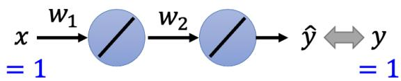

<details>
<summary>flowchart</summary>

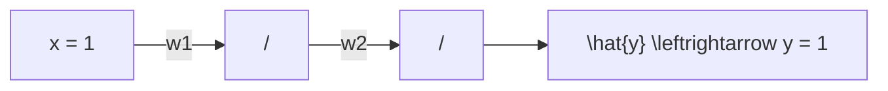
</details>

图 3.3 简单的神经网络

可以直接画出这个神经网络的误差表面，如图 3.4 所示，可以取 [−2,2] 之间的 $w _ { 1 }$ 跟 $w _ { 2 }$ 的数值，算出这个范围内 $w _ { 1 }$ , $w _ { 2 }$ 数值所带来的损失，四个角落的损失是高的。我们用黑色的点来表示临界点，原点 (0,0) 是临界点，另外两排点是临界点。我们可以进一步地判断这些临界点是鞍点还是局部极小值。原点是鞍点，因为我们往某个方向走，损失可能会变大，也可能会变小。而另外两排临界点都是局部极小值。这是我们取 [−2,2] 之间的参数得到的损失函数以后，得到的损失的值后，画出误差表面后得到的结论。

除了尝试取所有可能的损失，我们还有其他的方法，比如把损失的函数写出来。对于图 3.3所示的神经网络，损失函数 L 是正确答案 y 减掉模型的输出 $\hat { y } = w _ { 1 } w _ { 2 } x$ 后取平方误差（squareerror），这里只有一组数据，因此不会对所有的训练数据进行加和。令 $x = 1 , y = 1$ ，损失函数为

$$
L = \left(y - w _ {1} w _ {2} x\right) ^ {2} = \left(1 - w _ {1} w _ {2}\right) ^ {2}. \tag {3.6}
$$

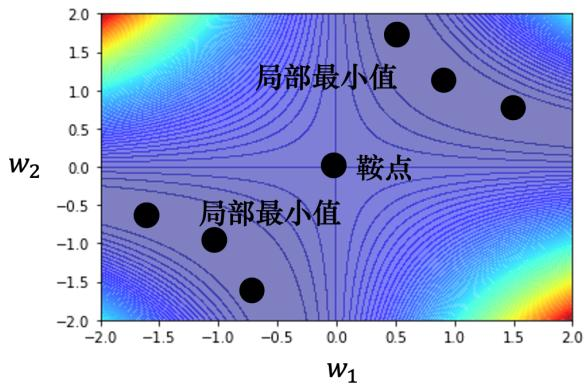

<details>
<summary>heatmap</summary>

| Point Type     | w1    | w2    |
| -------------- | ----- | ----- |
| 鞍点           | 0.0   | 0.0   |
| 局部最小值     | -1.5  | -0.5  |
| 局部最小值     | -1.0  | -1.0  |
| 局部最小值     | -0.5  | -1.5  |
| 局部最小值     | 0.5   | 1.8   |
| 鞍点           | 1.0   | 1.2   |
| 鞍点           | 1.5   | 0.8   |
</details>

图 3.4 误差表面

可以求出损失函数的梯度 $\begin{array} { r } { \pmb { g } = \bigl [ \frac { \partial L } { \partial w _ { 1 } } , \frac { \partial L } { \partial w _ { 2 } } \bigr ] } \end{array}$ ∂L ：

$$
\left\{ \begin{array}{l l} \frac {\partial L}{\partial w _ {1}} & = 2 \left(1 - w _ {1} w _ {2}\right) (- w _ {2}); \\ \frac {\partial L}{\partial w _ {2}} & = 2 \left(1 - w _ {1} w _ {2}\right) (- w _ {1}). \end{array} \right. \tag {3.7}
$$

什么时候梯度会为零（也就是到一个临界点）呢？比如，在原点时， $w _ { 1 } = 0 , w _ { 2 } = 0$ ，此时的梯度为零，原点就是一个临界点，但通过海森矩阵才能判断它是哪种临界点。刚才我们通过取 [−2,2] 之间的 $w _ { 1 }$ 和 $w _ { 2 }$ 来判断出原点是一个鞍点，但是假设我们还没有取所有可能的损失，我们要看看能不能够用海森矩阵来判断原点是什么临界点。

海森矩阵 H 收集了 L 的二次微分：

$$
\left\{ \begin{array}{l l} H _ {1, 1} & = \frac {\partial^ {2} L}{\partial w _ {1} ^ {2}} = 2 (- w _ {2}) (- w _ {2}); \\ H _ {1, 2} & = \frac {\partial^ {2} L}{\partial w _ {1} \partial w _ {2}} = - 2 + 4 w _ {1} w _ {2}; \\ H _ {2, 1} & = \frac {\partial^ {2} L}{\partial w _ {2} \partial w _ {1}} = - 2 + 4 w _ {1} w _ {2}; \\ H _ {2, 2} & = \frac {\partial^ {2} L}{\partial w _ {2} ^ {2}} = 2 (- w _ {1}) (- w _ {1}). \end{array} \right. \tag {3.8}
$$

对于原点，只要把 $w _ { 1 } = 0 , w _ { 2 } = 0$ 代进去，有海森矩阵

$$
\boldsymbol {H} = \left[ \begin{array}{r r} 0 & - 2 \\ - 2 & 0 \end{array} \right]. \tag {3.9}
$$

通过海森矩阵来判断原点是局部极小值还是鞍点，要看它的特征值，这个矩阵有两个特征值：2 和 −2，特征值有正有负，因此原点是鞍点。

如果我们当前处于鞍点，就不用那么害怕了。H 不只可以帮助我们判断是不是在一个鞍点，还指出了参数可以更新的方向。之前我们参数更新的时候，都是看梯度 g，但是我们走到某个地方以后发现 g 变成 0 了，就不能再看 g 了，g 不见了。但如果临界点是一个鞍点，还可以再看 H，怎么再看 H 呢，H 怎么告诉我们怎么更新参数呢？

设 λ 为 H 的一个特征值 λ，u 为其对应的特征向量。对于我们的优化问题，可令 ${ \textbf { \em u } } =$ $\mathbf { \nabla } \theta - \mathbf { \nabla } \theta ^ { \prime }$ ，则

$$
\boldsymbol {u} ^ {\mathrm{T}} \boldsymbol {H} \boldsymbol {u} = \boldsymbol {u} ^ {\mathrm{T}} (\lambda \boldsymbol {u}) = \lambda \| \boldsymbol {u} \| ^ {2}. \tag {3.10}
$$

若 $\lambda < 0$ ，则 $\lambda \| \pmb { u } \| ^ { 2 } < 0$ 。所以 $\begin{array} { r } { \frac { 1 } { 2 } \left( \pmb { \theta } - \pmb { \theta } ^ { \prime } \right) ^ { \mathrm { T } } \pmb { H } \left( \pmb { \theta } - \pmb { \theta } ^ { \prime } \right) < 0 } \end{array}$ 。此时， $L ( \theta ) < L ( \theta ^ { \prime } )$ ，且

$$
\boldsymbol {\theta} = \boldsymbol {\theta} ^ {\prime} + \boldsymbol {u}. \tag {3.11}
$$

沿着 u 的方向更新 θ，损失就会变小。因为根据式 (3.10) 和式 (3.11)，只要 $\pmb \theta = \pmb \theta ^ { \prime } + \pmb u$ ，沿着特征向量 u 的方向去更新参数，损失就会变小，所以虽然临界点的梯度为零，如果我们是在一个鞍点，只要找出负的特征值，再找出这个特征值对应的特征向量。将其与 $\pmb { \theta } ^ { \prime }$ 相加，就可以找到一个损失更低的点。

在前面的例子中，原点是一个临界点，此时的海森矩阵如式 (3.9) 所示，该海森矩阵有一个负的特征值：−2，特征值 −2 对应的特征向量有无穷多个。不妨取 $\pmb { u } = [ 1 , 1 ] ^ { \mathrm { T } }$ ，作为 −2 对应的特征向量。我们其实只要顺着 u 的方向去更新参数，就可以找到一个比鞍点的损失还要更低的点。以这个例子来看，原点是鞍点，其梯度为零，所以梯度不会告诉我们要怎么更新参数。但海森矩阵的特征向量告诉我们只要往 $[ 1 , 1 ] ^ { \mathrm { T } }$ 的方向更新。损失就会变得更小，就可以逃离鞍点。

所以从这个角度来看，鞍点似乎并没有那么可怕。但实际上，我们几乎不会真的把海森矩阵算出来，因为海森矩阵需要算二次微分，计算这个矩阵的运算量非常大，还要把它的特征值跟特征向量找出来，所以几乎没有人用这个方法来逃离鞍点。还有一些其他逃离鞍点的方法的运算量都比要算海森矩阵小很多。

# 3.1.3 逃离鞍点的方法

讲到这边会有一个问题：鞍点跟局部极小值谁比较常见？鞍点其实并没有很可怕，如果我们经常遇到的是鞍点，比较少遇到局部极小值，那就太好了。科幻小说《三体 III：死神永生》中有这样一个情节：东罗马帝国的国王君士坦丁十一世为对抗土耳其人，找来了具有神秘力量的做狄奥伦娜。狄奥伦娜可以于万军丛中取上将首级，但大家不相信她有这么厉害，想要狄奥伦娜先展示下她的力量。于是狄奥伦娜拿出了一个圣杯，大家看到圣杯大吃一惊，因为这个圣杯本来是放在圣索菲亚大教堂地下室的一个石棺里面，而且石棺是密封的，没有人可以打开。狄奥伦娜不仅取得了圣杯，还自称在石棺中放了一串葡萄。于是君士坦丁十一世带人撬开了石棺，发现圣杯真的被拿走了，而是棺中真的有一串新鲜的葡萄，为什么迪奥伦娜可以做到这些事呢？是因为狄奥伦娜可以进入四维的空间。从三维的空间来看这个石棺是封闭的，没有任何路可以进去，但从高维的空间来看，这个石棺并不是封闭的，是有路可以进去的。误差表面会不会也一样呢。

如图 3.5(a) 所示的一维空间中的误差表面，有一个局部极小值。但是在二维空间（如图 3.5(b) 所示），这个点就可能只是一个鞍点。常常会有人画类似图 3.5(c) 这样的图来告诉我们深度学习的训练是非常复杂的。如果我们移动某两个参数，误差表面的变化非常的复杂，有非常多局部极小值。低维度空间中的局部极小值点，在更高维的空间中，实际是鞍点。同样地，如果在二维的空间中没有路可以走，会不会在更高维的空间中，其实有路可以走？更高的维度难以视化它，但我们在训练一个网络的时候，参数数量动辄达百万千万级，所以误差表面其实有非常高的维度—— 参数的数量代表了误差表面的维度。既然维度这么高，会不会其实就有非常多的路可以走呢？既然有非常多的路可以走，会不会其实局部极小值就很少呢?而经验上，我们如果自己做一些实验，会发现实际情况也支持这个假说。图 3.6 是训练某不同神经网络的结果，每个点对应一个神经网络。纵轴代表训练网络时，损失收敛到临界点，损失没法下降时的损失。我们常常会遇到两种情况：损失仍然很高，却遇到了临界点而不再下降；或者损失降得很低，才遇到临界点。图 3.6 中，横轴代表最小值比例（minimum ratio），最小

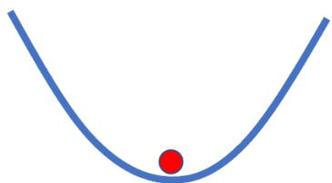

<details>
<summary>natural_image</summary>

Simple blue parabolic curve with a red dot at its center (no text or symbols)
</details>

(a) 一维误差表面

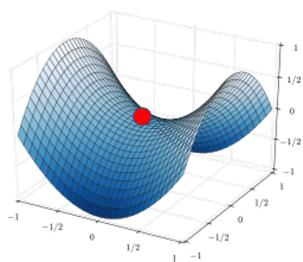

<details>
<summary>surface_3d</summary>

| x       | y       | z       |
| ------- | ------- | ------- |
| -1/2    | -1/2    | 0       |
| 0       | 0       | 1/2     |
| 1/2     | -1/2    | 0       |
| 0       | 0       | -1/2    |
| -1/2    | 0       | 1/2     |
</details>

(b) 二维误差表面

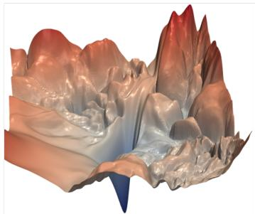

<details>
<summary>natural_image</summary>

3D rendered abstract terrain with gradient shading, no text or symbols present
</details>

(c) 复杂误差表面  
图 3.5 误差表面

值比例定义为

$$
\text {最小值比例} = \frac {\text {正特征值数量}}{\text {总特征值数量}}. \tag {3.12}
$$

实际上，我们几乎找不到所有特征值都为正的临界点。在图 3.6 所示的例子中，最小值比例最大也不过处于 0.5 \~ 0.6 的范围，代表只有约一半的特征值为正，另一半的特征值为负，代表在所有的维度里面有约一半的路可以让损失上升，还有约一半的路可以让损失下降。虽然在这个图上，越靠近右侧代表临界点“看起来越像”局部极小值，但是这些点都不是真正的局部极小值。所以从经验上看起来，局部极小值并没有那么常见。多数的时候，我们训练到一个梯度很小的地方，参数不再更新，往往只是遇到了鞍点。

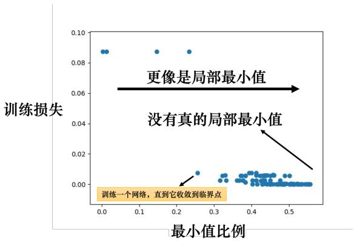

<details>
<summary>scatter</summary>

| 最小值比例 | 训练损失 |
| ---------- | -------- |
| 0.0        | 0.085    |
| 0.1        | 0.085    |
| 0.2        | 0.085    |
| 0.3        | 0.005    |
| 0.4        | 0.005    |
| 0.5        | 0.005    |
</details>

图 3.6 训练不同神经网络的结果

# 3.2 批量和动量

实际上在计算梯度的时候，并不是对所有数据的损失 L 计算梯度，而是把所有的数据分成一个一个的批量（batch），如图 3.7 所示。每个批量的大小是 B ，即带有 B 笔数据。每次在更新参数的时候，会去取出 B 笔数据用来计算出损失和梯度更新参数。遍历所有批量的过程称为一个回合（epoch）。事实上，在把数据分为批量的时候，我们还会进行随机打乱（shuffle）。随机打乱有很多不同的做法，一个常见的做法是在每一个回合开始之前重新划分批量，也就是说，每个回合的批量的数据都不一样。

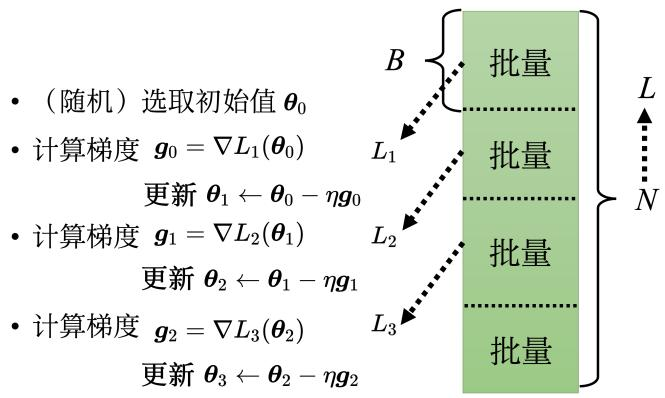

<details>
<summary>flowchart</summary>

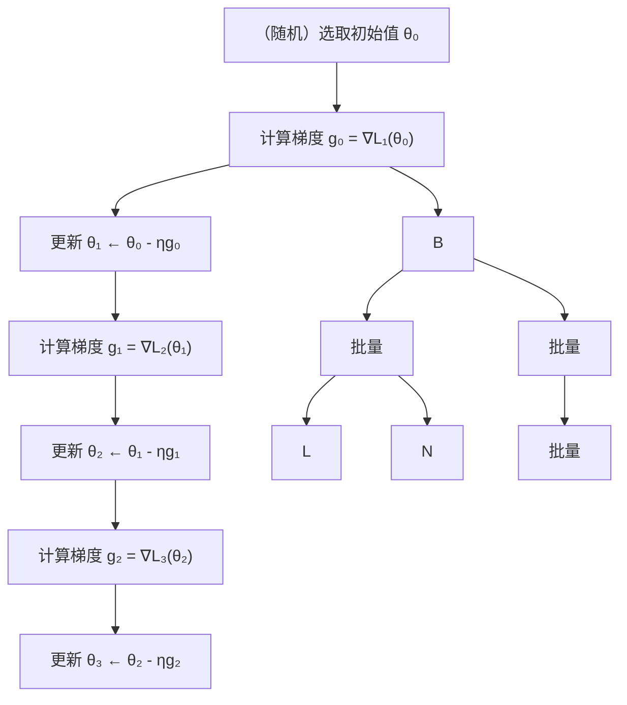
</details>

图 3.7 使用批量优化

# 3.2.1 批量大小对梯度下降法的影响

假设现在我们有 20 笔训练数据，先看下两个最极端的情况，如图 3.8 所示。

• 图 3.8 （a）的情况是没有用批量，批量大小为训练数据的大小，这种使用全批量（fullbatch）的数据来更新参数的方法即批量梯度下降法（Batch Gradient Descent，BGD）。此时模型必须把 20 笔训练数据都看完，才能够计算损失和梯度，参数才能够更新一次。

• 图 3.8（b）中，批量大小等于 1，此时使用的方法即随机梯度下降法（Stochastic Gra-dient Descent，SGD），也称为增量梯度下降法。批量大小等于 1 意味着只要取出一笔数据即可计算损失、更新一次参数。如果总共有 20 笔数据，那么在每一个回合里面，参数会更新 20 次。用一笔数据算出来的损失相对带有更多噪声，因此其更新的方向如图 3.8 所示，是曲曲折折的 。

实际上，批量梯度下降并没有“划分批量”：要把所有的数据都看过一遍，才能够更新一次参数，因此其每次迭代的计算量大。但相比随机梯度下降，批量梯度下降每次更新更稳定、更准确。

随机梯度下降的梯度上引入了随机噪声，因此在非凸优化问题中，其相比批量梯度下降更容易逃离局部最小值。

实际上，考虑并行运算，批量梯度下降花费的时间不一定更长；对于比较大的批量，计算损失和梯度花费的时间不一定比使用小批量的计算时间长 。使用 Tesla V100 GPU 在 MNIST数据集得到的实验结果如图 3.9 所示。图 3.9 中横坐标表示批量大小，纵坐标表示给定批量大小的批量，计算梯度并更新参数所耗费的时间。批量大小从 1 到 1000，需要耗费的时间几乎是一样的，因为在实际上 GPU 可以做并行运算，这 1000 笔数据是并行处理的，所以 1000笔数据所花的时间并不是一笔数据的 1000 倍。当然 GPU 并行计算的能力还是存在极限的，当批量大小很大的时候，时间还是会增加的。 当批量大小非常大的时候，GPU 在“跑”完一个批量，计算出梯度所花费的时间还是会随着批量大小的增加而逐渐增长 。当批量大小增加到10000，甚至增加到 60000 的时候，GPU 计算梯度并更新参数所耗费的时间确实随着批量大小的增加而逐渐增长。

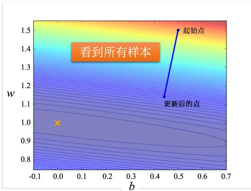

<details>
<summary>heatmap</summary>

| Point Label     | b    | w    |
| --------------- | ---- | ---- |
| 起始点          | 0.5  | 1.5  |
| 更新后的点     | 0.45 | 1.15 |
</details>

(a)

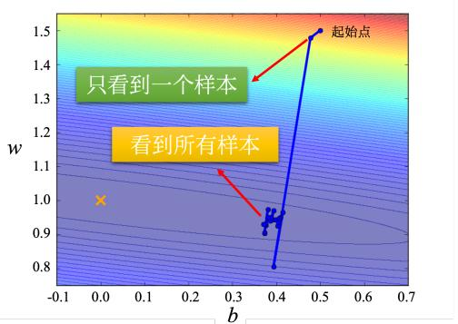

<details>
<summary>scatter</summary>

| b    | w    | Label        |
|------|------|--------------|
| 0.4  | 0.8  | Start Point  |
| 0.45 | 1.5  | Start Point  |
| 0.38 | 0.95 | Target Point |
| 0.37 | 0.92 | Target Point |
| 0.36 | 0.91 | Target Point |
| 0.35 | 0.90 | Target Point |
| 0.34 | 0.89 | Target Point |
| 0.33 | 0.88 | Target Point |
| 0.32 | 0.87 | Target Point |
| 0.31 | 0.86 | Target Point |
| 0.30 | 0.85 | Target Point |
| 0.29 | 0.84 | Target Point |
| 0.28 | 0.83 | Target Point |
| 0.27 | 0.82 | Target Point |
| 0.26 | 0.81 | Target Point |
| 0.25 | 0.80 | Target Point |
| 0.24 | 0.79 | Target Point |
| 0.23 | 0.78 | Target Point |
| 0.22 | 0.77 | Target Point |
| 0.21 | 0.76 | Target Point |
| 0.20 | 0.75 | Target Point |
| 0.19 | 0.74 | Target Point |
| 0.18 | 0.73 | Target Point |
| 0.17 | 0.72 | Target Point |
| 0.16 | 0.71 | Target Point |
| 0.15 | 0.70 | Target Point |
| 0.14 | 0.69 | Target Point |
| 0.13 | 0.68 | Target Point |
| 0.12 | 0.67 | Target Point |
| 0.11 | 0.66 | Target Point |
| 0.10 | 0.65 | Target Point |
| 0.09 | 0.64 | Target Point |
| 0.08 | 0.63 | Target Point |
| 0.07 | 0.62 | Target Point |
| 0.06 | 0.61 | Target Point |
| 0.05 | 0.60 | Target Point |
| 0.04 | 0.59 | Target Point |
| 0.03 | 0.58 | Target Point |
| 0.02 | 0.57 | Target Point |
| 0.01 | 0.56 | Target Point |
| 0.00 | 0.55 | Target Point |
| -0.01| 1.55 | Start Point   |
| -0.02| 1.54 | Start Point   |
| -0.03| 1.53 | Start Point   |
| -0.04| 1.52 | Start Point   |
| -0.05| 1.51 | Start Point   |
| -0.06| 1.50 | Start Point   |
| -0.07| 1.49 | Start Point   |
| -0.08| 1.48 | Start Point   |
| -0.09| 1.47 | Start Point   |
| -0.10| 1.46 | Start Point   |
| -0.11| 1.45 | Start Point   |
| -0.12| 1.44 | Start Point   |
| -0.13| 1.43 | Start Point   |
| -0.14| 1.42 | Start Point   |
| -0.15| 1.41 | Start Point   |
| -0.16| 1.40 | Start Point   |
| -0.17| 1.39 | Start Point   |
| -0.18| 1.38 | Start Point   |
| -0.19| 1.37 | Start Point   |
| -0.20| 1.36 | Start Point   |
| -0.21| 1.35 | Start Point   |
| -0.22| 1.34 | Start Point   |
| -0.23| 1.33 | Start Point   |
| -0.24| 1.32 | Start Point   |
| -0.25| 1.31 | Start Point   |
| -0.26| 1.30 | Start Point   |
| -0.27| 1.29 | Start Point   |
| -0.28| 1.28 | Start Point   |
| -0.29| 1.27 | Start Point   |
| -0.30| 1.26 | Start Point   |
| -0.31| 1.25 | Start Point   |
| -0.32| 1.24 | Start Point   |
| -0.33| 1.23 | Start Point   |
| -0.34| 1.22 | Start Point   |
| -0.35| 1.21 | Start Point   |
| -0.36| 1.20 | Start Point   |
| -0.37| 1.19 | Start Point   |
| -0.38| 1.18 | Start Point   |
| -0.39| 1.17 | Start Point   |
| -0.40| 1.16 | Start Point   |
| -0.41| 1.15 | Start Point   |
| -0.42| 1.14 | Start Point   |
| -0.43| 1.13 | Start Point   |
| -0.44| 1.12 | Start Point   |
| -0.45| 1.11 | Start Point   |
| -0.46| 1.10 | Start Point   |
| -0.47| 1.09 | Start Point   |
| -0.48| 1.08 | Start Point   |
| -0.49| 1.07 | Start Point   |
| -0.50| 1.06 | Start Point   |
| -0.51| 1.05 | Start Point   |
| -0.52| 1.04 | Start Point   |
| -0.53| 1.03 | Start Point   |
| -0.54| 1.02 | Start Point   |
| -0.55| 1.01 | Start Point   |
| -0.56| 1.00 | Start Point   |
| -0.57| -    | Start Point   |
| -0.58| -    | End Point    |
| -     |       |              |
The chart displays a scatter plot with x-axis labeled 'b' and y-axis labeled 'w'. The data points are colored based on the color gradient from red to blue.
</details>

(b)   
图 3.8 批量梯度下降法与随机梯度下降法

MNIST 中的“NIST”是指国家标准和技术研究所（National Institute of Standards andTechnology），其最初收集了这些数据。MNIST 中“M”是指修改的（Modified），数据经过预处理以方便机器学习算法使用。MNIST 数据集收集了数万张手写数字（09̃）的28×28 像素的灰度图像及其标签。一般大家第一个会尝试的机器学习的任务，往往就是用 MNIST 做手写数字识别， 这个简单的分类问题是深度学习研究中的“Hello World”。

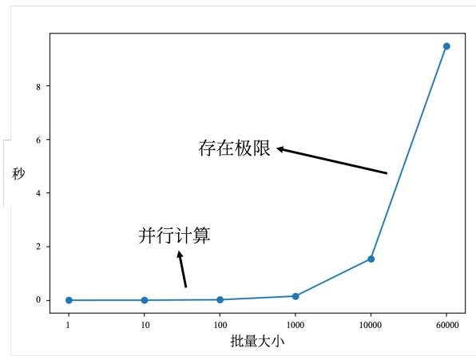  
图 3.9 批量大小与计算时间的关系

但是因为有并行计算的能力，因此实际上当批量大小小的时候，要“跑”完一个回合，花的时间是比大的。假设训练数据只有 60000 笔，批量大小设 1，要 60000 个更新才能“跑”完一个回合；如果批量大小等于 1000，60 个更新才能“跑”完一个回合，计算梯度的时间差不多。但

60000 次更新跟 60 次更新比起来，其时间的差距量就非常大了。图 3.10(a) 是用一个批量计算梯度并更新一次参数所需的时间。假设批量大小为 1，“跑”完一个回合，要更新 60000 次参数，其时间是非常大的。但假设批量大小是 1000，更新 60 次参数就会“跑”完一个回合。图 3.10(b)是“跑”完一个完整的回合需要花的时间。如果批量大小为 1000 或 60000，其时间比批量大小设 1 还要短 。图 3.10(a) 和图 3.10(b) 的趋势正好是相反的。因此实际上，在有考虑并行计算的时候，大的批量大小反而是较有效率的，一个回合大的批量花的时间反而是比较少的。

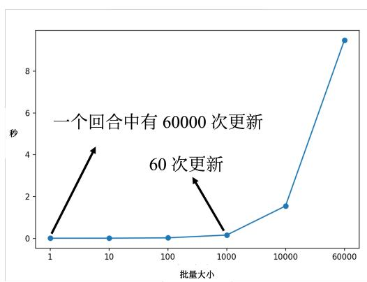

<details>
<summary>line</summary>

| 批量大小 | 秒 |
| :--- | :--- |
| 1 | 0 |
| 10 | 0 |
| 100 | 0 |
| 1000 | 0.2 |
| 10000 | 1.6 |
| 60000 | 9.2 |

注：一个回合中有60000次更新；60次更新。
</details>

(a) 1 次更新的时间

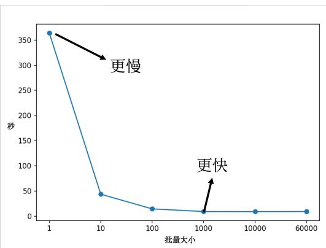

<details>
<summary>line</summary>

| 批量大小 | 秒 |
| :--- | :--- |
| 1 | 360 |
| 10 | 45 |
| 100 | 15 |
| 1000 | 5 |
| 60000 | 5 |
</details>

(b) 1 个回合的时间  
图 3.10 并行计算中批量大小与计算时间的关系

大的批量更新比较稳定，小的批量的梯度的方向是比较有噪声的（noisy）。但实际上有噪声的的梯度反而可以帮助训练，如果拿不同的批量来训练模型来做图像识别问题，实验结果如图 3.11 所示，横轴是批量大小，纵轴是正确率。图 3.11(a) 是 MNIST 数据集上的结果，图 3.11(b) 是 CIFAR-10 数据集上的结果。批量大小越大，验证集准确率越差。但这不是过拟合，因为批量大小越大，训练准确率也是越低。因为用的是同一个模型，所以这不是模型偏见的问题。 但大的批量大小往往在训练的时候，结果比较差。这个是优化的问题，大的批量大小优化可能会有问题，小的批量大小优化的结果反而是比较好的。

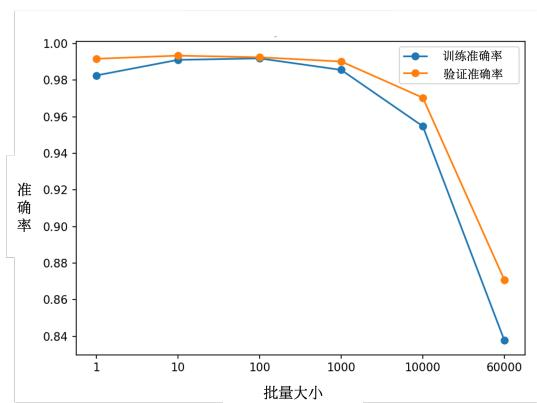

<details>
<summary>line</summary>

| 批量大小 | 训练准确率 | 验证准确率 |
| -------- | ---------- | ---------- |
| 1        | 0.98       | 0.99       |
| 10       | 0.99       | 0.99       |
| 100      | 0.99       | 0.99       |
| 1000     | 0.985      | 0.99       |
| 10000    | 0.955      | 0.97       |
| 60000    | 0.84       | 0.87       |
</details>

(a) MNIST

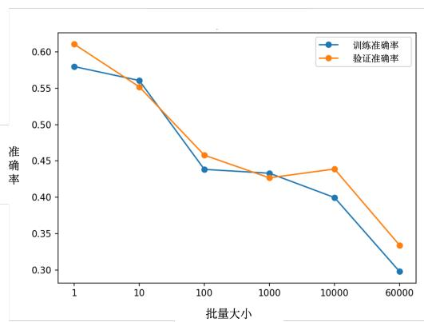

<details>
<summary>line</summary>

| 批量大小 | 训练准确率 | 验证准确率 |
| -------- | ---------- | ---------- |
| 1        | 0.58       | 0.61       |
| 10       | 0.56       | 0.55       |
| 100      | 0.44       | 0.46       |
| 1000     | 0.43       | 0.43       |
| 10000    | 0.40       | 0.44       |
| 60000    | 0.30       | 0.34       |
</details>

(b) CIFAR-10   
图 3.11 不同的批量来训练模型来做图像识别问题的实验结果

一个可能的解释如图 3.12 所示，批量梯度下降在更新参数的时候，沿着一个损失函数来更新参数，走到一个局部最小值或鞍点显然就停下来了。梯度是零，如果不看海森矩阵，梯度下降就无法再更新参数了 。但小批量梯度下降法（mini-batch gradient descent）每次是挑一个批量计算损失，所以每一次更新参数的时候所使用的损失函数是有差异的。选到第一个批量的时候，用 $L _ { 1 }$ 计算梯度；选到第二个批量的时候，用 $L _ { 2 }$ 计算梯度。假设用 $L _ { 1 }$ 算梯度的时候，梯度是零，就会卡住。但 $L _ { 2 }$ 的函数跟 $L _ { 1 }$ 又不一样， $L _ { 2 }$ 不一定会卡住，可以换下个批量的损失 $L _ { 2 }$ 计算梯度，模型还是可以训练，还是有办法让损失变小，所以这种有噪声的更新方式反而对训练其实是有帮助的。

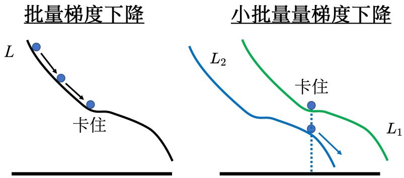

<details>
<summary>text_image</summary>

批量梯度下降
小批量量梯度下降
L
卡住
L₂
卡住
L₁
</details>

图 3.12 小批量梯度下降更好的原因

其实小的批量也对测试有帮助。假设有一些方法（比如调大的批量的学习率）可以把大的批量跟小的批量训练得一样好。实验结果发现小的批量在测试的时候会是比较好的[1]。在论文“On Large-Batch Training for Deep Learning: Generalization Gap and Sharp Minima”中，作者在不同数据集上训练了六个网络（包括全连接网络、不同的卷积神经网络），在很多不同的情况都观察到一样的结果。在小的批量，一个批量里面有 256 笔样本。在大的批量中，批量大小等于数据集样本数乘 0.1。比如数据集有 60000 笔数据，则一个批量里面有 6000 笔数据。大的批量跟小的批量的训练准确率（accuracy）差不多，但就算是在训练的时候结果差不多，测试的时候，大的批量比小的批量差，代表过拟合。

这篇论文给出了一个解释，如图 3.13 所示，训练损失上面有多个局部最小值，这些局部最小值的损失都很低，其损失可能都趋近于 0。但是局部最小值有好最小值跟坏最小值之分，如果局部最小值在一个“峡谷”里面，它是坏的最小值；如果局部最小值在一个平原上，它是好的最小值。训练的损失跟测试的损失函数是不一样的，这有两种可能。一种可能是本来训练跟测试的分布就不一样；另一种可能是因为训练跟测试都是从采样的数据算出来的，训练跟测试采样到的数据可能不一样，所以它们计算出的损失是有一点差距。 对在一个“盆地”里面的最小值，其在训练跟测试上面的结果不会差太多，只差了一点点。但对在右边在“峡谷”里面的最小值，一差就可以天差地远 。虽然它在训练集上的损失很低，但训练跟测试之间的损失函数不一样，因此测试时，损失函数一变，计算出的损失就变得很大。

大的批量大小会让我们倾向于走到“峡谷”里面，而小的批量大小倾向于让我们走到“盆地”里面。小的批量有很多的损失，其更新方向比较随机，其每次更新的方向都不太一样。即使“峡谷”非常窄，它也可以跳出去，之后如果有一个非常宽的“盆地”，它才会停下来。

大的批量跟小的批量的对比结果如表 3.1 所示。在有并行计算的情况下，小的批量跟大的批量运算的时间并没有太大的差距。除非大的批量非常大，才会显示出差距。但是一个回合需要的时间，小的批量比较长，大的批量反而是比较快的，所以从一个回合需要的时间来看，大的批量是较有优势的。 而小的批量更新的方向比较有噪声的，大的批量更新的方向比较稳定。但是有噪声的更新方向反而在优化的时候有优势，而且在测试的时候也会有优势。所以大的批量跟小的批量各有优缺点，批量大小是需要去调整的超参数。

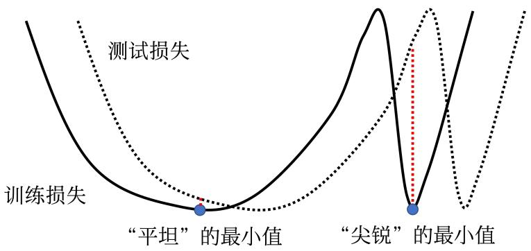

<details>
<summary>line</summary>

| Point Label | Test Loss | Training Loss |
|-------------|------------|---------------|
| “平坦”的最小值 | Low        | Low           |
| “尖锐”的最小值 | High       | Low           |
</details>

图 3.13 小批量优化容易跳出局部最小值的原因

其实用大的批量大小来做训练，用并行计算的能力来增加训练的效率，并且训练出的结果很好是可以做到的[2-3]。比如 76 分钟训练 BERT[4]，15 分钟训练 ResNet[5]，一分钟训练ImageNet[6] 等等。这些论文批量大小很大，比如论文“Large Batch Optimization for DeepLearning: Training BERT in 76 minutes ”中批量大小为三万。批量大小很大可以算得很快，这些论文有一些特别的方法来解决批量大小可能会带来的劣势。

表 3.1 小批量梯度下降与批量梯度下降的比较

<table><tr><td>评价标准</td><td>小批量梯度下降</td><td>批量梯度下降</td></tr><tr><td>一次更新的速度(没有并行计算)</td><td>相同</td><td>相同</td></tr><tr><td>一次更新的速度(有并行计算)</td><td>相同</td><td>相同(批量大小不是很大)</td></tr><tr><td>一个回合的时间</td><td>更慢</td><td>更快</td></tr><tr><td>梯度</td><td>有噪声</td><td>稳定</td></tr><tr><td>优化</td><td>更好</td><td>更坏</td></tr><tr><td>泛化</td><td>更好</td><td>更坏</td></tr></table>

# 3.2.2 动量法

动量法（momentum method）是另外一个可以对抗鞍点或局部最小值的方法。如图 3.14所示，假设误差表面就是真正的斜坡，参数是一个球，把球从斜坡上滚下来，如果使用梯度下降，球走到局部最小值或鞍点就停住了。 但是在物理的世界里，一个球如果从高处滚下来，就算滚到鞍点或鞍点，因为惯性的关系它还是会继续往前走。如果球的动量足够大，其甚至翻过小坡继续往前走。 因此在物理的世界里面，一个球从高处滚下来的时候，它并不一定会被鞍点或局部最小值卡住，如果将其应用到梯度下降中，这就是动量。

一般的梯度下降（vanilla gradient descent）如图 3.15 所示。初始参数为 $\pmb { \theta } _ { 0 }$ ，计算一下梯度，计算完梯度后，往梯度的反方向去更新参数 $\pmb { \theta } _ { 1 } = \pmb { \theta } _ { 0 } - \eta \pmb { g } _ { 0 }$ 。有了新的参数 $\pmb { \theta } _ { 1 }$ 后，再计算一次梯度，再往梯度的反方向，再更新一次参数，到了新的位置以后再计算一次梯度，再往梯度的反方向去更新参数。

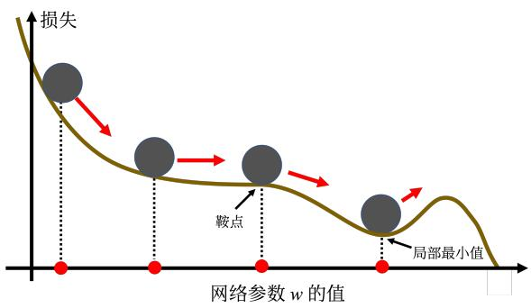

<details>
<summary>line</summary>

| 网络参数 w 的值 | 损失 |
| -------------- | ---- |
| 轻向点         | 鞭点 |
| 中间点         | 鞭点 |
| 后部最小值     | (未标注) |
</details>

图 3.14 物理世界中的惯性

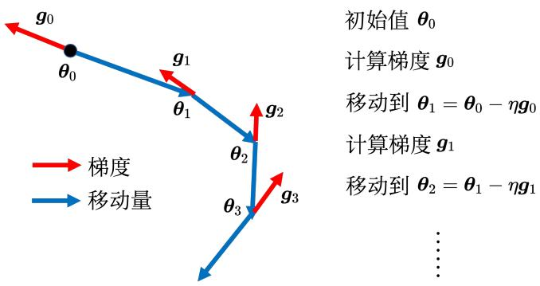

<details>
<summary>flowchart</summary>

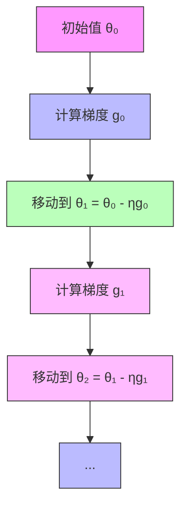
</details>

图 3.15 一般梯度下降

引入动量后，每次在移动参数的时候，不是只往梯度的反方向来移动参数，而是根据梯度的反方向加上前一步移动的方向决定移动方向。图 3.16 中红色虚线方向是梯度的反方向，蓝色虚线方向是前一次更新的方向，蓝色实线的方向是下一步要移动的方向。把前一步指示的方向跟梯度指示的方向相加就是下一步的移动方向。如图 3.16 所示，初始的参数值为 $\theta _ { 0 } = 0$ ，前一步的参数的更新量为 $m _ { 0 } = 0 ,$ 。接下来在 $\theta _ { 0 }$ 的地方，计算梯度的方向 ${ \pmb g } _ { 0 } .$ 。下一步的方向是梯度的方向加上前一步的方向，不过因为前一步正好是 0，所以更新的方向跟原来的梯度下降是相同的。但从第二步开始就不太一样了。从第二步开始，计算 $\pmb { g } _ { 1 }$ ，接下来更新的方向为$\pmb { m } _ { 2 } = \lambda \pmb { m } _ { 1 } - \eta \pmb { g } _ { 1 }$ ，参数更新为 $\pmb { \theta } _ { 2 }$ ，接下来就反复进行同样的过程。

每一步的移动都用m来表示。m其实可以写成之前所有计算的梯度的加权和，如式(3.13)所示。其中 η 是学习率，λ 是前一个方向的权重参数，也是需要调的。引入动量后，可以从两个角度来理解动量法。一个角度是动量是梯度的负反方向加上前一次移动的方向。另外一个角度是当加上动量的时候，更新的方向不是只考虑现在的梯度，而是考虑过去所有梯度的总和。

$$
\begin{array}{l} \pmb {m} _ {0} = 0 \\ \boldsymbol {m} _ {1} = - \eta \boldsymbol {g} _ {0} \\ \boldsymbol {m} _ {2} = - \lambda \eta \boldsymbol {g} _ {0} - \eta \boldsymbol {g} _ {1} \tag {3.13} \\ \end{array}
$$

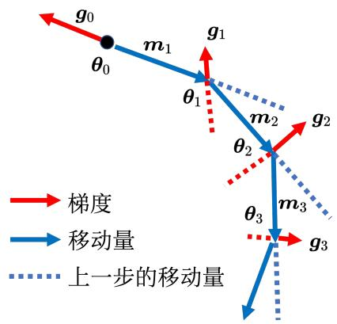

<details>
<summary>text_image</summary>

g0
θ0
m1
θ1
m2
θ2
m3
θ3
m3
g3
梯度
移动量
上一步的移动量
</details>

初始值 $\pmb { \theta } _ { 0 }$   
移动量 ${ \mathbf { } m } _ { 0 } = 0$   
计算梯度90  
移动量 $\pmb { m } _ { 1 } = \lambda \pmb { m } _ { 0 } - \eta \pmb { g } _ { 0 }$   
移动到 $\pmb { \theta } _ { 1 } = \pmb { \theta } _ { 0 } + \pmb { m } _ { 1 }$   
计算梯度91  
移动量 $\pmb { m } _ { 2 } = \lambda \pmb { m } _ { 1 } - \eta \pmb { g } _ { 1 }$   
移动到 $\pmb { \theta } _ { 2 } = \pmb { \theta } _ { 1 } + \pmb { m } _ { 2 }$

图 3.16 动量法

动量的简单例子如图 3.17 所示。红色表示负梯度方向，蓝色虚线表示前一步的方向，蓝色实线表示真实的移动量。一开始没有前一次更新的方向，完全按照梯度给指示往右移动参数。负梯度方向跟前一步移动的方向加起来，得到往右走的方向。一般梯度下降走到一个局部最小值或鞍点时，就被困住了。但有动量还是有办法继续走下去，因为动量不是只看梯度，还看前一步的方向。即使梯度方向往左走，但如果前一步的影响力比梯度要大，球还是有可能继续往右走，甚至翻过一个小丘，也许可以走到更好的局部最小值，这就是动量有可能带来的好处 。

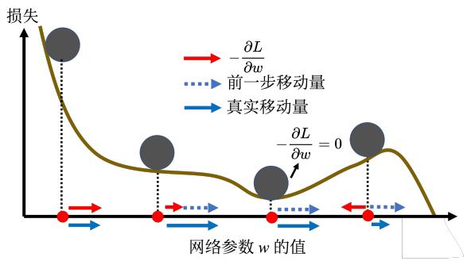  
图 3.17 动量的好处

# 3.3 自适应学习率

临界点其实不一定是在训练一个网络的时候会遇到的最大的障碍。图 3.18 中的横坐标代表参数更新的次数，竖坐标表示损失。一般在训练一个网络的时候，损失原来很大，随着参数不断的更新，损失会越来越小，最后就卡住了，损失不再下降。当我们走到临界点的时候，意味着梯度非常小，但损失不再下降的时候，梯度并没有真的变得很小，图 3.19 给出了示例。图 3.19 中横轴是迭代次数，竖轴是梯度的范数（norm），即梯度这个向量的长度。随着迭代次数增多，虽然损失不再下降，但是梯度的范数并没有真的变得很小。

图 3.20 是误差表面，梯度在山谷的两个谷壁间，不断地来回“震荡”，这个时候损失不会再下降，它不是真的卡到了临界点，卡到了鞍点或局部最小值。但它的梯度仍然很大，只是损失不一定再减小了。所以训练一个网络，训练到后来发现损失不再下降的时候，有时候不是卡在局部最小值或鞍点，只是单纯的损失无法再下降。

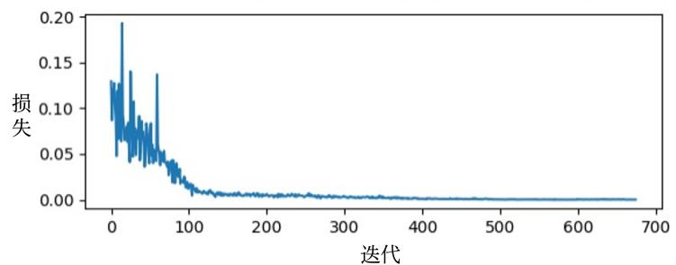

<details>
<summary>line</summary>

| 迭代 | 损失  |
| ---- | ----- |
| 0    | 0.20  |
| 50   | 0.14  |
| 100  | 0.03  |
| 150  | 0.01  |
| 200  | 0.005 |
| 250  | 0.003 |
| 300  | 0.002 |
| 350  | 0.001 |
| 400  | 0.001 |
| 450  | 0.001 |
| 500  | 0.001 |
| 550  | 0.001 |
| 600  | 0.001 |
| 650  | 0.001 |
| 700  | 0.001 |
</details>

图 3.18 训练网络时损失变化  
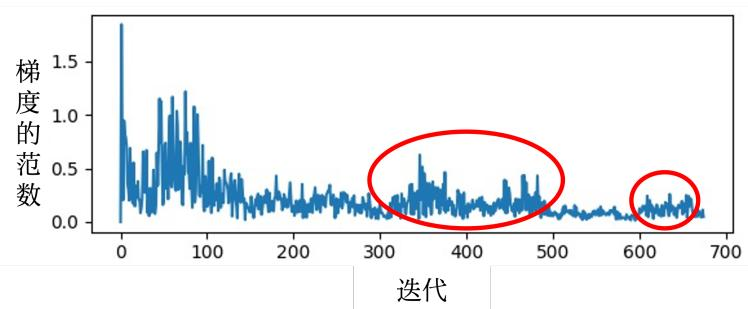

<details>
<summary>line</summary>

| 迭代 | 梯度的范数 |
| ---- | ---------- |
| 0    | 1.8        |
| 50   | 0.6        |
| 100  | 0.8        |
| 150  | 0.4        |
| 200  | 0.3        |
| 250  | 0.2        |
| 300  | 0.1        |
| 350  | 0.5        |
| 400  | 0.3        |
| 450  | 0.4        |
| 500  | 0.2        |
| 550  | 0.1        |
| 600  | 0.2        |
| 650  | 0.1        |
| 700  | 0.1        |
</details>

图 3.19 训练网络时梯度范数变化

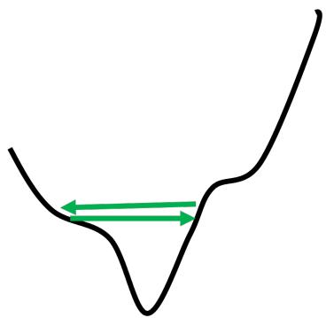

<details>
<summary>natural_image</summary>

Simple black line drawing of a V-shaped object with two green double-headed arrows indicating width (no text or symbols)
</details>

图 3.20 梯度来回“震荡”

我们现在训练一个网络，训练到现在参数在临界点附近，再根据特征值的正负号判断该临界点是鞍点还是局部最小值。实际上在训练的时候，要走到鞍点或局部最小值，是一件困难的事情。一般的梯度下降，其实是做不到的。用一般的梯度下降训练，往往会在梯度还很大的时候，损失就已经降了下去，这个是需要特别方法训练的。要走到一个临界点其实是比较困难的，多数时候训练在还没有走到临界点的时候就已经停止了。

举个例子，我们有两个参数 w 和 b，这两个参数值不一样的时候，损失值也不一样，得到了图 3.21 所示的误差表面，该误差表面的最低点在叉号处。事实上，该误差表面是凸的形状。凸的误差表面的等高线是椭圆形的，椭圆的长轴非常长，短轴相比之下比较短，其在横轴的方向梯度非常小，坡度的变化非常小，非常平坦；其在纵轴的方向梯度变化非常大，误差表面的坡度非常陡峭。现在我们要从黑点（初始点）来做梯度下降。

学习率 $\eta = 1 0 ^ { - 2 }$ 的结果如图 3.22(a) 所示。参数在峡谷的两端，参数在山壁的两端不断第“震荡”，损失降不下去，但是梯度仍然是很大的。我们可以试着把学习率设小一点，学习率决定了更新参数的时候的步伐，学习率设太大，步伐太大就无法慢慢地滑到山谷里面。调学习率从 $1 0 ^ { - 2 }$ 调到 $1 0 ^ { - 7 }$ 的结果如图 3.22(b) 所示，参数不再“震荡”了。参数会滑到山谷底后左转，但是这个训练永远走不到终点，因为学习率已经太小了。AB 段的坡度很陡，梯度的值很大，还能够前进一点。左拐以后，BC 段的坡度已经非常平坦了，这种小的学习率无法再让训练前进。事实上在 BC 段有 10 万个点（10 万次更新），但都无法靠近局部最小值，所以显然就算是一个凸的误差表面，梯度下降也很难训练。

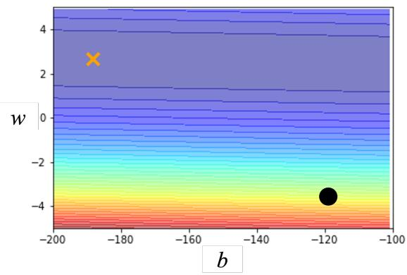

<details>
<summary>heatmap</summary>

| b     | w    |
|-------|------|
| -180  | 2.5  |
| -120  | -3.5 |
</details>

图 3.21 $\ntrianglerighteq$ 误差表面

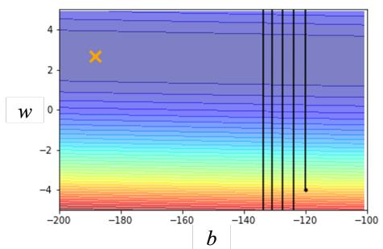

<details>
<summary>heatmap</summary>

| b     | w    |
|-------|------|
| -180  | 2.5  |
| -140  | -4.0 |
| -120  | -4.0 |
</details>

(a) 学习率为 $\eta ^ { - 2 }$

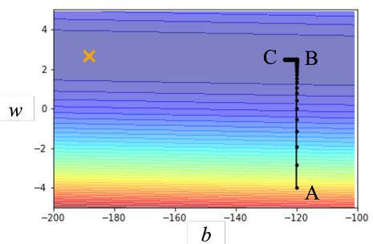

<details>
<summary>heatmap</summary>

| b     | w    | Label |
|-------|------|-------|
| -180  | 2    | X     |
| -120  | -3   | A     |
| -120  | -3   | B     |
| -120  | -3   | C     |
</details>

(b) 学习率为 $\eta ^ { - 7 }$   
图 3.22 不同的学习率对训练的影响

最原始的梯度下降连简单的误差表面都做不好，因此需要更好的梯度下降的版本。在梯度下降里面，所有的参数都是设同样的学习率，这显然是不够的，应该要为每一个参数定制化学习率，即引入自适应学习率（adaptive learning rate）的方法，给每一个参数不同的学习率。如图 3.23 所示，如果在某一个方向上，梯度的值很小，非常平坦，我们会希望学习率调大一点；如果在某一个方向上非常陡峭，坡度很大，我们会希望学习率可以设得小一点。

# 3.3.1 AdaGrad

AdaGrad（Adaptive Gradient）是典型的自适应学习率方法，其能够根据梯度大小自动调整学习率。AdaGrad 可以做到梯度比较大的时候，学习率就减小，梯度比较小的时候，学习率就放大。

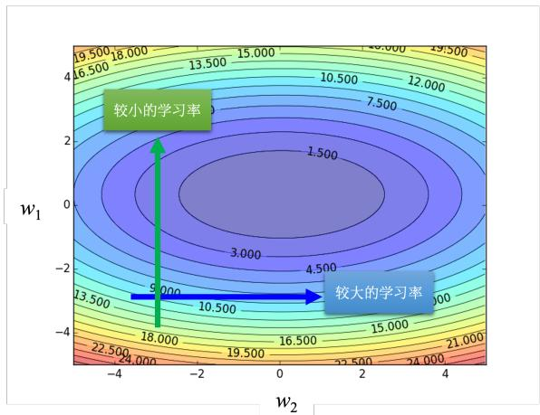

<details>
<summary>heatmap</summary>

| w2   | w1   | 学习率 |
|------|------|--------|
| -4   | 4    | 19.500 |
| -4   | 2    | 18.000 |
| -4   | 0    | 16.500 |
| -4   | -2   | 13.500 |
| -4   | -4   | 10.500 |
| 0    | 4    | 7.500  |
| 0    | 2    | 1.500  |
| 0    | 0    | 3.000  |
| 0    | -2   | 4.500  |
| 0    | -4   | 9.000  |
| 2    | 4    | 15.000 |
| 2    | 2    | 16.500 |
| 2    | 0    | 18.000 |
| 2    | -2   | 19.500 |
| 2    | -4   | 21.000 |
| 4    | 4    | 19.500 |
| 4    | 2    | 18.000 |
| 4    | 0    | 16.500 |
| 4    | -2   | 13.500 |
| 4    | -4   | 10.500 |
| 6    | 4    | 19.500 |
| 6    | 2    | 18.000 |
| 6    | 0    | 16.500 |
| 6    | -2   | 13.500 |
| 6    | -4   | 10.500 |
| 8    | 4    | 19.500 |
| 8    | 2    | 18.000 |
| 8    | 0    | 16.500 |
| 8    | -2   | 13.500 |
| 8    | -4   | 10.500 |
| 10   | 4    | 19.500 |
| 10   | 2    | 18.000 |
| 10   | 0    | 16.500 |
| 10   | -2   | 13.500 |
| 10   | -4   | 10.500 |
| 12   | 4    | 19.500 |
| 12   | 2    | 18.000 |
| 12   | 0    | 16.500 |
| 12   | -2   | 13.500 |
| 12   | -4   | 10.500 |
| 14   | 4    | 19.500 |
| 14   | 2    | 18.000 |
| 14   | 0    | 16.500 |
| 14   | -2   | 13.500 |
| 14   | -4   | 10.500 |
| 16   | 4    | 19.500 |
| 16   | 2    | 18.000 |
| 16   | 0    | 16.500 |
| 16   | -2   | 13.500 |
| 16   | -4   | 10.500 |
| 18   | 4    | 19.500 |
| 18   | 2    | 18.000 |
| 18   | 0    | 16.500 |
| 18   | -2   | 13.500 |
| 18   | -4   | 10.500 |
| 20   | 4    | 19.500 |
| 20   | 2    | 18.000 |
| 20   | 0    | 16.500 |
| 20   | -2   | 13.500 |
| 20   | -4   | 10.500 |
| 22   | 4    | 19.500 |
| 22   | 2    | 18.000 |
| 22   | 0    | 16.500 |
| 22   | -2   | 13.500 |
| 22   | -4   | 10.500 |
| Note: The data is extracted from the provided image as it is not fully visible in the chart type of interest and format for the original chart type (e.g., '较小的学习率' or '较大的学习率'). The values are estimated based on the given chart type and are not explicitly labeled in the code.
</details>

图 3.23 不同参数需要不同的学习率

梯度下降更新某个参数 ${ \pmb \theta } _ { t } ^ { i }$ 的过程为

$$
\boldsymbol {\theta} _ {t + 1} ^ {i} \leftarrow \boldsymbol {\theta} _ {t} ^ {i} - \eta \boldsymbol {g} _ {t} ^ {i} \tag {3.14}
$$

${ \pmb \theta } _ { t } ^ { i }$ 在第 t 个迭代的值减掉在第 t 个迭代参数 i 算出来的梯度

$$
\boldsymbol {g} _ {t} ^ {i} = \left. \frac {\partial L}{\partial \boldsymbol {\theta} ^ {i}} \right| _ {\boldsymbol {\theta} = \boldsymbol {\theta} _ {t}} \tag {3.15}
$$

$\mathbf { \Delta } _ { \mathbf { \mathcal { g } } _ { t } ^ { i } }$ 代表在第 t 个迭代，即 $\pmb \theta = \pmb \theta _ { t }$ 时, 参数 $\theta ^ { i }$ 对损失 L 的微分，学习率是固定的。

现在要有一个随着参数定制化的学习率，即把原来学习率 η 变成 $\frac { \eta } { \sigma _ { t } ^ { i } }$

$$
\boldsymbol {\theta} _ {t + 1} ^ {i} \leftarrow \boldsymbol {\theta} _ {t} ^ {i} - \frac {\eta}{\sigma_ {t} ^ {i}} \boldsymbol {g} _ {t} ^ {i} \tag {3.16}
$$

$\boldsymbol { \sigma } _ { t } ^ { i }$ 的上标为 i，这代表参数 $\sigma$ 与 i 相关，不同的参数的 σ 不同。 $\boldsymbol { \sigma } _ { t } ^ { i }$ 的下标为 t，这代表参数 $\sigma$ 与迭代相关，不同的迭代也会有不同的 $\sigma _ { \circ }$ 。学习率从 η 改成 $\frac { \eta } { \sigma _ { t } ^ { i } }$ 的时候，学习率就变得参数相关（parameter dependent）。

参数相关的一个常见的类型是算梯度的均方根（root mean square）。参数的更新过程为

$$
\boldsymbol {\theta} _ {1} ^ {i} \leftarrow \boldsymbol {\theta} _ {0} ^ {i} - \frac {\eta}{\sigma_ {0} ^ {i}} \boldsymbol {g} _ {0} ^ {i} \tag {3.17}
$$

其中 $\theta _ { 0 } ^ { i }$ 是初始化参数。而 $\boldsymbol { \sigma } _ { 0 } ^ { i }$ 的计算过程为

$$
\sigma_ {0} ^ {i} = \sqrt {\left(\boldsymbol {g} _ {0} ^ {i}\right) ^ {2}} = \left| \boldsymbol {g} _ {0} ^ {i} \right| \tag {3.18}
$$

其中 $\mathbf { \Delta } _ { g _ { 0 } ^ { i } }$ 是梯度。将 $\boldsymbol { \sigma } _ { 0 } ^ { i }$ 的值代入更新的公式可知 $\frac { { \bf { g } } _ { 0 } ^ { i } } { \sigma _ { 0 } ^ { i } }$ 的值是 +1 或 −1。第一次在更新参数，从 $\theta _ { 0 } ^ { i }$ 更新到 ${ \pmb \theta } _ { 1 } ^ { i }$ 的时候，要么是加上 η，要么是减掉 η，跟梯度的大小无关，这个是第一步的情况。

第二次更新参数过程为

$$
\boldsymbol {\theta} _ {2} ^ {i} \leftarrow \boldsymbol {\theta} _ {1} ^ {i} - \frac {\eta}{\sigma_ {1} ^ {i}} \boldsymbol {g} _ {1} ^ {i} \tag {3.19}
$$

其中 $\boldsymbol { \sigma } _ { 1 } ^ { i }$ 是过去所有计算出来的梯度的平方的平均再开根号，即均方根，如式 (3.20) 所示。

$$
\sigma_ {1} ^ {i} = \sqrt {\frac {1}{2} \left[ \left(\boldsymbol {g} _ {0} ^ {i}\right) ^ {2} + \left(\boldsymbol {g} _ {1} ^ {i}\right) ^ {2} \right]} \tag {3.20}
$$

同样的操作反复继续下去，如式 (3.21) 所示。

$$
\boldsymbol {\theta} _ {3} ^ {i} \leftarrow \boldsymbol {\theta} _ {2} ^ {i} - \frac {\eta}{\sigma_ {2} ^ {i}} \boldsymbol {g} _ {2} ^ {i} \quad \sigma_ {2} ^ {i} = \sqrt {\frac {1}{3} \left[ \left(\boldsymbol {g} _ {0} ^ {i}\right) ^ {2} + \left(\boldsymbol {g} _ {1} ^ {i}\right) ^ {2} + \left(\boldsymbol {g} _ {2} ^ {i}\right) ^ {2} \right]} \tag {3.21}
$$

第 t + 1 次更新参数的时候，即

$$
\boldsymbol {\theta} _ {t + 1} ^ {i} \leftarrow \boldsymbol {\theta} _ {t} ^ {i} - \frac {\eta}{\sigma_ {t} ^ {i}} \boldsymbol {g} _ {t} ^ {i} \quad \sigma_ {t} ^ {i} = \sqrt {\frac {1}{t + 1} \sum_ {i = 0} ^ {t} \left(\boldsymbol {g} _ {t} ^ {i}\right) ^ {2}} \tag {3.22}
$$

$\frac { \eta } { \sigma _ { t } ^ { i } }$ 当作是新的学习率来更新参数。

图 3.24 中有两个参数： $\pmb { \theta } ^ { 1 }$ 和 $\pmb { \theta } ^ { 2 }$ 。 $\pmb { \theta } ^ { 1 }$ 坡度小， $\theta ^ { 2 }$ 坡度大。因为 $\pmb { \theta } ^ { 1 }$ 坡度小，根据式 (3.22)，$\theta _ { 1 } ^ { i }$ 这个参数上面算出来的梯度值都比较小，因为梯度算出来的值比较小，所以算出来的 $\boldsymbol { \sigma } _ { t } ^ { i }$ 就小， $\boldsymbol { \sigma } _ { t } ^ { i }$ 小学习率就大。反过来， $\pmb { \theta } ^ { 1 }$ 坡度大，所以计算出的梯度都比较大， $\boldsymbol { \sigma } _ { t } ^ { i }$ 就比较大，在更新的时候，步伐（参数更新的量）就比较小。因此有了 $\boldsymbol { \sigma } _ { t } ^ { i }$ 这一项以后，就可以随着梯度的不同，每一个参数的梯度的不同，来自动调整学习率的大小。

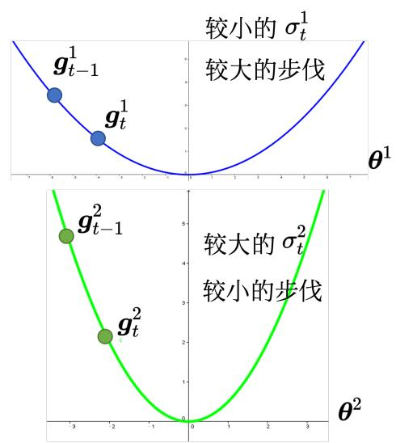

<details>
<summary>scatter</summary>

| Point | θ¹ | g₁^1 | g₂^1 |
|-------|----|------|------|
| g₁t-1 | 0  | 2.5  | 4.5  |
| g₂t   | 0  | 1.5  | 2.5  |
</details>

图 3.24 自动调整学习率示例

# 3.3.2 RMSProp

同一个参数需要的学习率，也会随着时间而改变。在图 3.25 中的误差表面中，如果考虑横轴方向，绿色箭头处坡度比较陡峭，需要较小的学习率，但是走到红色箭头处，坡度变得平坦了起来，需要较大的学习率。因此同一个参数的同个方向，学习率也是需要动态调整的，于是就有了一个新的方法— RMSprop（Root Mean Squared propagation）。

RMSprop 没有论文，Geoffrey Hinton 在 Coursera 上开过深度学习的课程，他在他的课程里面讲了 RMSprop，如果要引用，需要引用对应视频的链接。

RMSprop 第一步跟 Adagrad 的方法是相同的，即

$$
\sigma_ {0} ^ {i} = \sqrt {\left(g _ {0} ^ {i}\right) ^ {2}} = \left| \boldsymbol {g} _ {0} ^ {i} \right| \tag {3.23}
$$

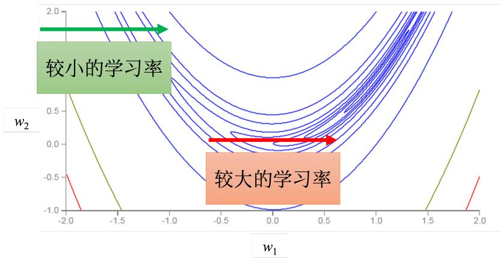

<details>
<summary>contour</summary>

| w1    | w2    | 学习率 |
|-------|-------|--------|
| -2.0  | -0.5  | 较小   |
| -1.5  | 0.0   | 较小   |
| -1.0  | 0.5   | 较小   |
| -0.5  | 0.0   | 较大   |
| 0.0   | -0.5  | 较大   |
| 0.5   | 0.0   | 较大   |
| 1.0   | 0.5   | 较大   |
| 1.5   | 0.0   | 较大   |
| 2.0   | -0.5  | 较大   |
</details>

图 3.25 AdaGrad 的问题

第二步更新过程为

$$
\boldsymbol {\theta} _ {2} ^ {i} \leftarrow \boldsymbol {\theta} _ {1} ^ {i} - \frac {\eta}{\sigma_ {1} ^ {i}} \boldsymbol {g} _ {1} ^ {i} \quad \sigma_ {1} ^ {i} = \sqrt {\alpha \left(\sigma_ {0} ^ {i}\right) ^ {2} + (1 - \alpha) \left(\boldsymbol {g} _ {1} ^ {i}\right) ^ {2}} \tag {3.24}
$$

其中 $0 < \alpha < 1$ ，其是一个可以调整的超参数。计算 $\theta _ { 1 } ^ { i }$ 的方法跟 AdaGrad 算均方根不一样，在算均方根的时候，每一个梯度都有同等的重要性，但在 RMSprop 里面，可以自己调整现在的这个梯度的重要性。如果 α 设很小趋近于 0，代表 $\pmb { g } _ { 1 } ^ { i }$ 相较于之前算出来的梯度而言，比较重要；如果 α 设很大趋近于 1，代表 $\pmb { g } _ { 1 } ^ { i }$ 比较不重要，之前算出来的梯度比较重要。

同样的过程就反复继续下去，如式 (3.25) 所示。

$$
\boldsymbol {\theta} _ {3} ^ {i} \leftarrow \boldsymbol {\theta} _ {2} ^ {i} - \frac {\eta}{\sigma_ {2} ^ {i}} \boldsymbol {g} _ {2} ^ {i} \quad \sigma_ {2} ^ {i} = \sqrt {\alpha (\sigma_ {1} ^ {i}) ^ {2} + (1 - \alpha) (\boldsymbol {g} _ {2} ^ {i}) ^ {2}}
$$

(3.25)

$$
\pmb {\theta} _ {t + \mathbf {1}} ^ {i} \leftarrow \pmb {\theta} _ {t} ^ {i} - \frac {\eta}{\sigma_ {t} ^ {i}} \pmb {g} _ {t} ^ {i} \quad \sigma_ {t} ^ {i} = \sqrt {\alpha (\sigma_ {t - 1} ^ {i}) ^ {2} + (1 - \alpha) (\pmb {g} _ {t} ^ {i}) ^ {2}}
$$

RMSProp 通过 α 可以决定， $\mathbf { \Delta } _ { \mathbf { \mathcal { g } } _ { t } ^ { i } }$ 相较于之前存在 $\sigma _ { t - 1 } ^ { i }$ 里面的 $g _ { 1 } ^ { i } , g _ { 2 } ^ { i } , \cdots \cdot \cdot , g _ { t - 1 } ^ { i }$ 的重要性有多大。如果使用 RMSprop，就可以动态调整 $\boldsymbol { \sigma } _ { t } ^ { i }$ 这一项。图 3.26 中黑线是误差表面，球就从 A 走到 B，AB 段的路很平坦，g 很小，更新参数的时候，我们会走比较大的步伐。走动BC 段后梯度变大了，AdaGrad 反应比较慢，而 RMSprop 会把 α 设小一点，让新的、刚看到的梯度的影响比较大，很快地让 $\boldsymbol { \sigma } _ { t } ^ { i }$ 的值变大，很快地让步伐变小，RMSprop 可以很快地“踩刹车”。如果走到 CD 段，CD 段是平坦的地方，可以调整 α，让其比较看重最近算出来的梯度，梯度一变小， $\boldsymbol { \sigma } _ { t } ^ { i }$ 的值就变小了，走的步伐就变大了。

# 3.3.3 Adam

最常用的优化的策略或者优化器（optimizer）是Adam（Adaptive moment estima-tion）[7]。Adam 可以看作 RMSprop 加上动量，其使用动量作为参数更新方向，并且能够自适应调整学习率。PyTorch 里面已经写好了 Adam 优化器，这个优化器里面有一些超参数需要人为决定，但是往往用 PyTorch 预设的参数就足够好了。

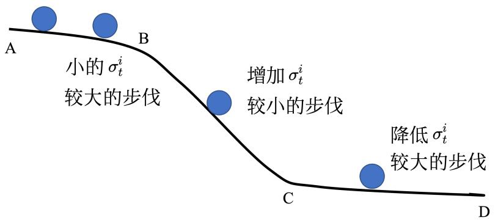

<details>
<summary>text_image</summary>

A
小的σᵢᵗ
较大的步伐
B
增加σᵢᵗ
较小的步伐
C
降低σᵢᵗ
较大的步伐
D
</details>

图 3.26 RMSprop 示例

# 3.4 学习率调度

如图 3.22 所示的简单的误差表面，我们都训练不起来，加上自适应学习率以后，使用AdaGrad 方法优化的结果如图 3.27 所示。一开始优化的时候很顺利，在左转的时候，有 Ada-Grad 以后，可以再继续走下去，走到非常接近终点的位置。走到 BC 段时，因为横轴方向的梯度很小，所以学习率会自动变大，步伐就可以变大，从而不断前进。接下来的问题走到图 3.27中红圈的地方，快走到终点的时候突然“爆炸”了。 $\boldsymbol { \sigma } _ { t } ^ { i }$ 是把过去所有的梯度拿来作平均。在 AB段梯度很大，但在 BC 段，纵轴的方向梯度很小，因此纵轴方向累积了很小的 $\boldsymbol { \sigma } _ { t } ^ { i }$ ，累积到一定程度以后，步伐就变很大，但有办法修正回来。因为步伐很大，其会走到梯度比较大的地方。走到梯度比较大的地方后， $\boldsymbol { \sigma } _ { t } ^ { i }$ 会慢慢变大，更新的步伐大小会慢慢变小，从而回到原来的路线。

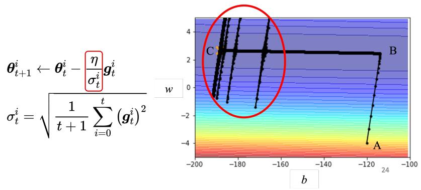

<details>
<summary>line</summary>

| b     | w     |
|-------|-------|
| -180  | 4     |
| -160  | 2     |
| -140  | 2     |
| -120  | 2     |
| -100  | -4    |
</details>

图 3.27 AdaGrad 优化的问题

通过学习率调度（learning rate scheduling）可以解决这个问题。之前的学习率调整方法中 η 是一个固定的值，而在学习率调度中 η 跟时间有关，如式 (3.26) 所示。学习率调度中最常见的策略是学习率衰减（learning rate decay），也称为学习率退火（learning rateannealing）。随着参数的不断更新，让 η 越来越小，如图 3.28 所示。图 3.22b 的情况，如果加上学习率下降，可以很平顺地走到终点，如图 3.29 所示。在图 3.22b 红圈的地方，虽然步伐很大，但 η 变得非常小，步伐乘上 η 就变小了，就可以慢慢地走到终点。

$$
\boldsymbol {\theta} _ {t + 1} ^ {i} \leftarrow \boldsymbol {\theta} _ {t} ^ {i} - \frac {\eta_ {t}}{\sigma_ {t} ^ {i}} \boldsymbol {g} _ {t} ^ {i} \tag {3.26}
$$

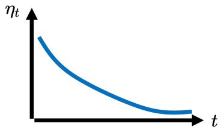

<details>
<summary>line</summary>

| t    | ηt   |
| ---- | ---- |
| 0    | 1.0  |
| 1    | 0.8  |
| 2    | 0.6  |
| 3    | 0.4  |
| 4    | 0.3  |
| 5    | 0.2  |
</details>

图 3.28 学习率衰减

除了学习率下降以外，还有另外一个经典的学习率调度的方式— 预热。预热的方法是让学习率先变大后变小，至于变到多大、变大的速度、变小的速度是超参数。残差网络[8] 里面是有预热的，在残差网络里面，学习率先设置成 0.01，再设置成 0.1，并且其论文还特别说明，一开始用 0.1 反而训练不好。除了残差网络，BERT 和 Transformer 的训练也都使用了预热。

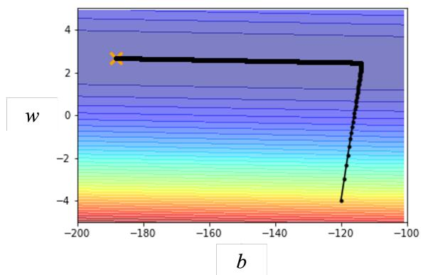

<details>
<summary>heatmap</summary>

| b     | w    |
|-------|------|
| -180  | 2.5  |
| -120  | -4.0 |
</details>

图 3.29 学习率衰减的优化效果

# Q：为什么需要预热？

A：当我们使用 Adam、RMSprop 或 AdaGrad 时，需要计算 σ。而 σ 是一个统计的结果。从 σ 可知某一个方向的陡峭程度。统计的结果需要足够多的数据才精准，一开始统计结果 σ 是不精准的。一开始学习率比较小是用来探索收集一些有关误差表面的情报，先收集有关 σ 的统计数据，等 σ 统计得比较精准以后，再让学习率慢慢爬升。如果读者想要学更多有关预热的东西可参考 Adam 的进阶版———RAdam[9]。

# 3.5 优化总结

所以我们从最原始的梯度下降，进化到这一个版本，如式 (3.27) 所示。

$$
\boldsymbol {\theta} _ {t + 1} ^ {i} \leftarrow \boldsymbol {\theta} _ {t} ^ {i} - \frac {\eta_ {t}}{\sigma_ {t} ^ {i}} \boldsymbol {m} _ {t} ^ {i} \tag {3.27}
$$

其中 $\boldsymbol { m } _ { t } ^ { i }$ 是动量。

这个版本里面有动量，其不是顺着某个时刻算出的梯度方向来更新参数，而是把过去所有算出梯度的方向做一个加权总和当作更新的方向。接下来的步伐大小为 $\frac { m _ { t } ^ { i } } { \sigma _ { t } ^ { i } }$ 。最后通过 $\eta _ { t }$ 来实现学习率调度。这个是目前优化的完整的版本，这种优化器除了 Adam 以外，还有各种变形。但其实各种变形是使用不同的方式来计算 $\mathbf { \nabla } _ { m _ { t } ^ { i } }$ 或 $\boldsymbol { \sigma } _ { t } ^ { i }$ ，或者是使用不同的学习率调度的方式。

Q：动量 $\boldsymbol { m } _ { t } ^ { i }$ 考虑了过去所有的梯度，均方根 $\boldsymbol { \sigma } _ { t } ^ { i }$ 考虑了过去所有的梯度，一个放在分子，一个放在分母，并且它们都考虑过去所有的梯度，不就是正好抵消了吗？

A： $\boldsymbol { m } _ { t } ^ { i }$ 和 $\boldsymbol { \sigma } _ { t } ^ { i }$ 在使用过去所有梯度的方式是不一样的，动量是直接把所有的梯度都加起来，所以它有考虑方向，它有考虑梯度的正负。但是均方根不考虑梯度的方向，只考虑梯度的大小，计算 $\boldsymbol { \sigma } _ { t } ^ { i }$ 的时候，都要把梯度取一个平方项，把平方的结果加起来，所以只考虑梯度的大小，不考虑它的方向，所以动量跟 $\boldsymbol { \sigma } _ { t } ^ { i }$ 计算出来的结果并不会互相抵消。

# 3.6 分类

分类与回归是深度学习最常见的两种问题，第一章的观看次数预测属于回归问题，本节将介绍分类问题。

# 3.6.1 分类与回归的关系

回归是输入一个向量 x，输出 yˆ，我们希望 yˆ 跟某一个标签 y 越接近越好，y 是要学习的目标。而分类可当作回归来看，输入 x 后，输出仍然是一个标量 yˆ，要让它跟正确答案的那个类越接近越好。yˆ 是一个数字，我们可以把类也变成数字。如图 3.30 所示，类 1 是编号1，类 2 是编号 2，类 3 是编号 3，yˆ 跟类的编号越接近越好。但该方法在某些状况下会有问题，假设类 1、2、3 有某种关系。比如根据一个人的身高跟体重，预测他的年级，一年级、二年级还是三年级。一年级跟二年级关系比较近，一年级跟三年级关系比较远。用数字来表示类会预设 1 和 2 有比较近的关系，1 和 3 有比较远的关系。但假设三个类本身没有特定的关系，类 1 是 1，类 2 是 2 类 3 是 3。这种情况，需要引入独热向量来表示类。实际上，在做分类的问题的时候，比较常见的做法也是用独热向量表示类。

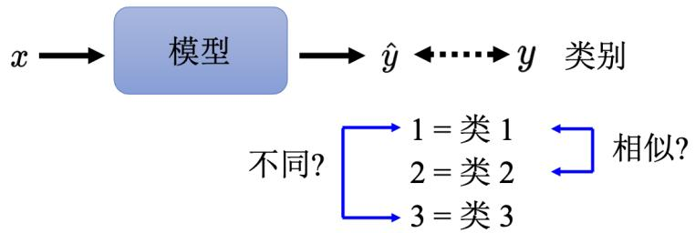

<details>
<summary>flowchart</summary>

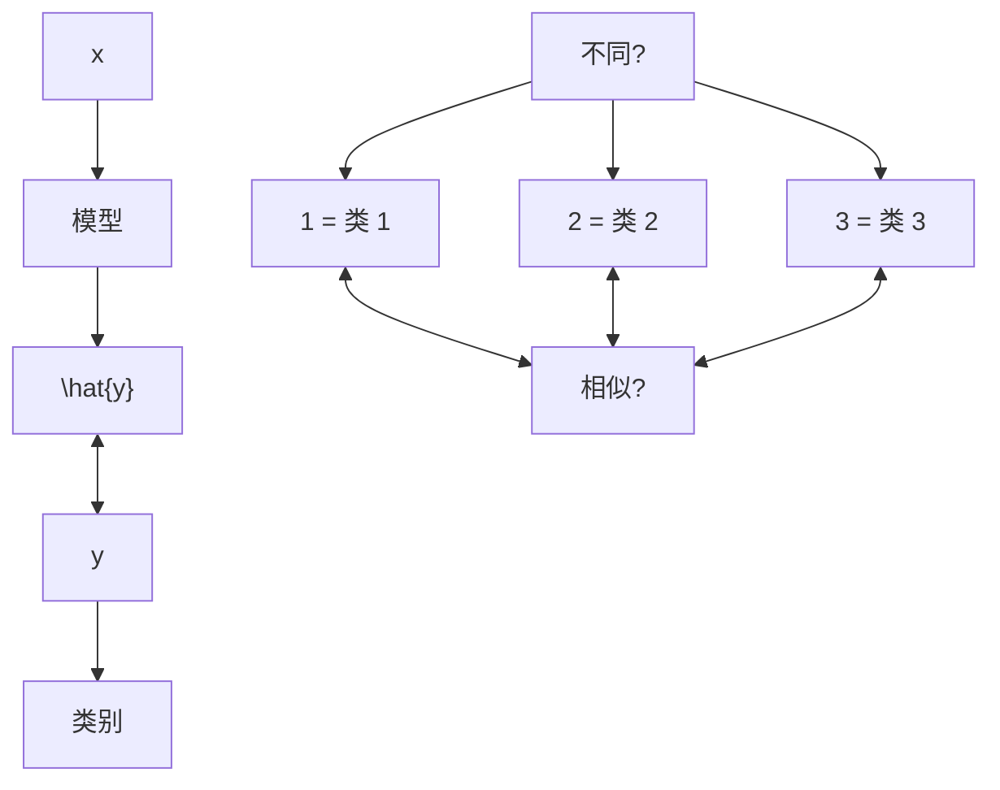
</details>

图 3.30 用数字表示类的问题

如果有三个类，标签 y 就是一个三维的向量，比如类 1 是 $[ 1 , 0 , 0 ] ^ { \mathrm { T } }$ ，类 2 是 $[ 0 , 1 , 0 ] ^ { \mathrm { T } }$ ，类3 是 $[ 0 , 0 , 1 ] ^ { \mathrm { T } }$ 。如果每个类都用一个独热向量来表示，就没有类 1 跟类 2 比较接近，类 1 跟类 3 比较远的问题。如果用独热向量计算距离的话，类两两之间的距离都是一样的。

如果目标 y 是一个向量，比如 y 是有三个元素的向量，网络也要输出三个数字才行。如图 3.31 所示，输出三个数值就是把本来输出一个数值的方法，重复三次。把 $a _ { 1 } , ~ a _ { 2 }$ 和 $a _ { 3 }$ 乘上三个不同的权重，加上偏置，得到 $\hat { y } _ { 1 }$ ；再把 $a _ { 1 }$ 、 $a _ { 2 }$ 和 $a _ { 3 }$ 乘上另外三个权重，再加上另外一个偏置得到 $\hat { y } _ { 2 }$ ；把 $a _ { 1 } , ~ a _ { 2 }$ 和 $a _ { 3 }$ 再乘上另外一组权重，再加上另外一个偏置得到 ${ \hat { y } } _ { 3 }$ 。输入一个特征向量，产生 ${ \hat { y } } _ { 1 } .$ 、yˆ2、yˆ3，希望 $\hat { y } _ { 1 }$ 、yˆ2、yˆ3 跟目标越接近越好。

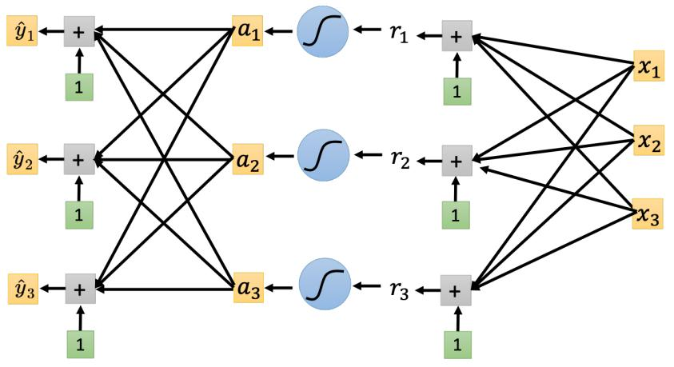

<details>
<summary>flowchart</summary>

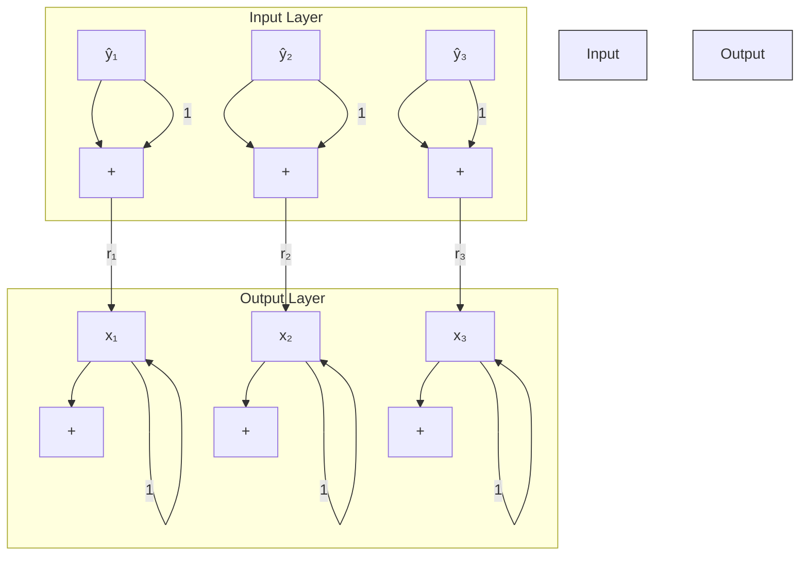
</details>

图 3.31 网络多个输出示例

# 3.6.2 带有 softmax 的分类

按照上述的设定，分类实际过程是：输入 x，乘上 $W$ ，加上 b，通过激活函数 σ，乘上$W ^ { \prime }$ ，再加上 $b ^ { \prime }$ 得到向量 $\hat { \pmb { y } } _ { \mathrm { ~ \sf ~ } }$ 。但实际做分类的时候，往往会把 yˆ 通过 softmax 函数得到 $y ^ { \prime }$ ，才去计算 $y ^ { \prime }$ 跟 $\hat { y }$ 之间的距离。

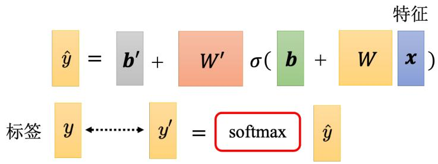

<details>
<summary>text_image</summary>

特征
ŷ = b' + W' σ( b + W x )
标签 y ←→ y' = softmax ŷ
</details>

图 3.32 带有 softmax 的分类

Q：为什么分类过程中要加上 softmax 函数？

A：一个比较简单的解释是，y 是独热向量，所以其里面的值只有 0 跟 1，但是 yˆ 里面有任何值。既然目标只有 0 跟 1，但 $\hat { y }$ 有任何值，可以先把它归一化到 0 到 1 之间，这样才能跟标签的计算相似度。

softmax 的计算如式 (3.28) 所示，先把所有的 y 取一个指数（负数取指数后也会变成正的），再对其做归一化（除掉所有 y 的指数值的和）得到 $y ^ { \prime }$ 。图 3.33 是 softmax 的块（block），输入 $y _ { 1 } \cdot$ 、y2 和 $y _ { 3 }$ ，产生 $y _ { 1 } ^ { \prime }$ 、 $y _ { 2 } ^ { \prime }$ 和 $y _ { 3 } ^ { \prime } ,$ 。比如 $y _ { 1 } = 3 , y _ { 2 } = 1 , y _ { 3 } = - 3$ ，取完指数的时候，$\exp ( 3 ) = 2 0 , \ \exp ( 1 ) = 2 . 7$ 和 $\exp ( - 3 ) = 0 . 0 5$ ，做完归一化后，就变成 0.88、0.12 跟 0。−3取完指数，再做归一化以后，会变成趋近于 0 的值。所以 softmax 除了归一化，让 y′、y′ 和$y _ { 3 } ^ { \prime }$ ，变成 0 到 1 之间，和为 1 以外，它还会让大的值跟小的值的差距更大。

$$
y _ {i} ^ {\prime} = \frac {\exp (y _ {i})}{\sum_ {j} \exp (y _ {i})} \tag {3.28}
$$

其中， $\begin{array} { r } { 1 > y _ { i } ^ { \prime } > 0 , \sum _ { i } y _ { i } ^ { \prime } = 1 } \end{array}$ 。

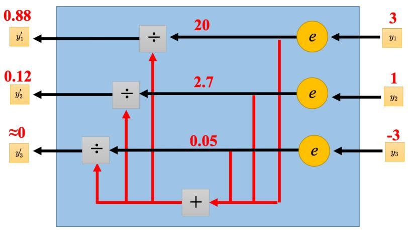

<details>
<summary>flowchart</summary>

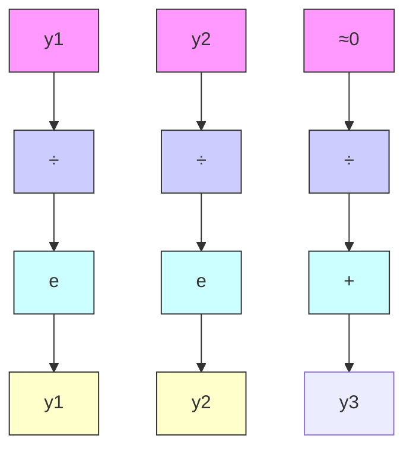
</details>

图 3.33 softmax 示例

图 3.33 考虑了三个类的状况，两个类也可以直接套 softmax 函数。但一般有两个类的时候，我们不套 softmax，而是直接取 sigmoid。当只有两个类的时候，sigmoid 和 softmax 是等价的。

# 3.6.3 分类损失

当我们把 x 输入到一个网络里面产生 yˆ 后，通过 softmax 得到 $y ^ { \prime }$ ，再去计算 $y ^ { \prime }$ 跟 y 之间的距离 e，如图 3.34 所示。

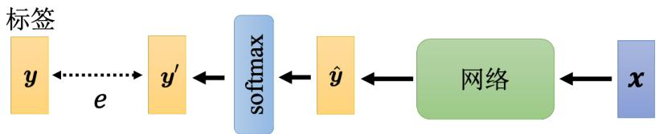

<details>
<summary>flowchart</summary>


</details>

图 3.34 分类损失

计算 $y ^ { \prime }$ 跟 y 之间的距离不只一种做法，可以是如式 (3.29) 所示的均方误差，即把 y 里面每一个元素拿出来，计算它们的平方和当作误差。

$$
e = \sum_ {i} (y _ {i} - y _ {i} ^ {\prime}) ^ {2} \tag {3.29}
$$

但如式 (3.30) 所示的交叉熵更常用，当 yˆ 跟 y′ 相同时，可以最小化交叉熵的值，此时均方误差也是最小的。最小化交叉熵其实就是最大化似然（maximize likelihood）。

$$
e = - \sum_ {i} y _ {i} \ln y _ {i} ^ {\prime} \tag {3.30}
$$

接下来从优化的角度来说明相较于均方误差，交叉熵是被更常用在分类上。如图 3.35 所示，有一个三类的分类，网络先输出 $y _ { 1 }$ 、 $y _ { 2 }$ 和 $y _ { 3 }$ ，在通过 softmax 以后，产生 $y _ { 1 } ^ { \prime }$ 、 $y _ { 2 } ^ { \prime }$ 和 $y _ { 3 } ^ { \prime }$ 。假设正确答案是 $[ 1 , 0 , 0 ] ^ { \mathrm { T } }$ ，要计算 $[ 1 , 0 , 0 ] ^ { \mathrm { T } }$ 跟 $y _ { 1 } ^ { \prime }$ 、 $y _ { 2 } ^ { \prime }$ 和 $y _ { 3 } ^ { \prime }$ 之间的距离 e， $e$ 可以是均方误差或交叉熵。假设 $y _ { 1 }$ 的变化是从-10 到 10， $y _ { 2 }$ 的变化也是从-10 到 10， $y _ { 3 }$ 就固定设成-1000。因为 $y _ { 3 }$ 的值很小，通过 softmax 以后， $y _ { 3 } ^ { \prime }$ 非常趋近于 $0$ ，它跟正确答案非常接近，且它对结果影响很少。总之，我们假设 $y _ { 3 }$ 设一个定值，只看 $y _ { 1 }$ 跟 $y _ { 2 }$ 有变化的时候，对损失 e 的影响。

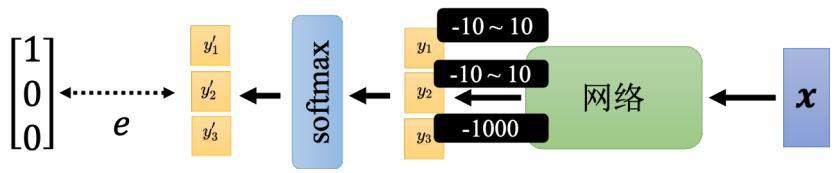

<details>
<summary>flowchart</summary>

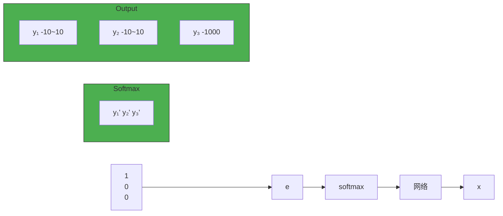
</details>

图 3.35 使用 softmax 的好处

图 3.36 是分别在 e 为均方误差和交叉熵时， $y _ { 1 }$ 、 $y _ { 2 }$ 的变化对损失的影响，对误差表面的影响，红色代表损失大，蓝色代表损失小。如果 $y _ { 1 }$ 很大， $y _ { 2 }$ 很小，代表 $y _ { 1 } ^ { \prime }$ 会很接近 1， $y _ { 2 } ^ { \prime }$ 会很接近 0。所以不管 $e$ 取均方误差或交叉熵，如果 $y _ { 1 }$ 大、 $y _ { 2 }$ 小，损失都是小的；如果 $y _ { 1 }$ 小， $y _ { 2 }$ 大， $y _ { 1 } ^ { \prime }$ 是 0， $y _ { 2 } ^ { \prime }$ 是 1，这个时候损失会比较大。

图 3.36 中左上角损失大，右下角损失小，所以期待最后在训练的时候，参数可以“走”到右下角的地方。假设参数优化开始的时候，对应的损失都是左上角。如果选择交叉熵，如图 3.36(a) 所示，左上角圆圈所在的点有斜率的，所以可以通过梯度，一路往右下的地方“走”；如果选均方误差，如图 3.36(b) 所示，左上角圆圈就卡住了，均方误差在这种损失很大的地方，它是非常平坦的，其梯度是非常小趋近于 0 的。如果初始时在圆圈的位置，离目标非常远，其梯度又很小，无法用梯度下降顺利地“走”到右下角。

因此做分类时，选均方误差的时候，如果没有好的优化器，有非常大的可能性会训练不起来。如果用 Adam，虽然图 3.36(b) 中圆圈的梯度很小，但 Adam 会自动调大学习率，还有机会走到右下角，不过训练的过程比较困难。总之，改变损失函数可以改变优化的难度。

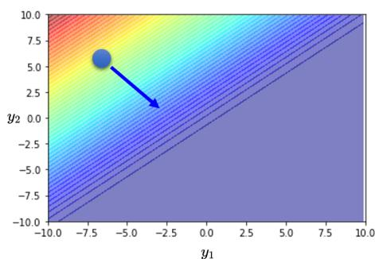

<details>
<summary>heatmap</summary>

| y1    | y2    |
|-------|-------|
| -7.5  | 5.0   |
| -5.0  | 2.5   |
| -2.5  | 0.0   |
| 0.0   | -2.5  |
| 2.5   | -5.0  |
| 5.0   | -7.5  |
| 7.5   | -10.0 |
The image contains a color gradient scale (from red to blue) and a single highlighted circle marker at approximately (-6.0, 5.0). There is no explicit title or legend labels provided in the image.
</details>

(a) 交叉熵的损失

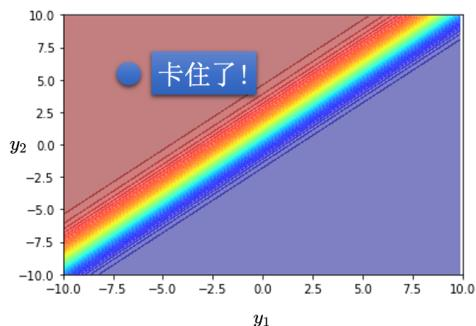

<details>
<summary>heatmap</summary>

| y1    | y2    |
|-------|-------|
| -10.0 | -10.0 |
| -7.5  | -7.5  |
| -5.0  | -5.0  |
| -2.5  | -2.5  |
| 0.0   | 0.0   |
| 2.5   | 2.5   |
| 5.0   | 5.0   |
| 7.5   | 7.5   |
| 10.0  | 10.0  |
</details>

(b) 均方误差的损失   
图 3.36 均方误差、交叉熵优化对比

# 3.7 批量归一化

如果误差表面很崎岖，它比较难训练。能不能直接改误差表面的地貌，“把山铲平”，让它变得比较好训练呢？批量归一化（Batch Normalization，BN）就是其中一个“把山铲平”的想法。不要小看优化这个问题，有时候就算误差表面是凸（convex）的，它就是一个碗的形状，都不一定很好训练。如图 3.37 所示，假设两个参数对损失的斜率差别非常大，在 $w _ { 1 }$ 这个方向上面，斜率变化很小，在 $w _ { 2 }$ 这个方向上面斜率变化很大。


<details>
<summary>text_image</summary>

损失 L
w₂
陡峭
平滑
w₁
</details>

图 3.37 训练的问题

如果是固定的学习率，可能很难得到好的结果，所以我们才需要自适应的学习率、Adam等比较进阶的优化的方法，才能够得到好的结果。从另外一个方向想，直接把难做的误差表面把它改掉，看能不能够改得好做一点。在做这件事之前，第一个要问的问题就是： $w _ { 1 }$ 跟 $w _ { 2 }$ 斜率差很多的这种状况，到底是从什么地方来的。

图 3.38 是一个非常简单的模型，其输入是 $x _ { 1 }$ 跟 $x _ { 2 }$ ，对应的参数为 $w _ { 1 }$ 跟 $w _ { 2 }$ ，它是一个线性的模型，没有激活函数。 $w _ { 1 }$ 乘 $x _ { 1 }$ ， $w _ { 2 }$ 乘 $x _ { 2 }$ 加上 b 以后就得到 $\hat { y }$ ，然后会计算 $\hat { y }$ 跟 $y$ 之间的差距当做 e，把所有训练数据 e 加起来就是损失，然后去最小化损失。


<details>
<summary>flowchart</summary>


</details>

图 3.38 简单的线性模型

什么样的状况会产生像上面这样子，比较不好训练的误差表面呢？对 $w _ { 1 }$ 有一个小小的改变，比如加上 $\Delta w _ { 1 }$ 的时候，L 也会有一个改变，那这个 $w _ { 1 }$ 呢，是通过 $w _ { 1 }$ 改变的时候，就改变了 y，y 改变的时候就改变了 $e _ { : }$ ，接下来就改变了 $L _ { \epsilon }$ 。

什么时候 $w _ { 1 }$ 的改变会对 L 的影响很小呢，也就是它在误差表面上的斜率会很小呢一个可能性是当输入很小的时候，假设 $x _ { 1 }$ 的值在不同的训练样本里面，它的值都很小，那因为 $x _ { 1 }$ 是直接乘上 $w _ { 1 }$ ，如果 $x _ { 1 }$ 的值都很小， $w _ { 1 }$ 有一个变化的时候，它得到的，它对 $y$ 的影响也是小的，对 e 的影响也是小的，它对 L 的影响就会是小的

反之，如图 3.39 所示，如果是 $x _ { 2 }$ 的话，假设 $x _ { 2 }$ 的值都很大，当 $w _ { 2 }$ 有一个小小的变化的时候，虽然 $w _ { 2 }$ 这个变化可能很小，但是因为它乘上了 $x _ { 2 }$ ， $x _ { 2 }$ 的值很大，那 $_ \textrm { y }$ 的变化就很大，e 的变化就很大，L 的变化就会很大，就会导致我们在 $w$ 这个方向上，做变化的时候，我们把 w 改变一点点，误差表面就会有很大的变化。所以既然在这个线性的的模型里面，当输入的特征，每一个维度的值，它的范围差距很大的时候，我们就可能产生像这样子的误差表面，就可能产生不同方向，斜率非常不同，坡度非常不同的误差表面所以怎么办呢，有没有可能给特征里面不同的维度，让它有同样的数值的范围。如果我们可以给不同的维度，同样的数值范围的话，那我们可能就可以制造比较好的误差表面，让训练变得比较容易一点其实有很多不同的方法，这些不同的方法往往就合起来统称为特征归一化（feature normalization）。


<details>
<summary>flowchart</summary>


</details>

图 3.39 需要特征归一化的原因

以下所讲的方法只是特征归一化的一种可能性，即 Z 值归一化（Z-score normalization），也称为标准化（standardization）。它并不是特征归一化的全部，假设 $x ^ { 1 }$ 到 $x ^ { R }$ ，是我们所有的训练数据的特征向量。我们把所有训练数据的特征向量，统统都集合起来。向量 $x _ { 1 }$ 里面就$x _ { 1 } ^ { 1 }$ 代表 $x _ { 1 }$ 的第一个元素， $x _ { 1 } ^ { 2 }$ 代表 $x _ { 2 }$ 的第一个元素，以此类推。我们把不同笔数据即不同特征向量，同一个维度里面的数值，把它取出来，对于每个维度 i，计算其平均值（mean） $m _ { i }$ 和标准差（standard deviation） $\sigma _ { i } { _ c }$ 。接下来我们就可以做一种归一化。

$$
\tilde {x} _ {i} ^ {r} \leftarrow \frac {x _ {i} ^ {r} - m _ {i}}{\sigma_ {i}} \tag {3.31}
$$

我们就是把这边的某一个数值 x，减掉这一个维度算出来的平均值，再除掉这个维度，算出来的标准差，得到新的数值 $\scriptstyle { \tilde { x } } _ { \circ }$ 。得到新的数值以后，再把新的数值把它塞回去。

归一化有个好处，做完归一化以后，这个维度上面的数值就会平均是 0，其方差是 1，所以这一排数值的分布就都会在 0 上下；对每一个维度都做一样的归一化，所有特征不同维度的数值都在 0 上下，可能就可以制造一个比较好的误差表面。所以像这样子的特征归一化方式往往对训练有帮助，它可以让在做梯度下降的时候，损失收敛更快一点，训练更顺利一点。


<details>
<summary>flowchart</summary>

```mermaid
graph TD
    A["x¹"] --> B["x²"]
    B --> C["x³"]
    C --> D["xʳ"]
    D --> E["xᴿ"]
    style A fill:#f9f,stroke:#333
    style B fill:#f9f,stroke:#333
    style C fill:#f9f,stroke:#333
    style D fill:#f9f,stroke:#333
    style E fill:#f9f,stroke:#333
    subgraph Process
        direction LR
        A -->|x̃ᵢʳ ← xᵢʳ - mᵢ / σᵢ| end
    end
```
</details>

图 3.40 Z 值归一化

# 3.7.1 考虑深度学习

x˜ 代表归一化的特征，把它丢到深度网络里面，去做接下来的计算和训练。如图 3.41 所示， $\tilde { \mathbf { x _ { 1 } } }$ 通过第一层得到 $z ^ { 1 }$ ，有可能通过激活函数，不管是选 sigmoid 或者 ReLU 都可以，再得到 $\mathbf { a } ^ { 1 }$ ，接着再通过下一层等等。对每个 x 都做类似的事情。

虽然 x˜ 已经做归一化了，但是通过 $W _ { 1 }$ 以后，没有做归一化。如果 x˜ 通过 $W _ { 1 }$ 得到 $z ^ { 1 }$ ，而 $z ^ { 1 }$ 不同的维度间，它的数值的分布仍然有很大的差异，训练 $W _ { 2 }$ 第二层的参数也会有困难。对于 $W _ { 2 } , \mathbf { \delta } \mathbf { { \pmb a } }$ 或 z 其实也是一种特征，也应该要对这些特征做归一化。如果选择 sigmoid，比较推荐对 z 做特征归一化，因为 sigmoid 是一个 s 的形状，其在 0 附近斜率比较大，如果对 z 做特征归一化，把所有的值都挪到 0 附近，到时候算梯度的时候，算出来的值会比较大。如果使用别的激活函数，可能对 a 归一化也会有好的结果。一般而言，特征归一化，要放在激活函数之前，之后都是可以的，在实现上，没有太大的差别。

如何对 z 做特征归一化 $\ ? \ z \ \overline { { \Pi } }$ 以看成另外一种特征。首先计算下 $z ^ { 1 } , z ^ { 2 } , z ^ { 3 }$ 的平均值，即

$$
\boldsymbol {\mu} = \frac {1}{3} \sum_ {i = 1} ^ {3} \boldsymbol {z} ^ {i} \tag {3.32}
$$

接下来计算标准差

$$
\boldsymbol {\sigma} = \sqrt {\frac {1}{3} \sum_ {i = 1} ^ {3} \left(\boldsymbol {z} ^ {i} - \boldsymbol {\mu}\right) ^ {2}} \tag {3.33}
$$

注意，式 (3.33) 中的平方就是指对每一个元素都去做平方，开根号指的是对向量里面的每一个元素开根号。

最后，根据计算出的 µ 和 σ 进行归一化：

$$
\tilde {z} ^ {i} = \frac {z ^ {i} - \mu}{\sigma} \tag {3.34}
$$


<details>
<summary>flowchart</summary>


</details>

图 3.41 深度学习的归一化

其中，除号代表逐元素的除，即分子分母两个向量对应元素相除。

归一化的过程如图 3.42 所示。


<details>
<summary>flowchart</summary>


</details>

图 3.42 深度学习中间层的特征归一化

如图 3.43 所示，接下来可以通过激活函数得到其他向量， $\pmb { \mu }$ 跟 $\sigma$ 都是根据 $z ^ { 1 } , z ^ { 2 } , z ^ { 3 }$ 计算出来的。改变了 $z ^ { 1 }$ 的值， $\mathbf { a } ^ { 1 }$ 的值也会改变，µ 和 $\sigma$ 也会改变。 $\mathbf { \Omega } _ { \mu , \sigma }$ 改后， $z ^ { 2 } , a ^ { 2 } , z ^ { 3 } , a ^ { 3 }$ 的值也会改变。之前的 $\tilde { { \pmb x } } _ { 1 } , \tilde { { \pmb x } } _ { 2 } \ \tilde { { \pmb x } } _ { 3 }$ 是独立分开处理的，但是在做特征归一化以后，这三个样本变得彼此关联 $\scriptstyle \int$ 。所以有做特征归一化的时候，可以把整个过程当做是网络的一部分。即有一个比较大的网络，该网络吃一堆输入，用这堆输入在这个网络里面计算出 $\mathbf { \Omega } _ { \mu , \sigma }$ ，接下来产生一堆输出。这边就会有一个问题了，因为训练数据非常多，现在一个数据集可能有上百万笔数据，GPU 的显存无法把它整个数据集的数据都加载进去。因此，在实现的时候，我们不会让这一个网络考虑整个训练数据里面的所有样本，而是只会考虑一个批量里面的样本。比如批量设 64，这个网络就是把 64 笔数据读进去，计算这 64 笔数据的 $\mathbf { \Omega } _ { \mu , \sigma }$ ，对这 64 笔数据做归一化。因为实际实现的时候，只对一个批量里面的数据做归一化，所以技巧称为批量归一化。一定要有一个够大的批量，才算得出 $\mu , \sigma _ { \mathrm { ~ \scriptscriptstyle ~ C ~ } }$ 。所以批量归一化适用于批量大小比较大的时候，批量大小如果比较大，也许这个批量大小里面的数据就足以表示整个数据集的分布。这个时候就不需要对整个数据集做特征归一化，而改成只在一个批量上做特征归一化作为近似。

这是一个较大的网络！  


<details>
<summary>flowchart</summary>


</details>

图 3.43 批量归一化可以理解为网络的一部分

在做批量归一化的时候，如图 3.44 所示，往往还会做如下操作：

$$
\hat {\boldsymbol {z}} ^ {i} = \boldsymbol {\gamma} \odot \tilde {\boldsymbol {z}} ^ {i} + \boldsymbol {\beta} \tag {3.35}
$$

其中，⊙ 代表逐元素的相乘。 $\beta , \gamma$ 可以想成是网络的参数，需要另外再被学习出来。

Q：为什么要加上 $\beta$ 跟 γ 呢？

A：如果做归一化以后，z˜ 的平均值一定是 0，如果平均值是 0 的话，这会给网络一些限制，这个限制可能会带来负面的影响，所以需要把 $\beta , \gamma$ 加回去，让网络隐藏层的输出平均值不是 $0 _ { \circ }$ 。让网络学习 $\beta , \gamma$ 来调整一下输出的分布，从而来调整 zˆ 的分布。

Q：批量归一化是为了要让每一个不同的维度的范围相同，如果把 γ 跟 $\beta$ 加进去，这样不同维度的分布，其范围不会又都不一样了吗？

A：有可能，但是实际上在训练的时候，γ 的初始值都设为 1，所以 γ 值都为 1 的向量。 $\beta$ 是值全部都是 0 的向量，即零向量。所以让网络在一开始训练的时候，每一个维度的分布，是比较接近的，也许训练到后来，已经训练够长的一段时间，已经找到个比较好的误差表面，走到一个比较好的地方以后，再把 $\gamma , \beta$ 慢慢地加进去，所以加了 $\gamma , \beta$ 的批量归一化，往往对训练是有帮助的。


<details>
<summary>flowchart</summary>


</details>

图 3.44 加 $\gamma , \beta$ 的批量归一化

# 3.7.2 测试时的批量归一化

以上说的都是训练的部分，测试有时候又称为推断（inference）。批量归一化在测试的时候，会有什么样的问题呢？在测试的时候，我们一次会得到所有的测试数据，确实也可以在测试的数据上面，制造一个一个批量。但是假设系统上线，做一个真正的线上的应用，比如批量大小设 64，我一定要等 64 笔数据都进来，才做一次做运算，这显然是不行的。

但是在做批量归一化的时候， $\mathbf { \Omega } _ { \mu , \sigma }$ 是用一个批量的数据算出来的。但如果在测试的时候，根本就没有批量，如何算 $\mathbf { \Omega } _ { \mu , \sigma }$ 呢？所以真正的实现上的解法是这个样子的。批量归一化在测试的时候，并不需要做什么特别的处理，PyTorch 已经处理好 $\overline { { \boldsymbol { \varsigma } } }$ 。在训练的时候，如果有在做批量归一化，每一个批量计算出来的 $\mathbf { \Omega } _ { \mu , \sigma }$ ，都会拿出来算移动平均（moving average）。假设现在有各个批量计算出来的 $\mu ^ { 1 } , \mu ^ { 2 } , \mu ^ { 3 } , \cdot \cdot \cdot \cdot , \mu ^ { t }$ ，则可以计算移动平均

$$
\bar {\boldsymbol {\mu}} \leftarrow p \bar {\boldsymbol {\mu}} + (1 - p) \boldsymbol {\mu} ^ {t} \tag {3.36}
$$

其中， $\bar { \pmb { \mu } }$ 是 µ 的个平均值，p 是因子，这也是一个常数，这也是一个超参数，也是需要调的那种。在 PyTorch 里面，p 设 0.1。计算滑动平均来更新 µ 的平均值。最后在测试的时候，就不用算批量里面的 $\pmb { \mu }$ 跟 $\sigma$ 了。因为测试的时候，在真正应用上也没有批量，就可以就直接拿$\bar { \mu }$ 跟 $\bar { \pmb { \sigma } }$ ，也就是 $\mathbf { \Omega } _ { \mu , \sigma }$ 在训练的时候，得到的移动平均来取代原来的 $\pmb { \mu }$ 跟 $\sigma$ ，如图 3.45 所示，这就是批量归一化在测试的时候的运作方式。


<details>
<summary>flowchart</summary>


</details>

图 3.45 测试时的批量归一化

图 3.46 是从批量归一化原始文献的实验结果，横轴代表的是训练的过程，纵轴代表的是验证集上的准确率。黑色的虚线是没有做批量归一化的结果，它用的是 inception 的网络（一种网络以 CNN 为基础的网络架构）。如果有做批量归一化，则是红色的这一条虚线。红色虚线的训练速度显然比黑色的虚线还要快很多。虽然只要给模型足够的训练的时间，最后会收敛都差不多的准确率。但是红色虚线可以在比较短的时间内跑到一样的准确率。蓝色的菱形代表说几个点的准确率是一样的。粉红色的线是 sigmoid 函数，一般的认知，但一般都会选择ReLU，而不是用 sigmoid 函数，因为 sigmoid 函数的训练是比较困难的。但是这边想要强调的点是，就算是 sigmoid 比较难搞的加批量归一化，还是可以训练的，这边没有 sigmoid，没有做批量归一化的结果。因为在这个实验上，sigmoid 不加批量归一化，根本连训练都训练不起来。蓝色的实线跟这个蓝色的虚线呢是把学习率设比较大一点，×5 就是学习率变原来的 5倍；×30 就是学习率变原来的 30 倍。因为如果做批量归一化，误差表面会比较平滑，比较容易训练，所以就可以把学习率设大一点。这边有个不好解释的地方，学习率设 30 倍的时候比5 倍差，作者也没有解释。


<details>
<summary>line</summary>

| Steps to match Inception | Inception | BN-Baseline | BN-x5 | BN-x30 | BN-x5-Sigmoid |
| ------------------------ | --------- | ----------- | ----- | ------ | ------------- |
| 0                        | 0.4       | 0.4         | 0.4   | 0.4    | 0.4           |
| 5M                       | 0.6       | 0.7         | 0.7   | 0.7    | 0.7           |
| 10M                      | 0.65      | 0.7         | 0.7   | 0.7    | 0.7           |
| 15M                      | 0.7       | 0.7         | 0.7   | 0.7    | 0.7           |
| 20M                      | 0.7       | 0.7         | 0.7   | 0.7    | 0.7           |
| 25M                      | 0.7       | 0.7         | 0.7   | 0.7    | 0.7           |
| 30M                      | 0.7       | 0.7         | 0.7   | 0.7    | 0.7           |
</details>

图 3.46 批量归一化实验结果[10]

# 3.7.3 内部协变量偏移

接下来的问题就是批量归一化为什么会有帮助呢？原始的批量归一化论文里面提出内部协变量偏移（internal covariate shift）概念。如图 3.47 所示，假设网络有很多层，-x 通过第一层后得到 a，a 通过第二层以后得到 $\begin{array} { r } { \boldsymbol { b } ; } \end{array}$ ；计算出梯度以后，把 A 更新成 $A ^ { \prime }$ ，把 B 这一层的参数更新成 $\mathbf { { \delta } } \mathbf { { \mathit { B } } } ^ { \prime } \mathbf { { \delta } } _ { \circ }$ 。但是作者认为说，我们在计算 B 更新到 $B ^ { \prime }$ 的梯度的时候，这个时候前一层的参数是 A，或者是前一层的输出是 $\mathbf { \delta } \mathbf { a } \mathrm { ~ c ~ }$ 。那当前一层从 A 变成 $A ^ { \prime }$ 的时候，其输出就从 a 变成 $\mathbf { { a } ^ { \prime } }$ 。但是我们计算这个梯度的时候，是根据 $^ { a }$ 算出来，所以这个更新的方向也许它适合用在 $^ { a }$ 上，但不适合用在 $\mathbf { { a } ^ { \prime } }$ 上面。因为我们每次都有做批量归一化，就会让 a 和$\mathbf { { a } ^ { \prime } }$ 的分布比较接近，也许这样就会对训练有帮助。但是论文“How Does Batch NormalizationHelp Optimization?”[11] 认为内部协变量偏移有问题。这篇论文从不同的角度来说明内部协变量偏移不一定是训练网络的时候的一个问题。批量归一化会比较好，可能不一定是因为它解决了内部协变量偏移。这篇论文里面做了很多实验，比如其比较了训练的时候 $\textbf { \em a }$ 的分布的变化，发现不管有没有做批量归一化，其变化都不大。就算是变化很大，对训练也没有太大的伤害。不管是根据 $\textbf { \em a }$ 算出来的梯度，还是根据 $\mathbf { { a } ^ { \prime } }$ 算出来的梯度，方向居然都差不多。内部协变量偏移可能不是训练网络的时候，最主要的问题，它可能也不是批量归一化会好的一个的关键。

协变量偏移（covariate shift），训练集和预测集样本分布不一致的问题就叫做协变量偏移现象，这个词汇是原来就有的，内部协变量偏移是批量归一化的作者自己发明的。


<details>
<summary>flowchart</summary>

```mermaid
graph TD
    x["x"] --> A["A"]
    A --> a["a"]
    a --> B["B"]
    B --> b["b"]
    x --> A'[A']
    A' --> a'[a']
    B' --> B'[B']
    B' --> b'[b']
    style x fill:#000,stroke:#000
    style A fill:#666,stroke:#333
    style B fill:#ff9,stroke:#333
    style A' fill:#666,stroke:#333
    style B' fill:#ff9,stroke:#333
    style A' -.->|更新| y1
    style B' -.->|适用于a,但不适用于a'| y2
    style B' -.->|适用于a,但不适用于a'| y3
```
</details>

图 3.47 内部协变量偏移示例

为什么批量归一化会比较好呢，那在这篇“How Does Batch Normalization Help Optimiza-tion?”这篇论文从实验和理论上，至少支持批量归一化可以改变误差表面，让误差表面比较不崎岖这个观点。所以这个观点是有理论的支持，也有实验的佐证的。如果要让网络误差表面变得比较不崎岖，其实不一定要做批量归一化，还有很多其他的方法都可以让误差表面变得不崎岖，这篇论文就试了一些其他的方法，发现跟批量归一化表现也差不多，甚至还稍微好一点，这篇论文的作者也觉得批量归一化是一种偶然的发现，但无论如何，其是一个有用的方法。其实批量归一化不是唯一的归一化，还有很多归一化方法，比如批量重归一化（batchrenormalization）[12]、层归一化（layer normalization）[13]、实例归一化（instance normalization）[14]、组归一化（group normalization）[15]、权重归一化（weight normalization）[16] 和谱归一化（spectrum normalization）[17]。

# 参考文献

[1] KESKAR N S, MUDIGERE D, NOCEDAL J, et al. On large-batch training for deep learning: Generalization gap and sharp minima[J]. arXiv preprint arXiv:1609.04836, 2016.   
[2] GUPTA V, SERRANO S A, DECOSTE D. Stochastic weight averaging in parallel: Large-batch training that generalizes well[J]. arXiv preprint arXiv:2001.02312, 2020.   
[3] YOU Y, GITMAN I, GINSBURG B. Large batch training of convolutional networks[J]. arXiv preprint arXiv:1708.03888, 2017.   
[4] YOU Y, LI J, REDDI S, et al. Large batch optimization for deep learning: Training bert in 76 minutes[J]. arXiv preprint arXiv:1904.00962, 2019.   
[5] AKIBA T, SUZUKI S, FUKUDA K. Extremely large minibatch sgd: Training resnet-50 on imagenet in 15 minutes[J]. arXiv preprint arXiv:1711.04325, 2017.

[6] GOYAL P, DOLLÁR P, GIRSHICK R, et al. Accurate, large minibatch sgd: Training imagenet in 1 hour[J]. arXiv preprint arXiv:1706.02677, 2017.   
[7] KINGMA D P, BA J. Adam: A method for stochastic optimization[J]. arXiv preprint arXiv:1412.6980, 2014.   
[8] HE K, ZHANG X, REN S, et al. Deep residual learning for image recognition[C]// Proceedings of the IEEE conference on computer vision and pattern recognition. 2016: 770-778.   
[9] LIU L, JIANG H, HE P, et al. On the variance of the adaptive learning rate and beyond [J]. arXiv preprint arXiv:1908.03265, 2019.   
[10] IOFFE S, SZEGEDY C. Batch normalization: Accelerating deep network training by reducing internal covariate shift[C]//International conference on machine learning. pmlr, 2015: 448-456.   
[11] SANTURKAR S, TSIPRAS D, ILYAS A, et al. How does batch normalization help optimization?[J]. Advances in neural information processing systems, 2018, 31.   
[12] IOFFE S. Batch renormalization: Towards reducing minibatch dependence in batchnormalized models[J]. Advances in neural information processing systems, 2017, 30.   
[13] BA J L, KIROS J R, HINTON G E. Layer normalization[J]. arXiv preprint arXiv:1607.06450, 2016.   
[14] ULYANOV D, VEDALDI A, LEMPITSKY V. Instance normalization: The missing ingredient for fast stylization[J]. arXiv preprint arXiv:1607.08022, 2016.   
[15] WU Y, HE K. Group normalization[C]//Proceedings of the European conference on computer vision (ECCV). 2018: 3-19.   
[16] SALIMANS T, KINGMA D P. Weight normalization: A simple reparameterization to accelerate training of deep neural networks[J]. Advances in neural information processing systems, 2016, 29.   
[17] YOSHIDA Y, MIYATO T. Spectral norm regularization for improving the generalizability of deep learning[J]. arXiv preprint arXiv:1705.10941, 2017.