# 第 6 章 自注意力机制

讲完了卷积神经网络以后，我们要讲另外一个常见的网络架构——自注意力模型（self-attention model）。目前为止，不管是在预测观看人数的问题上，还是图像处理上，网络的输入都是一个向量。如图 6.1 所示，输入可以看作是一个向量，如果是回归问题，输出是一个标量，如果是分类问题，输出是一个类别。

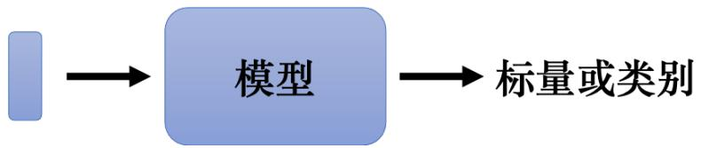

<details>
<summary>flowchart</summary>


</details>

图 6.1 输入是一个向量

# 6.1 输入是向量序列的情况

在图像识别的时候，假设输入的图像大小都是一样的。但如果问题变得复杂，如图 6.2 所示，输入是一组向量，并且输入的向量的数量是会改变的，即每次模型输入的序列长度都不一样，这个时候应该要怎么处理呢？我们通过具体的例子来讲解处理方法。

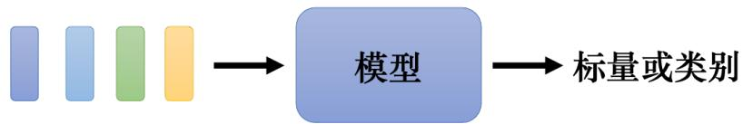

<details>
<summary>flowchart</summary>

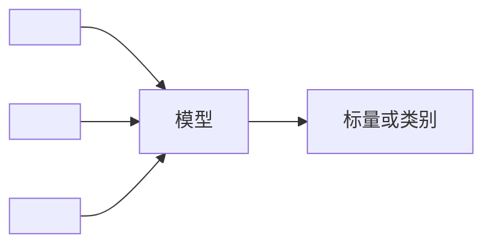
</details>

图 6.2 输入是一组向量

第一个例子是文字处理，假设网络的输入是一个句子，每一个句子的长度都不一样（每个句子里面词汇的数量都不一样）。如果把一个句子里面的每一个词汇都描述成一个向量，用向量来表示，模型的输入就是一个向量序列，而且该向量序列的大小每次都不一样（句子的长度不一样，向量序列的大小就不一样）。

将词汇表示成向量最简单的做法是独热编码，创建一个很长的向量，该向量的长度跟世界上存在的词汇的数量是一样多的。假设英文是十万个词汇，创建一个十万维的向量，每一个维度对应到一个词汇，如式 (6.1) 所示。但是这种表示方法有一个非常严重的问题，它假设所有的词汇彼此之间都是没有关系的。cat 和 dog 都是动物，它们应该比较像；cat 是动物，apple 是植物，它们应该比较不像。但从独热向量中不能看到这件事情，其里面没有任何语义的信息。

$$
\mathrm{apple} = [ 1, 0, 0, 0, 0, \dots \dots . ]
$$

$$
\mathrm{bag} = [ 0, 1, 0, 0, 0, \dots \dots ]
$$

$$
\text { cat } = [ 0, 0, 1, 0, 0, \dots \dots ] \tag {6.1}
$$

$$
\mathrm{dog} = [ 0, 0, 0, 1, 0, \dots \dots ]
$$

$$
\mathrm{elephant} = [ 0, 0, 0, 0, 1, \dots \dots ]
$$

除了独热编码，词嵌入（word embedding）也可将词汇表示成向量。词嵌入使用一个向量来表示一个词汇，而这个向量是包含语义信息的。如图 6.3 所示，如果把词嵌入画出来，所有的动物可能聚集成一团，所有的植物可能聚集成一团，所有的动词可能聚集成一团等等。词嵌入会给每一个词汇一个向量，而一个句子就是一组长度不一的向量。

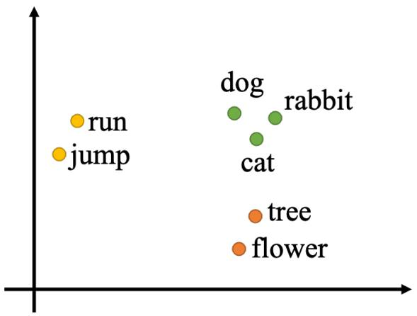

<details>
<summary>scatter</summary>

| Label  | X     | Y     |
|--------|-------|-------|
| run    | -2.5  | 1.0   |
| jump   | -3.0  | 0.5   |
| dog    | 1.0   | 1.5   |
| cat    | 1.5   | 1.0   |
| rabbit | 2.0   | 1.5   |
| tree   | 2.5   | 0.5   |
| flower | 3.0   | 0.5   |
</details>

图 6.3 词嵌入

接下来举一些把一个向量的序列当做输入的例子。如图 6.4 所示，一段声音信号其实是一组向量。我们会把一段声音信号取一个范围，这个范围叫做一个窗口（window），把该窗口里面的信息描述成一个向量，这个向量称为一帧（frame）。通常这个窗口的长度就是 25 毫秒。为了要描述一整段的声音信号，我们会把这个窗口往右移一点，通常移动的大小是 10 毫秒。

Q：为什么窗口的长度是 25 毫秒，窗口移动的大小是 10 毫秒？

A：前人帮我们调好了。他们尝试了大量可能的值，这样得到的结果往往最理想。

总之，一段声音信号就是用一串向量来表示，而因为每一个窗口，他们往右移都是移动10 毫秒，所以一秒钟的声音信号有 100 个向量，所以一分钟的声音信号就有这个 100 乘以60，就有 6000 个向量。所以语音其实很复杂的。一小段的声音信号，它里面包含的信息量其实是非常可观的，所以声音信号也是一堆向量。

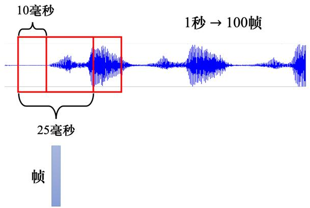

<details>
<summary>text_image</summary>

10毫秒
25毫秒
帧
1秒 → 100帧
</details>

图 6.4 语音处理

一个图（graph）也是一堆向量。社交网络是一个图，在社交网络上面每一个节点就是一个人。每一个节点可以看作是一个向量。每一个人的简介里面的信息（性别、年龄、工作等等）都可以用一个向量来表示。所以一个社交网络可以看做是一堆的向量所组成的。

药物发现（drug discovery）跟图有关，如图 6.5 所示，一个分子也可以看作是一个图。如果把一个分子当做是模型的输入，每一个分子可以看作是一个图，分子上面的每一个球就是一个原子，每个原子就是一个向量。每个原子可以用独热向量来表示，比如氢、碳、氧的独热向量表示如式 (6.2) 所示。

$$
\mathrm{H} = [ 1, 0, 0, 0, 0, \dots \dots . ]
$$

$$
\mathrm{C} = [ 0, 1, 0, 0, 0, \dots \dots ] \tag {6.2}
$$

$$
\mathrm{O} = [ 0, 0, 1, 0, 0, \dots \dots ]
$$

如果用独热向量来表示每一个原子，一个分子就是一个图，它就是一堆向量。

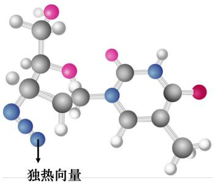

<details>
<summary>chemical</summary>

Molecular structure diagram showing single thermodynamic state with labeled Chinese annotation
</details>

图 6.5 药物发现【需要重绘，版权问题】

# 6.1.1 类型 1：输入与输出数量相同

模型的输入是一组向量，它可以是文字，可以是语音，可以是图。而输出有三种可能性，第一种可能性是每一个向量都有一个对应的标签。如图 6.6 所示，当模型看到输入是 4 个向量的时候，它就要输出 4 个标签。如果是回归问题，每个标签是一个数值。如果是分类问题，每个标签是一个类别。但是在类型 1 的问题里面，输入跟输出的长度是一样的。模型不需要去烦恼要输出多少的标签，输出多少的标量。反正输入是 4 个向量，输出就是 4 个标量。这是第一种类型。

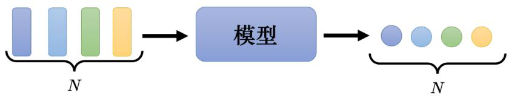

<details>
<summary>flowchart</summary>

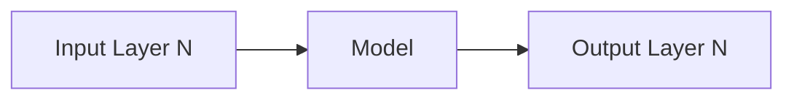
</details>

图 6.6 类型 1：输入与输出数量相同

什么样的应用会用到第一种类型的输出呢？举个例子，如图 6.7 所示，在文字处理上，假设我们要做的是词性标注（Part-Of-Speech tagging，POS tagging）。机器会自动决定每一个词汇的词性，判断该词是名词还是动词还是形容词等等。这个任务并不是很容易，举个例子，现在有一个句子：I saw a saw，这句话的意思是我看到一个锯子，第二个 saw 是名词锯子。所以机器要知道，第一个 saw 是个动词，第二个 saw 是名词，每一个输入的词汇都要有一个对应的输出的词性。这个任务就是输入跟输出的长度是一样的情况，属于第一个类型的输出。如果是语音，一段声音信号里面有一串向量。每一个向量都要决定它是哪一个音标。这不是真正的语音识别，这是一个语音识别的简化版。如果是社交网络，给定一个社交网络，模型要决定每一个节点有什么样的特性，比如某个人会不会买某个商品，这样我们才知道要不要推荐某个商品给他。以上就是举输入跟输出数量一样的例子，这是第一种可能的输出。

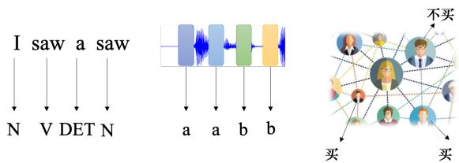

<details>
<summary>flowchart</summary>

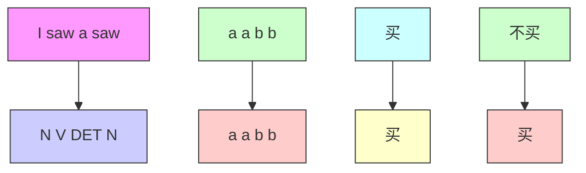
</details>

图 6.7 类型 1 应用的例子[1]

# 6.1.2 类型 2：输入是一个序列，输出是一个标签

第二种可能的输出如图 6.8 所示，整个序列只需要输出一个标签就好。

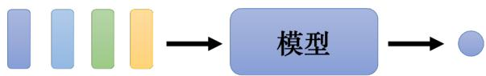

<details>
<summary>flowchart</summary>

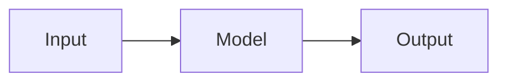
</details>

图 6.8 类似 2：输入是一个序列，输出是一个标签

举例而言，如图 6.9 所示，输入是文字，比如情感分析。情感分析就是给机器看一段话，模型要决定说这段话是积极的（positive）还是消极的（negative）。情感分析很有应用价值，假设公司开发的一个产品上线了，想要知道网友的评价，但又不可能一则一则地分析网友的留言。而使用情感分析就可以让机器自动去判别当一则贴文里面提到某个产品的时候，它是积极的还是消极的，这样就可以知道产品在网友心中的评价。给定一整个句子，只需要一个标签（积极的或消极的）。如果是语音，机器听一段声音，再决定是谁讲的这个声音。如果是图，比如给定一个分子，预测该分子的亲水性。

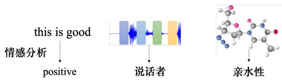

<details>
<summary>flowchart</summary>

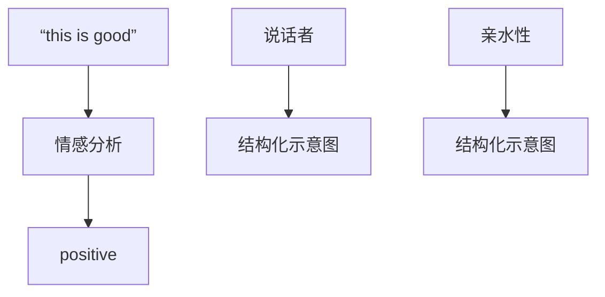
</details>

图 6.9 类型 2 的应用例子（亲水性这张图需要重绘，版权问题）

# 6.1.3 类型 3：序列到序列

还有第 3 个可能的输出：我们不知道应该输出多少个标签，机器要自己决定输出多少个标签。如图 6.10 所示，输入是 N 个向量，输出可能是 N′ 个标签。N′ 是机器自己决定的。这种任务又叫做序列到序列的任务。翻译就是序列到序列的任务，因为输入输出是不同的语言，它们的词汇的数量本来就不会一样多。真正的语音识别输入一句话，输出一段文字，其实也是一个序列到序列的任务。

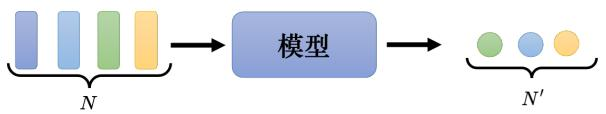

<details>
<summary>flowchart</summary>

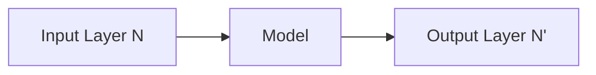
</details>

图 6.10 类型 3：序列到序列任务

# 6.2 自注意力的运作原理

我们就先只讲第一个类型：输入跟输出数量一样多的状况，以序列标注（sequence labeling）为例。序列标注要给序列里面的每一个向量一个标签。要怎么解决序列标注的问题呢？直觉的想法就是使用全连接网络。如图 6.11 所示，虽然输入是一个序列，但可以不要管它是不是一个序列，各个击破，把每一个向量分别输入到全连接网络里面得到输出。这种做法有非常大的瑕疵，以词性标注为例，给机器一个句子：I saw a saw。对于全连接网络，这个句子中的两个 saw 完全一模一样，它们是同一个词汇。既然全连接网络输入同一个词汇，它没有理由输出不同的东西。但实际上，我们期待第一个 saw 要输出动词，第二个 saw 要输出名词。但全连接网络无法做到这件事，因为这两个 saw 是一模一样的。有没有可能让全连接网络考虑更

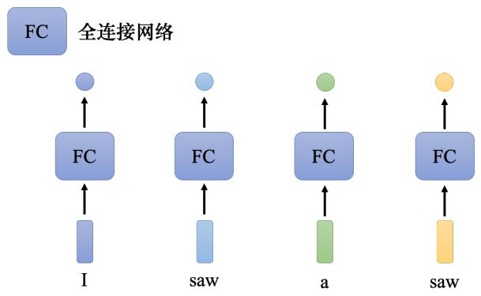

<details>
<summary>flowchart</summary>

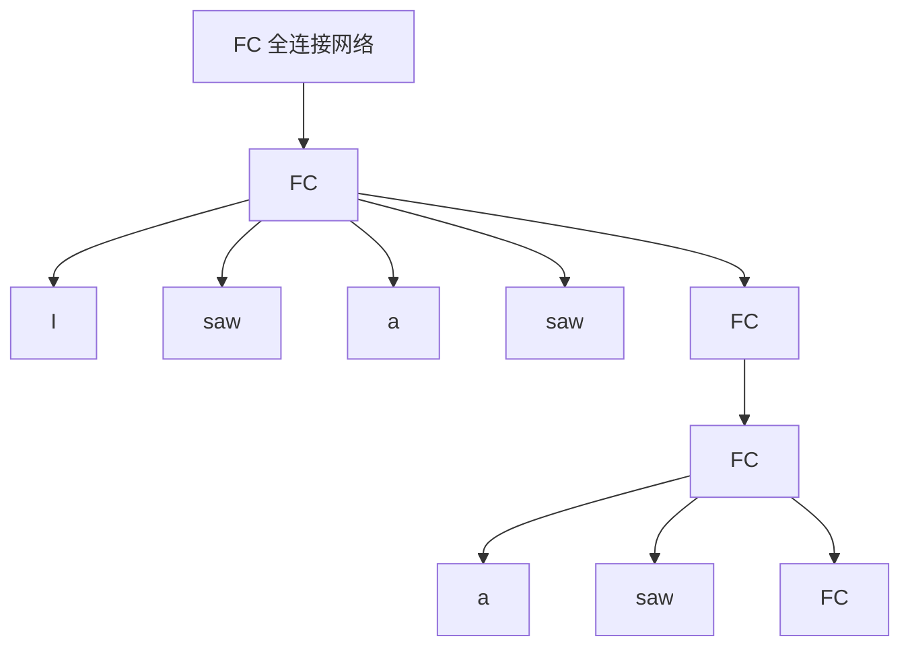
</details>

图 6.11 序列标注

多的信息，比如上下文的信息呢？这是有可能的，如图 6.12 所示，把每个向量的前后几个向量都“串”起来，一起输入到全连接网络就可以了。

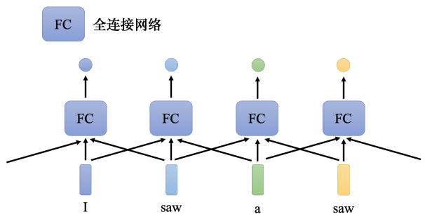

<details>
<summary>flowchart</summary>

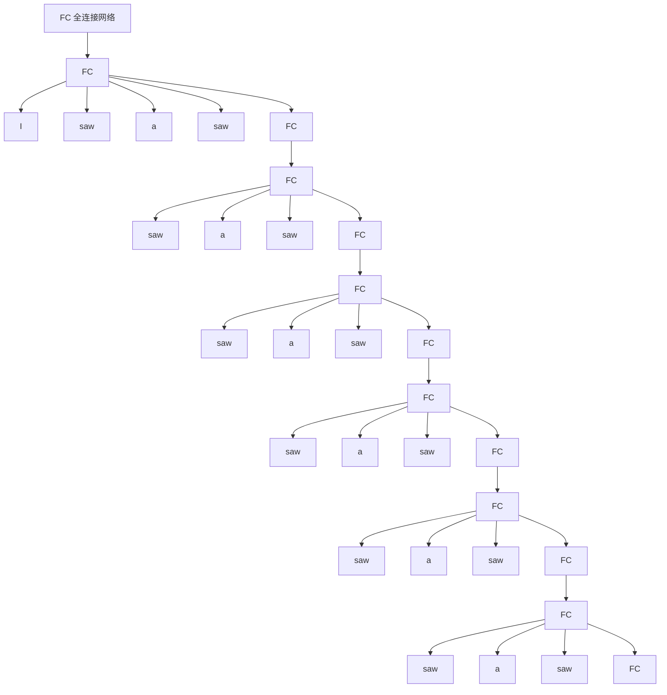
</details>

图 6.12 考虑上下文

在语音识别里面，我们不是只看一帧判断这个帧属于哪一个音标，而是看该帧以及其前后 5 个帧（共 11 个帧）来决定它是哪一个音标。所以可以给全连接网络一整个窗口的信息，让它可以考虑一些上下文，即与该向量相邻的其他向量的信息。如图 6.13 所示。但是这种的方法还是有极限的，如果有某一个任务不是考虑一个窗口就可以解决的，而是要考虑一整个序列才能够解决，那要怎么办呢？有人可能会想说这个还不容易，把窗口开大一点啊，大到可以把整个序列盖住，就可以了。但是序列的长度是有长有短的，输入给模型的序列的长度，每次可能都不一样。如果要开一个窗口把整个序列盖住，可能要统计一下训练数据，看看训练数据里面最长序列的长度。接着开一个窗口比最长的序列还要长，才可能把整个序列盖住。但是开一个这么大的窗口，意味着全连接网络需要非常多的参数，可能不只运算量很大，还容易过拟合。如果想要更好地考虑整个输入序列的信息，就要用到自注意力模型。

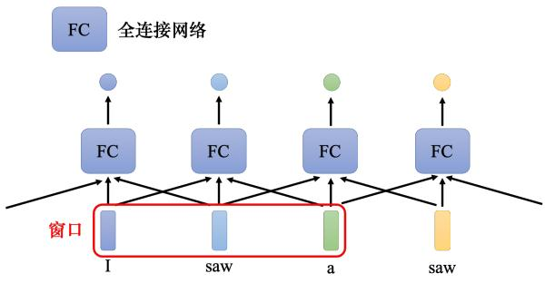

<details>
<summary>flowchart</summary>

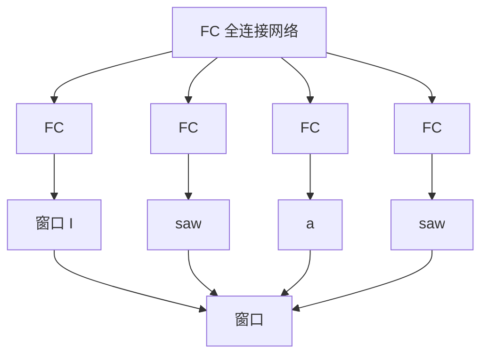
</details>

图 6.13 使用窗口来考虑上下文

自注意力模型的运作方式如图 6.14 所示，自注意力模型会“吃”整个序列的数据，输入几个向量，它就输出几个向量。图 6.14 中输入 4 个向量，它就输出 4 个向量。而这 4 个向量都是考虑整个序列以后才得到的，所以输出的向量有一个黑色的框，代表它不是一个普通的向量，它是考虑了整个句子以后才得到的信息。接着再把考虑整个句子的向量丢进全连接网络，再得到输出。因此全连接网络不是只考虑一个非常小的范围或一个小的窗口，而是考虑整个序列的信息，再来决定现在应该要输出什么样的结果，这就是自注意力模型。

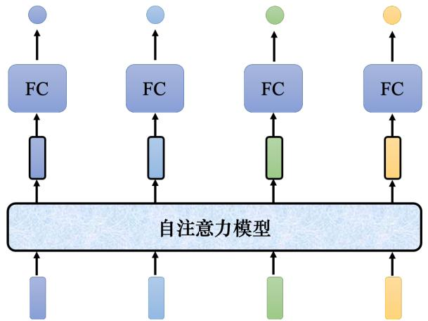

<details>
<summary>flowchart</summary>

```mermaid
graph TD
    A["●"] --> B["FC"]
    C["●"] --> D["FC"]
    E["●"] --> F["FC"]
    G["●"] --> H["FC"]
    I["●"] --> J["FC"]
    K["●"] --> L["FC"]
    M["●"] --> N["自注意力模型"]
    O["●"] --> P["自注意力模型"]
    Q["●"] --> R["自注意力模型"]
    S["●"] --> T["自注意力模型"]
    U["●"] --> V["自注意力模型"]
    W["●"] --> X["自注意力模型"]
    Y["●"] --> Z["自注意力模型"]
    AA["●"] --> AB["自注意力模型"]
    AC["●"] --> AD["自注意力模型"]
    AE["●"] --> AF["自注意力模型"]
    AG["●"] --> AH["自注意力模型"]
    AI["●"] --> AJ["自注意力模型"]
    AK["●"] --> AL["自注意力模型"]
    AM["●"] --> AN["自注意力模型"]
    AO["●"] --> AP["自注意力模型"]
    AQ["●"] --> AR["自注意力模型"]
    AS["●"] --> AT["自注意力模型"]
    AU["●"] --> AV["自注意力模型"]
    AW["●"] --> AX["自注意力模型"]
    AY["↑"] --> B
    AZ["↑"] --> D
    BA["↑"] --> F
    BB["↑"] --> H
    BC["↑"] --> AI
    BD["↑"] --> AJ
    BE["↑"] --> AF
    BF["↑"] --> AG
    BG["↑"] --> AH
    BH["↑"] --> AI
    BI["↑"] --> AJ
    BJ["↑"] --> AK
    BK["↑"] --> AL
```
</details>

图 6.14 自注意力模型的运作方式

自注意力模型不是只能用一次，可以叠加很多次。如图 6.15 所示，自注意力模型的输出通过全连接网络以后，得到全连接网络的输出。全连接网络的输出再做一次自注意力模型，再重新考虑一次整个输入序列的数据，将得到的数据输入到另一个全连接网络，就可以得到最终的结果。全连接网络和自注意力模型可以交替使用。全连接网络专注于处理某一个位置的信息，自注意力把整个序列信息再处理一次。有关自注意力最知名的相关的论文是 “AttentionIs All You Need”。在这篇论文里面，谷歌提出了 Transformer 网络架构。其中最重要的模块是自注意力，就像变形金刚的火种源。有很多更早的论文提出过类似自注意力的架构，只是叫别的名字，比如叫 Self-Matching。“Attention Is All You Need” 这篇论文将自注意力模块发扬光大。

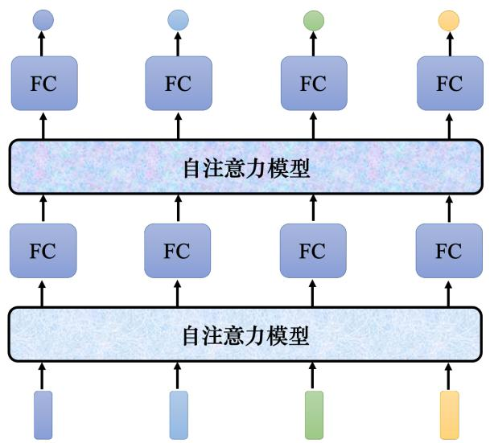

<details>
<summary>flowchart</summary>

```mermaid
graph TD
    A["FC"] --> B["自注意力模型"]
    C["FC"] --> B
    D["FC"] --> B
    E["FC"] --> B
    F["FC"] --> B
    G["FC"] --> B
    H["FC"] --> B
    I["FC"] --> B
    J["FC"] --> B
    K["FC"] --> B
    L["FC"] --> B
    M["FC"] --> B
    N["FC"] --> B
    O["FC"] --> B
    P["FC"] --> B
    Q["FC"] --> B
    R["FC"] --> B
    S["FC"] --> B
    T["FC"] --> B
    U["FC"] --> B
    V["FC"] --> B
    W["FC"] --> B
    X["FC"] --> B
    Y["FC"] --> B
    Z["FC"] --> B
    AA["FC"] --> B
    AB["FC"] --> B
    AC["FC"] --> B
    AD["FC"] --> B
    AE["FC"] --> B
    AF["FC"] --> B
    AG["FC"] --> B
    AH["FC"] --> B
    AI["FC"] --> B
    AJ["FC"] --> B
    AK["FC"] --> B
    AL["FC"] --> B
    AM["FC"] --> B
    AN["FC"] --> B
    AO["FC"] --> B
    AP["FC"] --> B
    AQ["FC"] --> B
    AR["FC"] --> B
    AS["FC"] --> B
    AT["FC"] --> B
    AU["FC"] --> B
    AV["FC"] --> B
    AW["FC"] --> B
    AX["FC"] --> B
    AY["FC"] --> B
    AZ["FC"] --> B
    BA["FC"] --> B
    BB["FC"] --> B
    BC["FC"] --> B
    BD["FC"] --> B
    BE["FC"] --> B
    BF["FC"] --> B
    BG["FC"] --> B
    BH["FC"] --> B
    BI["FC"] --> B
    BJ["FC"] --> B
    BK["FC"] --> B
    BL["FC"] --> B
    BM["FC"] --> B
    BN["FC"] --> B
    BO["FC"] --> B
    BP["FC"] --> B
    BQ["自注意力模型"]
```
</details>

图 6.15 自注意力模型与全连接网络的叠加使用

自注意力模型的运作过程如图 6.16 所示，其输入是一串的向量，这个向量可能是整个网络的输入，也可能是某个隐藏层的输出，所以不用 x 来表示它，而用 a 来表示它，代表它有可能是前面已经做过一些处理，是某个隐藏层的输出。输入一组向量 a，自注意力要输出一组向量 b，每个 b 都是考虑了所有的 a 以后才生成出来的。 ${ \pmb b } ^ { 1 }$ 、 $b ^ { 2 }$ 、 $b ^ { 3 }$ 、 $b ^ { 4 }$ 是考虑整个输入的序列 $\mathbf { a } ^ { 1 }$ 、 $\mathbf { { a } ^ { 2 } }$ 、 $\mathbf { \delta } _ { \mathbf { { \pmb { a } } } ^ { 3 } }$ 、 $\mathbf { \delta } _ { \mathbf { { a } ^ { \alpha } } }$ 才产生出来的。

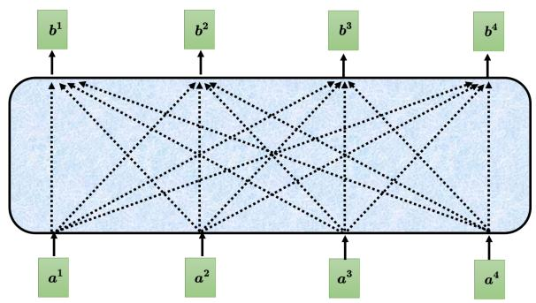

<details>
<summary>flowchart</summary>

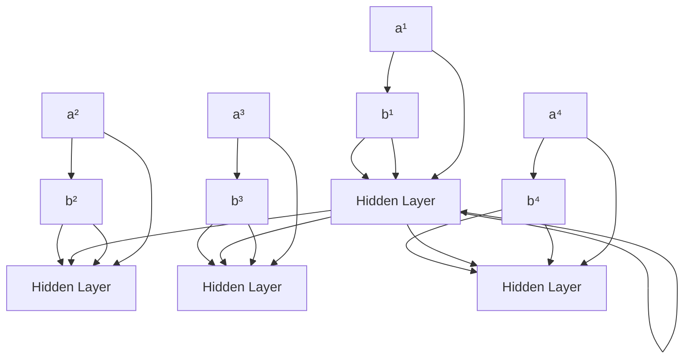
</details>

图 6.16 自注意力模型的运作方式

接下来介绍下向量 $\pmb { b } ^ { 1 }$ 产生的过程，了解产生向量 $\pmb { b } ^ { 1 }$ 的过程后，剩下向量 $b ^ { 2 }$ 、 $b ^ { 3 }$ 、 ${ \pmb b } ^ { 4 }$ 产生的过程以此类推。怎么产生向量 $\pmb { b } ^ { 1 }$ 呢？如图 6.17 所示，第一个步骤是根据 $\mathbf { \delta } _  \mathbf { \alpha } \mathbf { \alpha } \mathbf { \alpha } \mathbf { \alpha } \mathbf { \alpha } \mathbf { \alpha } \mathbf { \alpha } \mathbf { \alpha } \mathbf { \alpha } \mathbf { \alpha } \mathbf { \alpha } \mathbf { \alpha } \mathbf { \alpha } \mathbf { \alpha } \mathbf { \alpha } \mathbf { \alpha } \mathbf { \alpha } \mathbf { \alpha } \mathbf { \alpha } \mathbf { \alpha } \mathbf { \alpha } \mathbf { \alpha } \mathbf { \alpha } \mathbf { \alpha } \mathbf { \alpha } \mathbf { \alpha } \mathbf { \alpha } \mathbf { \alpha } \mathbf { \alpha } \mathbf { \alpha } \mathbf { \alpha } \mathbf { \alpha } \mathbf { \alpha } \mathbf { \alpha } \mathbf { \alpha } \mathbf { \alpha } \mathbf { \alpha } \mathbf { \alpha } \mathbf { \alpha } \mathbf { \alpha \alpha } \mathbf { \alpha } \mathbf { \alpha \alpha } \mathbf { \alpha \alpha } \mathbf { \alpha \alpha } \mathbf { \alpha \alpha } \mathbf { \alpha \alpha } \mathbf { \alpha \alpha } \mathbf { \alpha \alpha } \mathbf { \alpha \alpha } \mathbf { \alpha \alpha } \mathbf { \alpha \alpha } \mathbf  \alpha \alpha \alpha \alpha \alpha \mathbf { \alpha } \alpha \alpha \alpha \mathbf \alpha \alpha \alpha \beta \alpha \alpha \beta \alpha \alpha \beta \alpha \alpha \beta \alpha \alpha \mathbf \alpha \alpha \alpha \beta \alpha \alpha \alpha \beta \alpha \alpha \beta \alpha \alpha \alpha \mathbf \alpha \alpha \alpha \alpha \alpha \beta \alpha \alpha \alpha \delta \alpha \delta \delta \delta \alpha \delta \delta \delta \alpha \delta \alpha \delta \alpha \delta \delta \delta \delta \alpha \delta \delta \delta \alpha \delta \delta \delta \alpha \delta \delta \delta \delta \delta \delta \delta \delta \delta \delta \delta \delta \delta \delta \delta \delta \delta \delta \delta \delta \delta \delta \delta \delta \delta \delta \delta \delta \delta \delta \delta \delta \delta \delta \delta \delta \delta \delta \delta \delta \delta \delta \delta \delta \delta \delta \delta \delta \delta \delta \delta \delta \delta \delta \delta \delta \delta \delta \delta \delta \delta \delta \delta \delta \delta \delta \delta \delta \delta \delta \delta \delta \delta \delta \delta \delta \delta \delta \delta \delta \delta \delta \delta \delta \delta \delta \delta \delta \delta \delta \delta \delta \delta \delta \delta \delta \delta \delta \delta \delta \delta \delta \delta \delta \delta \delta \delta \delta \delta \delta \delta \delta \delta \delta \delta \delta \delta $ 找出输入序列里面跟 $\mathbf { a } ^ { 1 }$ 相关的其他向量。自注意力的目的是考虑整个序列，但是又不希望把整个序列所有的信息包在一个窗口里面。所以有一个特别的机制，这个机制是根据向量 $\mathbf { a } ^ { 1 }$ 找出整个很长的序列里面哪些部分是重要的，哪些部分跟判断 $\mathbf { \delta } _ { \mathbf { \alpha } \mathbf { \alpha } \mathbf { \alpha } \mathbf { \alpha } } \mathbf { \delta } _ { \mathbf { \alpha } \mathbf { \alpha } \mathbf { \alpha } \mathbf { \alpha } } \mathbf { \delta } _ { \mathbf { \alpha } \mathbf { \beta } \mathbf { \alpha } \mathbf { \alpha } \mathbf { \alpha } \mathbf { \beta } _ { \mathbf { \alpha \beta } \mathbf { \alpha } \mathbf { \alpha } } }$ 是哪一个标签是有关系的。每一个向量跟$\mathbf { a } ^ { 1 }$ 的关联的程度可以用数值 α 来表示。自注意力的模块如何自动决定两个向量之间的关联性呢？给它两个向量 $\mathbf { \delta } _ { \mathbf { \alpha } \mathbf { \alpha } \mathbf { \alpha } \mathbf { \alpha } } \mathbf { \delta } _ { \mathbf { \alpha } \mathbf { \alpha } \mathbf { \alpha } \mathbf { \alpha } } \mathbf { \delta } _ { \mathbf { \alpha } \mathbf { \beta } \mathbf { \alpha } \mathbf { \alpha } \mathbf { \alpha } \mathbf { \beta } _ { \mathbf { \alpha \beta } \mathbf { \alpha } \mathbf { \alpha } } }$ 跟 $\mathbf { \delta } _ { \mathbf { { a } ^ { \alpha } } }$ ，它怎么计算出一个数值 α 呢？我们需要一个计算注意力的模块。

计算注意力的模块使用两个向量作为输入，直接输出数值 α，α 可以当做两个向量的关联的程度。怎么计算 $\alpha \ ?$ 比较常见的做法是用点积（dot product）。如图 6.18(a) 所示，把输入的两个向量分别乘上两个不同的矩阵，左边这个向量乘上矩阵 $W ^ { q }$ ，右边这个向量乘上矩阵 $\boldsymbol { W } ^ { k }$ ，得到两个向量 q 跟 k，再把 q 跟 k 做点积，把它们做逐元素（element-wise）的相乘，再全部加起来以后就得到一个标量（scalar）α，这是一种计算 α 的方式。

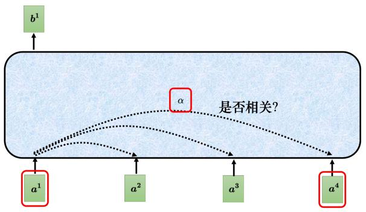

<details>
<summary>flowchart</summary>

```mermaid
graph TD
    b1["b¹"] --> α[α]
    a1["a¹"] --> α
    a2["a²"] --> α
    a3["a³"] --> α
    a4["a⁴"] --> α
    α -.-> a2
    α -.-> a3
    α -.-> a4
    style α stroke-dasharray: 5 5
    note right of α 是否相关?
```
</details>

图 6.17 向量 ${ \pmb b } ^ { 1 }$ 产生的过程

其实还有其他的计算方式，如图 6.18(b) 所示，有另外一个叫做相加（additive）的计算方式，其计算方法就是把两个向量通过 $W ^ { q }$ 、 $W ^ { k }$ 得到 q 和 k，但不是把它们做点积，而是把$\pmb q$ 和 $\boldsymbol { k }$ “串”起来“丢”到一个 tanh 函数，再乘上矩阵 W 得到 $\alpha _ { \circ }$ 。总之，有非常多不同的方法可以计算注意力，可以计算关联程度 α。但是在接下来的内容里面，我们都只用点积这个方法，这也是目前最常用的方法，也是用在 Transformer 里面的方法。

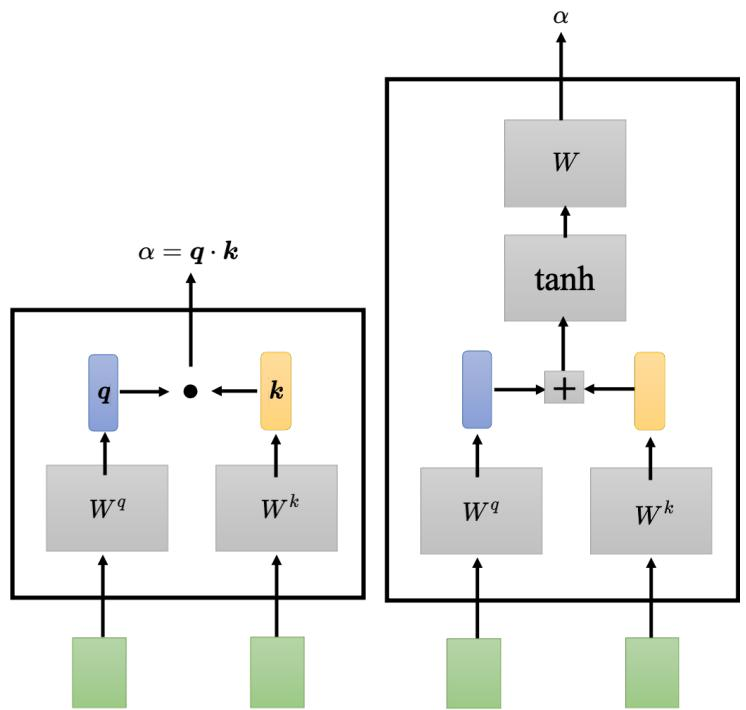

<details>
<summary>flowchart</summary>

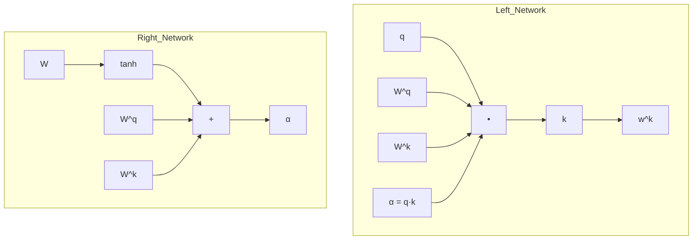
</details>

(a) 点积   
(b) 相加  
图 6.18 计算向量关联程度的方法

接下来如何把它套用在自注意力模型里面呢？自注意力模型一般采用查询-键-值（Query-Key-Value，QKV）模式。分别计算 $\mathbf { a } ^ { 1 }$ 与 $\mathbf { { a } ^ { 2 } }$ 、 $\mathbf { \delta } _ { \mathbf { { \alpha } } \mathbf { { \alpha } } \mathbf { { a } } ^ { 3 } }$ 、 $\mathbf { \Delta } \mathbf { a } ^ { 4 }$ 之间的关联性 $\alpha _ { \textsf { c } }$ 。如图 6.19 所示，把$\mathbf { a } ^ { 1 }$ 乘上 $W ^ { q }$ 得到 $q ^ { 1 }$ 。q 称为查询（query），它就像是我们使用搜索引擎查找相关文章所使用

的关键字，所以称之为查询。

接下来要去把 $\mathbf { \delta } _  \mathbf { { \alpha } } \mathbf { { \delta } } \mathbf { { \alpha } } \mathbf { { \delta } } \mathbf { { \alpha } } \mathbf { { \delta } } \mathbf { { \alpha } } \mathbf { { \delta } } \mathbf { { \alpha } } \mathbf { { \delta } } \mathbf { { \alpha } } \mathbf { { \delta } } \mathbf { { \alpha } } \mathbf { { \delta } } \mathbf { { \alpha } } \mathbf { { \delta \alpha } } \mathbf { { \delta \alpha } } \mathbf { { \delta \alpha } } \mathbf { { \delta \alpha } } \mathbf { { \delta \alpha } } \mathbf { { \delta \alpha } } \mathbf { { \delta \alpha } } \mathbf { { \delta \alpha } } \mathbf { { \delta \alpha } } \mathbf { { \delta \alpha } } \mathbf { { \delta \alpha } } \mathbf { { \delta \alpha } } \mathbf { { \delta \alpha } } \mathbf { { \delta \alpha } } \mathbf { { \delta \alpha } } \mathbf { { \delta \alpha } } \mathbf { { \delta \alpha } } \mathbf { { \delta \alpha } } \mathbf { \delta } \mathbf { \alpha } \mathbf { \delta \alpha } \mathbf { \delta } \mathbf { \delta \alpha } \mathbf { \delta \alpha } \mathbf { \delta \alpha } \mathbf \mathbf { \delta \alpha } \delta \mathbf \delta \mathbf { \delta \alpha } \delta \delta \delta \mathbf \delta \delta \mathbf \delta \delta \delta \delta \delta \delta \delta \delta \delta \delta \delta \delta \delta \delta \delta \delta \delta \delta \delta \delta \delta \delta \delta \delta \delta \delta \delta \delta \delta \delta \delta \delta \delta \delta \delta \delta \delta \delta \delta \delta \delta \delta \delta \delta \delta \delta \delta \delta \delta \delta \delta \delta \delta \delta \delta \delta \delta \delta \delta \delta \delta \delta \delta \delta \delta \delta \delta \delta \delta \delta \delta \delta \delta \delta \delta \delta \delta \delta \delta \delta \delta \delta \delta \delta \delta \delta \delta \delta \delta \delta \delta \delta \delta \delta \delta \delta \delta \delta \delta \delta \delta \delta \delta \delta \delta \delta \delta \delta \delta \delta \delta \delta \delta \delta \delta \delta \delta \delta \delta \delta \delta \delta \delta \delta \delta \delta \delta \delta \delta \delta \delta \delta \delta \delta \delta \delta \delta \delta \delta \delta \delta \delta \delta \delta \delta \delta \delta \delta \delta \delta \delta \delta \delta \delta \delta \delta \delta \delta \delta \delta $ 、 $\mathbf { \Delta } \mathbf { a } ^ { 3 }$ 、 $\mathbf { \Delta } \mathbf { a } ^ { 4 }$ 乘上 $W ^ { k }$ 得到向量 k，向量 k 称为键（key）。把查询 $\pmb q ^ { 1 }$ 跟键$k ^ { 2 }$ 算内积（inner-product）就得到 $\alpha _ { 1 , 2 }$ 。 $\alpha _ { 1 , 2 }$ 代表查询是 $q ^ { 1 }$ 提供的，键是 $k ^ { 2 }$ 提供的时候，$\pmb q ^ { 1 }$ 跟 $k ^ { 2 }$ 之间的关联性。关联性 α 也被称为注意力的分数。计算 $\pmb q ^ { 1 }$ 与 $k ^ { 2 }$ 的内积也就是计算$\mathbf { a } ^ { 1 }$ 与 $\mathbf { { a } ^ { 2 } }$ 的注意力的分数。计算出 $\mathbf { a } ^ { 1 }$ 与 $\mathbf { { a } ^ { 2 } }$ 的关联性以后，接下来还需要计算 $\mathbf { a } ^ { 1 }$ 与 $\mathbf { \Delta } \mathbf { a } ^ { 3 }$ 、 $ { \mathbf { { a } } } ^ { 4 }$ 的关联性。把 $\mathbf { \Delta } \mathbf { a } ^ { 3 }$ 乘上 $W ^ { k }$ 得到键 $k ^ { 3 }$ ， $ { \mathbf { { a } } } ^ { 4 }$ 乘上 $W ^ { k }$ 得到键 $k ^ { 4 }$ ，再把键 $k ^ { 3 }$ 跟查询 $\pmb q ^ { 1 }$ 做内积，得到 $\mathbf { a } ^ { 1 }$ 与 $\mathbf { \delta } _ { \mathbf { { a } ^ { 3 } } }$ 之间的关联性，即 $\mathbf { a } ^ { 1 }$ 跟 $\mathbf { \Delta } \mathbf { a } ^ { 3 }$ 的注意力分数。把 $k ^ { 4 }$ 跟 $q ^ { 1 }$ 做点积，得到 $\alpha _ { 1 , 4 }$ ，即$\mathbf { \delta } _ { \mathbf { \alpha } \mathbf { \alpha } \mathbf { \alpha } \mathbf { \alpha } } \mathbf { \delta } _ { \mathbf { \alpha } \mathbf { \alpha } \mathbf { \alpha } \mathbf { \alpha } } \mathbf { \delta } _ { \mathbf { \alpha } \mathbf { \beta } \mathbf { \alpha } \mathbf { \alpha } \mathbf { \alpha } \mathbf { \beta } _ { \mathbf { \alpha \beta } \mathbf { \alpha } \mathbf { \alpha } } }$ 跟 $ { \mathbf { { a } } } ^ { 4 }$ 之间的关联性。

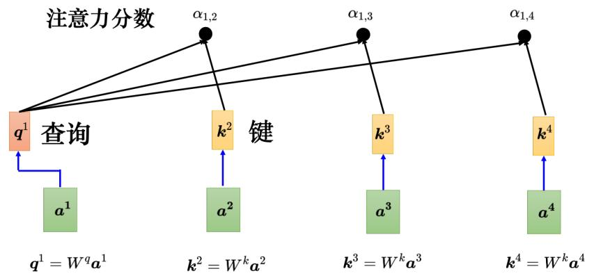

<details>
<summary>flowchart</summary>

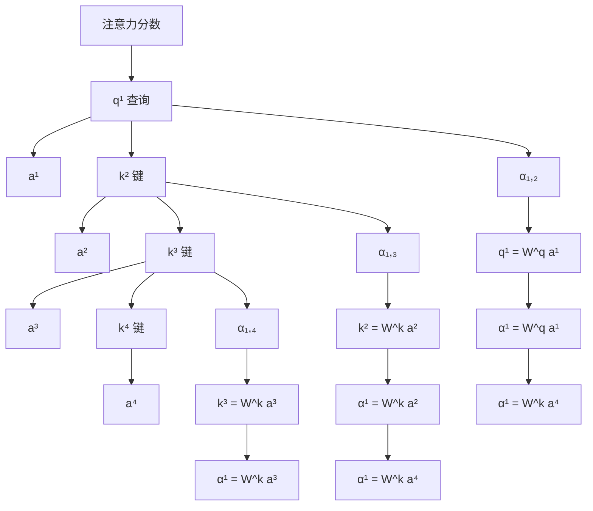
</details>

图 6.19 自注意力机制中使用点乘

一般在实践的时候，如图 6.20 所示， $\mathbf { \delta } _ { \mathbf { \alpha } \mathbf { \alpha } \mathbf { \alpha } \mathbf { \alpha } } \mathbf { \delta } _ { \mathbf { \alpha } \mathbf { \alpha } \mathbf { \alpha } \mathbf { \alpha } } \mathbf { \delta } _ { \mathbf { \alpha } \mathbf { \beta } \mathbf { \alpha } \mathbf { \alpha } \mathbf { \alpha } \mathbf { \beta } _ { \mathbf { \alpha \beta } \mathbf { \alpha } \mathbf { \alpha } } }$ 也会跟自己算关联性，把 $\mathbf { \delta } _ { \mathbf { \alpha } \mathbf { \alpha } \mathbf { \alpha } \mathbf { \alpha } } \mathbf { \delta } _ { \mathbf { \alpha } \mathbf { \alpha } \mathbf { \alpha } \mathbf { \alpha } } \mathbf { \delta } _ { \mathbf { \alpha } \mathbf { \beta } \mathbf { \alpha } \mathbf { \alpha } \mathbf { \alpha } \mathbf { \beta } _ { \mathbf { \alpha \beta } \mathbf { \alpha } \mathbf { \alpha } } }$ 乘上 $W ^ { k }$ 得到 $k ^ { 1 }$ 。用 $q ^ { 1 }$ 跟 $k ^ { 1 }$ 去计算 $\mathbf { \delta } _  \mathbf { \alpha } \mathbf { \alpha } \mathbf { \alpha } \mathbf { \alpha } \mathbf { \alpha } \mathbf { \alpha } \mathbf { \alpha } \mathbf { \alpha } \mathbf { \alpha } \mathbf { \alpha } \mathbf { \alpha } \mathbf { \alpha } \mathbf { \alpha } \mathbf { \alpha } \mathbf { \alpha } \mathbf { \alpha } \mathbf { \alpha } \mathbf { \alpha } \mathbf { \alpha } \mathbf { \alpha } \mathbf { \alpha } \mathbf { \alpha } \mathbf { \alpha } \mathbf { \alpha } \mathbf { \alpha } \mathbf { \alpha } \mathbf { \alpha } \mathbf { \alpha } \mathbf { \alpha } \mathbf { \alpha } \mathbf { \alpha } \mathbf { \alpha } \mathbf { \alpha } \mathbf { \alpha } \mathbf { \alpha } \mathbf { \alpha } \mathbf { \alpha } \mathbf { \alpha } \mathbf { \alpha } \mathbf { \alpha \alpha } \mathbf { \alpha } \mathbf { \alpha \alpha } \mathbf { \alpha \alpha } \mathbf { \alpha \alpha } \mathbf { \alpha \alpha } \mathbf { \alpha \alpha } \mathbf { \alpha \alpha } \mathbf { \alpha \alpha } \mathbf { \alpha \alpha } \mathbf { \alpha \alpha } \mathbf { \alpha \alpha } \mathbf  \alpha \alpha \alpha \alpha \alpha \mathbf { \alpha } \alpha \alpha \alpha \mathbf \alpha \alpha \alpha \beta \alpha \alpha \beta \alpha \alpha \beta \alpha \alpha \beta \alpha \alpha \mathbf \alpha \alpha \alpha \beta \alpha \alpha \alpha \beta \alpha \alpha \beta \alpha \alpha \alpha \mathbf \alpha \alpha \alpha \alpha \alpha \beta \alpha \alpha \alpha \delta \alpha \delta \delta \delta \alpha \delta \delta \delta \alpha \delta \alpha \delta \alpha \delta \delta \delta \delta \alpha \delta \delta \delta \alpha \delta \delta \delta \alpha \delta \delta \delta \delta \delta \delta \delta \delta \delta \delta \delta \delta \delta \delta \delta \delta \delta \delta \delta \delta \delta \delta \delta \delta \delta \delta \delta \delta \delta \delta \delta \delta \delta \delta \delta \delta \delta \delta \delta \delta \delta \delta \delta \delta \delta \delta \delta \delta \delta \delta \delta \delta \delta \delta \delta \delta \delta \delta \delta \delta \delta \delta \delta \delta \delta \delta \delta \delta \delta \delta \delta \delta \delta \delta \delta \delta \delta \delta \delta \delta \delta \delta \delta \delta \delta \delta \delta \delta \delta \delta \delta \delta \delta \delta \delta \delta \delta \delta \delta \delta \delta \delta \delta \delta \delta \delta \delta \delta \delta \delta \delta \delta \delta \delta \delta \delta \delta $ 与自己的关联性。计算出 $\mathbf { a } ^ { 1 }$ 跟每一个向量的关联性以后，接下来会对所有的关联性做一个 softmax 操作，如式 (6.3) 所示，把 α 全部取 e 的指数，再把指数的值全部加起来做归一化（normalize）得到 $\alpha ^ { \prime }$ 。这里的 softmax 操作跟分类的 softmax 操作是一模一样的。

$$
\alpha_ {1, i} ^ {\prime} = \exp \left(\alpha_ {1, i}\right) / \sum_ {j} \exp \left(\alpha_ {1, j}\right) \tag {6.3}
$$

所以本来有一组 α，通过 softmax 就得到一组 $\alpha ^ { \prime }$ 。

Q：为什么要用 softmax？

A：这边不一定要用 softmax，可以用别的激活函数，比如 ReLU。有人尝试使用 ReLU，结果发现还比 softmax 好一点。所以不一定要用 softmax，softmax 只是最常见的，我们可以尝试其他激活函数，看能不能试出比 softmax 更好的结果。

得到 $\alpha ^ { \prime }$ 以后，接下来根据 $\alpha ^ { \prime }$ 去抽取出序列里面重要的信息。如图 6.21 所示，根据 α 可知哪些向量跟 $\mathbf { a } ^ { 1 }$ 是最有关系的，接下来我们要根据关联性，即注意力的分数来抽取重要的信息。把向量 $\mathbf { a } ^ { 1 }$ 到 $\mathbf { \delta } _ { \mathbf { { a } ^ { \mu } } }$ 乘上 $W ^ { v }$ 得到新的向量： $v ^ { 1 }$ 、 $v ^ { 2 }$ 、 $v ^ { 3 }$ 和 $v ^ { 4 }$ ，接下来把每一个向量都去乘上注意力的分数 $\alpha ^ { \prime }$ ，再把它们加起来，如式 (6.4) 所示。

$$
\boldsymbol {b} ^ {1} = \sum_ {i} \alpha_ {1, i} ^ {\prime} \boldsymbol {v} ^ {i} \tag {6.4}
$$

如果 $\mathbf { a } ^ { 1 }$ 跟 $\mathbf { } \mathbf { \delta } \mathbf { a } ^ { 2 }$ 的关联性很强，即 $\alpha _ { 1 , 2 } ^ { \prime }$ 的值很大。在做加权和（weighted sum）以后，得到的 $\pmb { b } ^ { 1 }$ 的值就可能会比较接近 $v ^ { 2 }$ ，所以谁的注意力的分数最大，谁的 v 就会主导（dominant）抽出来的结果。这边我们讲述了如何从一整个序列得到 $\boldsymbol { b } ^ { 1 }$ 。同理，可以计算出 $b ^ { 2 }$ 到 $b ^ { 4 }$ 。

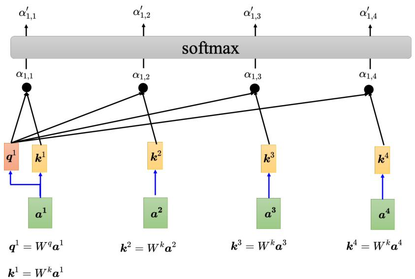

<details>
<summary>flowchart</summary>

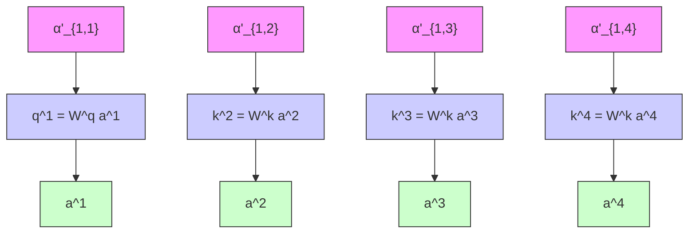
</details>

图 6.20 添加 softmax

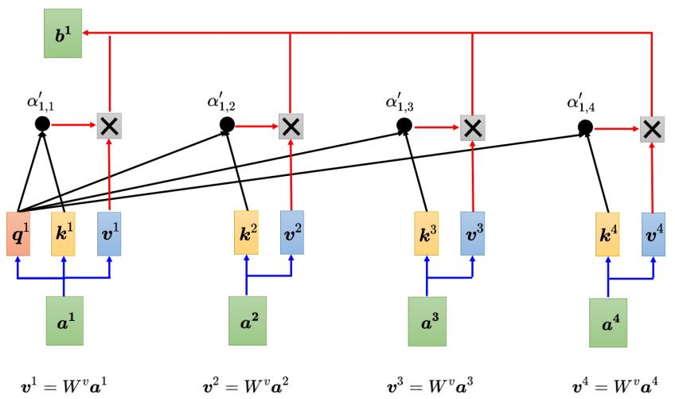

<details>
<summary>flowchart</summary>

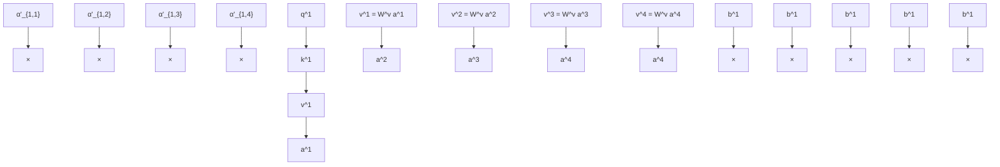
</details>

图 6.21 根据 $\alpha ^ { \prime }$ 抽取序列中重要的信息

刚才讲的是自注意力运作的过程，接下来从矩阵乘法的角度再重新讲一次自注意力的运作过程，如图 6.22 所示。现在已经知道 $\mathbf { a } ^ { 1 }$ 到 $ { \mathbf { { a } } } ^ { 4 }$ ，每一个 a 都要分别产生 q、k 和 v， $\mathbf { a } ^ { 1 }$ 要产生 $q ^ { 1 }$ 、 $k ^ { 1 }$ 、 $v ^ { 1 }$ ， $\mathbf { { a } ^ { 2 } }$ 要产生 $q ^ { 2 }$ 、 $k ^ { 2 }$ 和 $v ^ { 2 }$ ，以此类推。如果要用矩阵运算表示这个操作，每一个 $\mathbf { \Delta } \mathbf { a } ^ { i }$ 都乘上一个矩阵 $W ^ { q }$ 得到 $q ^ { i }$ ，这些不同的 a 可以合起来当作一个矩阵。什么意思呢？$\mathbf { a } ^ { 1 }$ 乘上 $W ^ { q }$ 得到 $q ^ { 1 }$ ， $\mathbf { { a } ^ { 2 } }$ 也乘上 $W ^ { q }$ 得到 $q ^ { 2 }$ ，以此类推。把 $\mathbf { \delta } _  \mathbf { \alpha } \mathbf { \alpha } \mathbf { \alpha } \mathbf { \alpha } \mathbf { \alpha } \mathbf { \alpha } \mathbf { \alpha } \mathbf { \alpha } \mathbf { \alpha } \mathbf { \alpha } \mathbf { \alpha } \mathbf { \alpha } \mathbf { \alpha } \mathbf { \alpha } \mathbf { \alpha } \mathbf { \alpha } \mathbf { \alpha } \mathbf { \alpha } \mathbf { \alpha } \mathbf { \alpha } \mathbf { \alpha } \mathbf { \alpha } \mathbf { \alpha } \mathbf { \alpha } \mathbf { \alpha } \mathbf { \alpha } \mathbf { \alpha } \mathbf { \alpha } \mathbf { \alpha } \mathbf { \alpha } \mathbf { \alpha } \mathbf { \alpha } \mathbf { \alpha } \mathbf { \alpha } \mathbf { \alpha } \mathbf { \alpha } \mathbf { \alpha } \mathbf { \alpha } \mathbf { \alpha } \mathbf { \alpha \alpha } \mathbf { \alpha } \mathbf { \alpha \alpha } \mathbf { \alpha \alpha } \mathbf { \alpha \alpha } \mathbf { \alpha \alpha } \mathbf { \alpha \alpha } \mathbf { \alpha \alpha } \mathbf { \alpha \alpha } \mathbf { \alpha \alpha } \mathbf { \alpha \alpha } \mathbf { \alpha \alpha } \mathbf  \alpha \alpha \alpha \alpha \alpha \mathbf { \alpha } \alpha \alpha \alpha \mathbf \alpha \alpha \alpha \beta \alpha \alpha \beta \alpha \alpha \beta \alpha \alpha \beta \alpha \alpha \mathbf \alpha \alpha \alpha \beta \alpha \alpha \alpha \beta \alpha \alpha \beta \alpha \alpha \alpha \mathbf \alpha \alpha \alpha \alpha \alpha \beta \alpha \alpha \alpha \delta \alpha \delta \delta \delta \alpha \delta \delta \delta \alpha \delta \alpha \delta \alpha \delta \delta \delta \delta \alpha \delta \delta \delta \alpha \delta \delta \delta \alpha \delta \delta \delta \delta \delta \delta \delta \delta \delta \delta \delta \delta \delta \delta \delta \delta \delta \delta \delta \delta \delta \delta \delta \delta \delta \delta \delta \delta \delta \delta \delta \delta \delta \delta \delta \delta \delta \delta \delta \delta \delta \delta \delta \delta \delta \delta \delta \delta \delta \delta \delta \delta \delta \delta \delta \delta \delta \delta \delta \delta \delta \delta \delta \delta \delta \delta \delta \delta \delta \delta \delta \delta \delta \delta \delta \delta \delta \delta \delta \delta \delta \delta \delta \delta \delta \delta \delta \delta \delta \delta \delta \delta \delta \delta \delta \delta \delta \delta \delta \delta \delta \delta \delta \delta \delta \delta \delta \delta \delta \delta \delta \delta \delta \delta \delta \delta \delta $ 到 $ { \mathbf { { a } } } ^ { 4 }$ 拼起来可以看作是一个矩阵 I，矩阵 I 有四列，它的列就是自注意力的输入： $\mathbf { a } ^ { 1 }$ 到 $\mathbf { \delta } _ { \mathbf { { a } ^ { \mu } } }$ 。把矩阵 I 乘上矩阵 $W ^ { q }$ 得到 $Q \circ W ^ { q }$ 是网络的参数， $Q$ 的四个列就是 $q ^ { 1 }$ 到 $\pmb q ^ { 4 }$ 。

产生 k 和 v 的操作跟 $\pmb q$ 是一模一样的，a 乘上 $\boldsymbol { W } ^ { k }$ 就会得到键 k。把 I 乘上矩阵 $\boldsymbol { W } ^ { k }$ ，就得到矩阵 K。K 的 4 个列就是 4 个键： $k ^ { 1 }$ 到 $k ^ { 4 }$ 。I 乘上矩阵 $W ^ { v }$ 会得到矩阵 V 。矩阵$V$ 的 4 个列就是 4 个向量 $v ^ { 1 }$ 到 $v ^ { 4 }$ 。因此把输入的向量序列分别乘上三个不同的矩阵可得到

q、k 和 v。

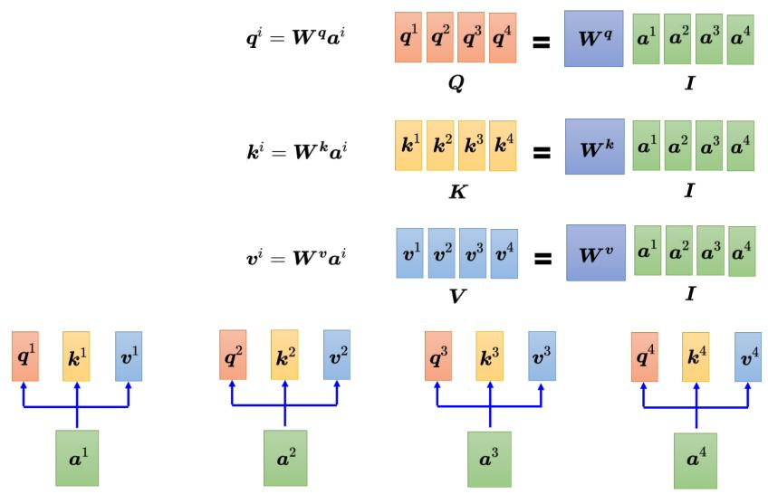

<details>
<summary>flowchart</summary>

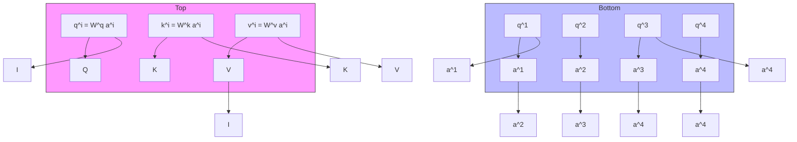
</details>

图 6.22 从矩阵乘法的角度理解自注意力的运作过程

如图 6.23 所示，下一步是每一个 q 都会去跟每一个 k 去计算内积，去得到注意力的分数，先计算 $\pmb q ^ { 1 }$ 的注意力分数。

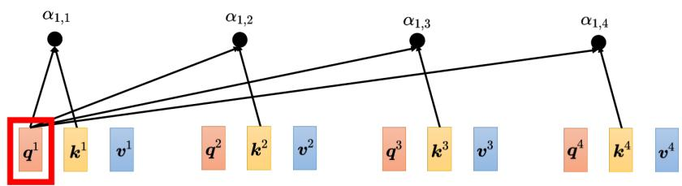

<details>
<summary>flowchart</summary>

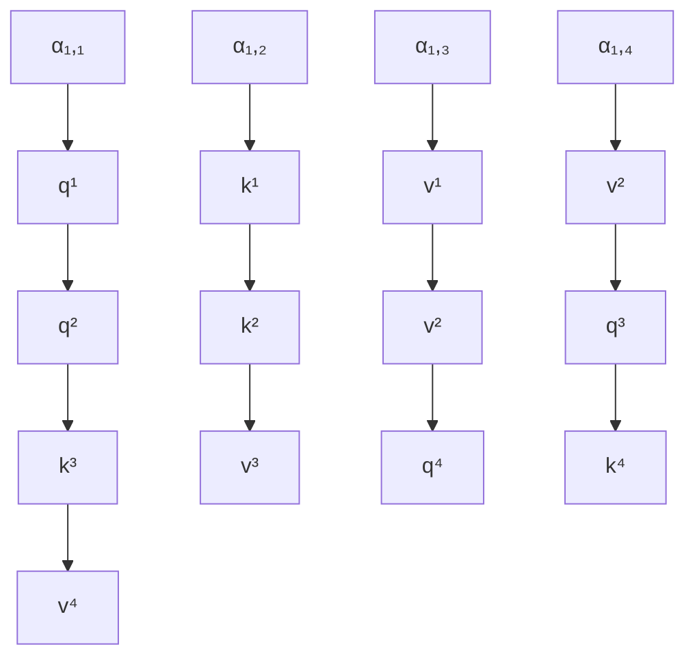
</details>

图 6.23 使用 $q ^ { 1 }$ 计算注意力分数

如图 6.24 所示，如果从矩阵操作的角度来看注意力计算这个操作，把 $q ^ { 1 }$ 跟 $k ^ { 1 }$ 做内积，得到 $\alpha _ { 1 , 1 \circ } \ q ^ { 1 }$ 乘上 $( k ^ { 1 } ) ^ { \mathrm { T } }$ ，也就是 $\pmb q ^ { 1 }$ 跟 $k ^ { 1 }$ 做内积。同理， $\alpha _ { 1 , 2 }$ 是 $\pmb q ^ { 1 }$ 跟 $k ^ { 2 }$ 做内积， $\alpha _ { 1 , 3 }$ 是$q ^ { 1 }$ 跟 $k ^ { 3 }$ 做内积， $\alpha _ { 1 , 4 }$ 就是 $q ^ { 1 }$ 跟 $k ^ { 4 }$ 做内积。这四个步骤的操作，其实可以把它拼起来，看作是矩阵跟向量相乘。 $\pmb q ^ { 1 }$ 乘 $k ^ { 1 }$ ， $\pmb q ^ { 1 }$ 乘 $k ^ { 2 }$ ， $\pmb q ^ { 1 }$ 乘 $k ^ { 3 }$ ， $\pmb q ^ { 1 }$ 乘 $k ^ { 4 }$ 这四个动作，可以看作是把$( k ^ { 1 } ) ^ { \mathrm { T } }$ 到 $( k ^ { 4 } ) ^ { \mathrm { T } }$ 拼起来当作是一个矩阵的四行，把这个矩阵乘上 $q ^ { 1 }$ 可得到注意力分数的矩阵，矩阵的每一行都是注意力的分数，即 $\alpha _ { 1 , 1 }$ 到 $\alpha _ { 1 , 4 }$ 。

$$
\begin{array}{rlr}&\alpha_{1,1}=\boxed{(\pmb{k}^1)^{\mathrm{T}}}\boxed{\pmb{q}^1}\quad\alpha_{1,2}=\boxed{(\pmb{k}^2)^{\mathrm{T}}}\boxed{\pmb{q}^1}\quad&{\alpha_{1,3}}\\&\alpha_{1,3}=\boxed{(\pmb{k}^3)^{\mathrm{T}}}\boxed{\pmb{q}^1}\quad\alpha_{1,4}=\boxed{(\pmb{k}^4)^{\mathrm{T}}}\boxed{\pmb{q}^1}\quad&{\alpha_{1,4}}\end{array}
$$

图 6.24 从矩阵操作角度来理解注意力分数计算的过程

如图 6.25 所示，不只是 $q ^ { 1 }$ 要对 $k ^ { 1 }$ 到 $k ^ { 4 }$ 计算注意力， $q ^ { 2 }$ 也要对 $k ^ { 1 }$ 到 $k ^ { 4 }$ 计算注意力。我们把 $q ^ { 2 }$ 也乘上 $k ^ { 1 }$ 到 $k ^ { 4 }$ ，得到 $\alpha _ { 2 , 1 }$ 到 $\alpha _ { 2 , 4 } { \mathrm { : } }$ 。现在的操作是一模一样的，把 $q ^ { 3 }$ 乘 $k ^ { 1 }$ 到 $k ^ { 4 }$ ，

把 $\pmb q ^ { 4 }$ 乘上 $k ^ { 1 }$ 到 $k ^ { 4 }$ 可以得到注意力的分数。

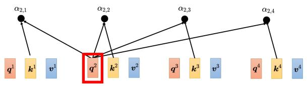

<details>
<summary>flowchart</summary>

```mermaid
graph TD
    A["α2,1"] --> B["q¹"]
    A --> C["k¹"]
    A --> D["v¹"]
    E["α2,2"] --> F["q²"]
    E --> G["k²"]
    E --> H["v²"]
    I["α2,3"] --> J["q³"]
    I --> K["k³"]
    I --> L["v³"]
    M["α2,4"] --> N["q⁴"]
    M --> O["k⁴"]
    M --> P["v⁴"]
```
</details>

图 6.25 使用 $q ^ { 2 }$ 计算注意力分数

如图 6.26 所示，通过两个矩阵的相乘就得到注意力的分数。一个矩阵的行就是 $\boldsymbol { k }$ ，即 $k ^ { 1 }$ 到 $k ^ { 4 }$ 。另外一个矩阵的列就是 $\pmb q \gets$ ，即 $\pmb q ^ { 1 }$ 到 $\pmb q ^ { 4 }$ 。把 k 所形成的矩阵 $\pmb { K } ^ { \mathrm { T } }$ 乘上 q 所形成的矩阵 $Q$ 就得到这些注意力的分数。假设 K 的列是 $k ^ { 1 }$ 到 $k ^ { 4 }$ ，在这边相乘的时候，要对矩阵 K做一下转置得到 $\pmb { K } ^ { \mathrm { T } }$ ， $\pmb { K } ^ { \mathrm { T } }$ 乘上 $Q$ 就得到矩阵 A，A 里面存的就是 Q 跟 K 之间的注意力的分数。对注意力的分数做一下归一化（normalization），比如使用 softmax，对 A 的每一列做 softmax，让每一列里面的值相加是 1。softmax 不是唯一的选项，完全可以选择其他的操作，比如 ReLU 之类的，得到的结果也不会比较差。由于把 α 做 softmax 操作以后，它得到的值有异于 α 的原始值，所以用 $A ^ { \prime }$ 来表示通过 softmax 以后的结果。

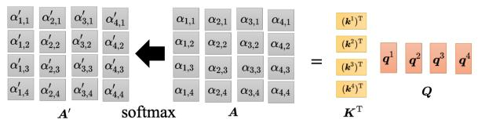

<details>
<summary>text_image</summary>

α₁,1 α₂,1 α₃,1 α₄,1
α₁,2 α₂,2 α₃,2 α₄,2
α₁,3 α₂,3 α₃,3 α₄,3
α₁,4 α₂,4 α₃,4 α₄,4
A′ softmax A = (k¹)ᵀ
(k²)ᵀ
(k³)ᵀ
(k⁴)ᵀ Q
Kᵀ
</details>

图 6.26 注意力分数的计算过程

如图 6.27 所示，计算出 $A ^ { \prime }$ 以后，需要把 $v ^ { 1 }$ 到 $v ^ { 4 }$ 乘上对应的 α 再相加得到 b。如果把 $v ^ { 1 }$ 到 $v ^ { 4 }$ 当成是矩阵 V 的 4 个列拼起来，则把 $A ^ { \prime }$ 的第一个列乘上 V 就得到 $\pmb { b } ^ { 1 }$ ，把 A′的第二个列乘上 V 得到 ${ \pmb b } ^ { 2 }$ ，以此类推。所以等于把矩阵 $A ^ { \prime }$ 乘上矩阵 V 得到矩阵 $O _ { \circ }$ 。矩阵O 里面的每一个列就是自注意力的输出 ${ \pmb b } ^ { 1 }$ 到 ${ \pmb b } ^ { 4 }$ 。所以整个自注意力的操作过程可分为以下步骤，先产生了 $q ,$ 、k 和 v，再根据 q 去找出相关的位置，然后对 v 做加权和。这一串操作就是一连串矩阵的乘法。

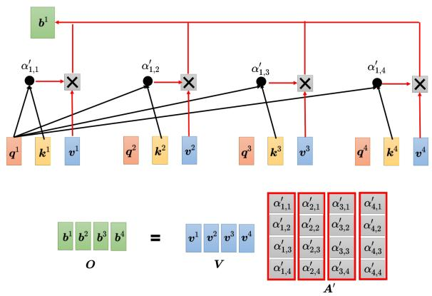

<details>
<summary>flowchart</summary>

```mermaid
graph TD
    b1["b¹"] --> α1_1["α₁,₁"]
    α1_1 --> k1["k¹"]
    α1_1 --> v1["v¹"]
    α1_1 --> q2["q²"]
    α1_1 --> k2["k²"]
    α1_1 --> v2["v²"]
    α1_1 --> q3["q³"]
    α1_1 --> k3["k³"]
    α1_1 --> v3["v³"]
    α1_1 --> q4["q⁴"]
    α1_1 --> k4["k⁴"]
    α1_1 --> v4["v⁴"]
    α1_2["α₁,₂'"] --> X1["X"]
    X1 --> X2["X"]
    X2 --> X3["X"]
    X3 --> X4["X"]
    X4 --> X5["X"]
    
    subgraph O
        b1["b¹"] --> b2["b²"] --> b3["b³"] --> b4["b⁴"]
        b2["b²"] --> b3["b³"] --> b4["b⁴"]
        b3["b³"] --> V["v¹"] --> v2["v²"] --> v3["v³"] --> v4["v⁴"]
    end
    
    subgraph V
        α1_1b["α₁,₁"] --> α2_1b["α₂,₁"] --> α3_1b["α₃,₁"] --> α4_1b["α₄,₁"]
        α2_1b["α₂,₂"] --> α3_2b["α₃,₂"] --> α4_2b["α₄,₂"]
        α3_2b["α₃,₂"] --> α4_3b["α₄,₃"]
        α4_3b["α₄,₃"] --> α4_4b["α₄,₄"]
        α4_4b["α₄,₄"] --> A'[A']
    end
```
</details>

图 6.27 自注意力输出的计算过程

如图 6.28 所示，自注意力的输入是一组的向量，将这排向量拼起来可得到矩阵 I。输入I 分别乘上三个矩阵： $W ^ { q }$ 、 $W ^ { k }$ 跟 $W ^ { v }$ ，得到三个矩阵 Q、K 和 V 。接下来 $Q$ 乘上 $\pmb { K } ^ { \mathrm { T } }$ 得到矩阵 A。把矩阵 A 做一些处理可得到 $A ^ { \prime }$ ， $A ^ { \prime }$ 称为注意力矩阵（attention matrix）。把$A ^ { \prime }$ 再乘上 V 就得到自注意力层的输出 O。自注意力的操作较为复杂，但自注意力层里面唯一需要学的参数就只有 $W ^ { q }$ 、 $\boldsymbol { W } ^ { k }$ 跟 $W ^ { v }$ 。只有 $W ^ { q }$ 、 $W ^ { k }$ 、 $W ^ { v }$ 是未知的，需要通过训练数据把它学习出来的。其他的操作都没有未知的参数，都是人为设定好的，都不需要通过训练数据学习。

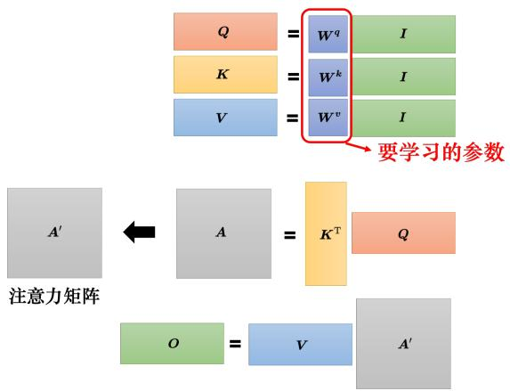

<details>
<summary>flowchart</summary>

```mermaid
graph TD
    A["Q"] --> B["W^q"] --> C["I"]
    D["K"] --> E["W^k"] --> F["I"]
    G["V"] --> H["W^v"] --> I["I"]
    style A fill:#f9f,stroke:#333
    style D fill:#f9f,stroke:#333
    style G fill:#f9f,stroke:#333
    style B fill:#ccf,stroke:#333
    style E fill:#ccf,stroke:#333
    style H fill:#ccf,stroke:#333
    note right of A: 要学习的参数
    note left of A' (注意力矩阵)
    note right of O (O = V) (A')
```
</details>

图 6.28 从矩阵乘法的角度来理解注意力

# 6.3 多头注意力

自注意力有一个进阶的版本——多头自注意力（multi-head self-attention）。多头自注意力的使用是非常广泛的，有一些任务，比如翻译、语音识别，用比较多的头可以得到比较好的结果。至于需要用多少的头，这个又是另外一个超参数，也是需要调的。为什么会需要比较多的头呢？在使用自注意力计算相关性的时候，就是用 q 去找相关的 k。但是相关有很多种不同的形式，所以也许可以有多个 q，不同的 q 负责不同种类的相关性，这就是多头注意力。如图 6.29 所示，先把 a 乘上一个矩阵得到 q，接下来再把 q 乘上另外两个矩阵，分别得到$q ^ { 1 }$ 、 $q ^ { 2 }$ 。用两个上标， $\pmb q ^ { i , 1 }$ 跟 $\pmb q ^ { i , 2 }$ 代表有两个头，i 代表的是位置，1 跟 2 代表是这个位置的第几个 $\pmb q$ ，这个问题里面有两种不同的相关性，所以需要产生两种不同的头来找两种不同的相关性。既然 q 有两个，k 也就要有两个，v 也就要有两个。怎么从 q 得到 $q ^ { 1 }$ 、 $q ^ { 2 }$ ，怎么从 k得到 $k ^ { 1 }$ 、 $k ^ { 2 }$ ，怎么从 v 得到 $v ^ { 1 }$ 、 $v ^ { 2 } ?$ ？其实就是把 $q \cdot$ 、k、v 分别乘上两个矩阵，得到不同的头。对另外一个位置也做一样的事情，另外一个位置在输入 a 以后，它也会得到两个 $\mathbf { \mu } _ { q } .$ 、两个 $k .$ 、两个 $\pmb { v } _ { \circ }$ 。接下来怎么做自注意力呢，跟之前讲的操作是一模一样的，只是现在 1 那一类的一起做，2 那一类的一起做。也就是 $q ^ { 1 }$ 在算这个注意力的分数的时候，就不要管 $k ^ { 2 }$ 了，它就只管 $k ^ { 1 }$ 就好。 $\pmb q ^ { i , 1 }$ 分别与 $\pmb { k } ^ { i , 1 }$ 、 $\pmb { k } ^ { j , 1 }$ 算注意力，在做加权和的时候也不要管 $v ^ { 2 }$ 了，看$\mathbf { \boldsymbol { v } } ^ { i , 1 }$ 跟 $v ^ { j , 1 }$ 就好，把注意力的分数乘 $\mathbf { \boldsymbol { v } } ^ { i , 1 }$ 和 $\pmb { v } ^ { j , 1 }$ ，再相加得到 $\boldsymbol { b } ^ { i , 1 }$ ，这边只用了其中一个头。

如图 6.30 所示，我们可以使用另外一个头做相同的事情。 $q ^ { 2 }$ 只对 $k ^ { 2 }$ 做注意力，在做加权和的时候，只对 $v ^ { 2 }$ 做加权和得到 $\mathbf { \delta } _ { b ^ { i , 2 } }$ 。如果有多个头，如 8 个头、16 个头，操作也是一样的。

如图 6.31 所示，得到 $\mathbf { \delta } _ { b } ^ { i , 1 }$ 跟 $\boldsymbol { b } ^ { i , 2 }$ ，可能会把 $\mathbf { \delta } _ { b } ^ { i , 1 }$ 跟 $\boldsymbol { b } ^ { i , 2 }$ 接起来，再通过一个变换，即再乘上一个矩阵然后得到 ${ \boldsymbol { b } } ^ { i }$ ，再送到下一层去，这就是自注意力的变形——多头自注意力。

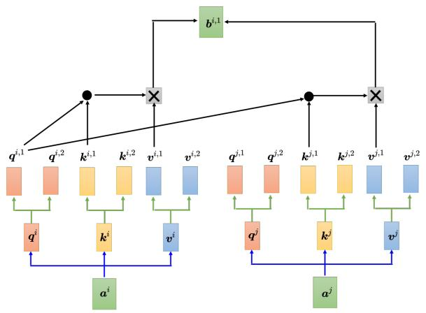

<details>
<summary>flowchart</summary>

```mermaid
graph TD
    q_i["q^i"] --> h1["×"]
    q_i --> h2["×"]
    h1 --> v_i1["v^{i,1}"]
    h1 --> v_i2["v^{i,2}"]
    h2 --> v_i1
    h2 --> v_i2
    h1 --> k_i["k^i"]
    h2 --> k_i
    h1 --> a_i["a^i"]
    h2 --> a_i
    h1 --> q_j["q^j"]
    h2 --> q_j
    h1 --> k_j["k^j"]
    h2 --> k_j
    h1 --> v_j["v^j"]
    h2 --> v_j
    b^{i,1} --> h1
    b^{i,1} --> h2
    style h1 fill:#f9f,stroke:#333
    style h2 fill:#f9f,stroke:#333
    style h1 fill:#ccf,stroke:#333
    style h2 fill:#ccf,stroke:#333
    style b^{i,1} fill:#cfc,stroke:#333
    style a_i fill:#fcc,stroke:#333
```
</details>

图 6.29 多头自注意力的计算过程  
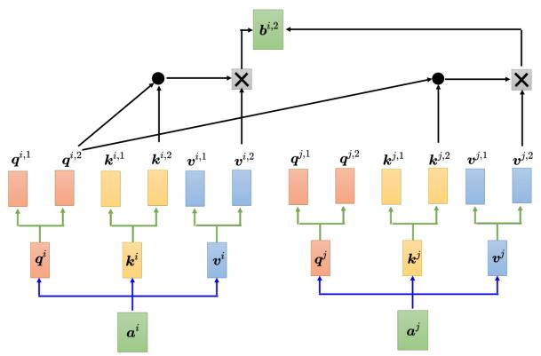

<details>
<summary>flowchart</summary>

```mermaid
graph TD
    subgraph Input Layer
        q_i1["q^{i,1}"] --> h1["×"]
        q_i2["q^{i,2}"] --> h2["×"]
        k_i1["k^{i,1}"] --> h3["×"]
        k_i2["k^{i,2}"] --> h4["×"]
        v_i1["v^{i,1}"] --> h5["×"]
        v_i2["v^{i,2}"] --> h6["×"]
    end
    h1 --> h7["×"]
    h2 --> h8["×"]
    h3 --> h9["×"]
    h4 --> h10["×"]
    h5 --> h11["×"]
    h6 --> h12["×"]
    h7 --> h13["×"]
    h8 --> h14["×"]
    h9 --> h15["×"]
    h10 --> h16["×"]
    h11 --> h17["×"]
    h12 --> h18["×"]
    h13 --> h19["×"]
    h14 --> h20["×"]
    h15 --> h21["×"]
    h16 --> h22["×"]
    h17 --> h23["×"]
    h18 --> h24["×"]
    h19 --> h25["×"]
    h20 --> h26["×"]
    h21 --> h27["×"]
    h22 --> h28["×"]
    h23 --> h29["×"]
    h24 --> h30["×"]
    h25 --> h31["×"]
    h26 --> h32["×"]
    h27 --> h33["×"]
    h28 --> h34["×"]
    h29 --> h35["×"]
    h30 --> h36["×"]
    h31 --> h37["×"]
    h32 --> h38["×"]
    h33 --> h39["×"]
    h34 --> h40["×"]
    h35 --> h41["×"]
    h36 --> h42["×"]
    h37 --> h43["×"]
    h38 --> h44["×"]
    h39 --> h45["×"]
    h40 --> h46["×"]
    h41 --> h47["×"]
    h42 --> h48["×"]
    h43 --> h49["×"]
    h44 --> h50["×"]
    h45 --> h51["×"]
    h46 --> h52["×"]
    h47 --> h53["×"]
    h48 --> h54["×"]
    h49 --> h55["×"]
    h50 --> h56["×"]
    h51 --> h57["×"]
    h52 --> h58["×"]
    h53 --> h59["×"]
    h54 --> h60["×"]
    h55 --> h61["×"]
    h56 --> h62["×"]
    h57 --> h63["×"]
    h58 --> h64["×"]
    h59 --> h65["×"]
    h60 --> h66["×"]
    h61 --> h67["×"]
    h62 --> h68["×"]
    h63 --> h69["×"]
    h64 --> h70["×"]
    h65 --> h71["×"]
    h66 --> h72["×"]
    h67 --> h73["×"]
    h68 --> h74["×"]
    h69 --> h75["×"]
    h70 --> h76["×"]
    h71 --> h77["×"]
    h72 --> h78["×"]
    h73 --> h79["×"]
    h74 --> h80["×"]
    h75 --> h81["×"]
    h76 --> h82["×"]
    h77 --> h83["×"]
    h78 --> h84["×"]
    h79 --> h85["×"]
```
</details>

图 6.30 多头自注意力另一个头的计算过程

# 6.4 位置编码

讲到目前为止，自注意力层少了一个也许很重要的信息，即位置的信息。对一个自注意力层而言，每一个输入是出现在序列的最前面还是最后面，它是完全没有这个信息的。有人可能会问：输入不是有位置 1、2、3、4 吗？但 1、2、3、4 是作图的时候，为了帮助大家理解所标上的一个编号。对自注意力而言，位置 1、位置 2、位置 3 跟位置 4 没有任何差别，这四个位置的操作是一模一样的。对它来说， $\pmb q ^ { 1 }$ 跟 $\pmb q ^ { 4 }$ 的距离并没有特别远，1 跟 4 的距离并没有特别远，2 跟 3 的距离也没有特别近，对它来说就是天涯若比邻，所有的位置之间的距离都是一样的，没有谁在整个序列的最前面，也没有谁在整个序列的最后面。但是这可能会有一个问题：

$$
\begin{array}{c}\boxed{\boldsymbol{b}^i} = \boxed{\boldsymbol{W}^o}\boxed{\begin{array}{c}\boxed{\boldsymbol{b}^{i,1}}\\ \boxed{\boldsymbol{b}^{i,2}}\end{array}} \end{array}
$$

图 6.31 从矩阵乘法的角度来理解多头自注意力位置的信息被忽略了，而有时候位置的信息很重要。举个例子，在做词性标注的时候，我们知道动词比较不容易出现在句首，如果某一个词汇它是放在句首的，它是动词的可能性就比较低，位置的信息往往也是有用的。可是到目前为止，自注意力的操作里面没有位置的信息。因此做自注意力的时候，如果我们觉得位置的信息很重要，需要考虑位置信息时，就要用到位置编码（positional encoding）。如图 6.32 所示，位置编码为每一个位置设定一个向量，即位置向量（positional vector）。位置向量用 $e ^ { i }$ 来表示，上标 i 代表位置，不同的位置就有不同的向量，不同的位置都有一个专属的 $^ e$ ，把 e 加到 $\mathbf { \Delta } \mathbf { a } ^ { i }$ 上面就结束了。这相当于告诉自注意力位置的信息，如果看到 $\mathbf { \Delta } \mathbf { a } ^ { i }$ 被加上 $e ^ { i }$ ，它就知道现在出现的位置应该是在 i 这个位置。

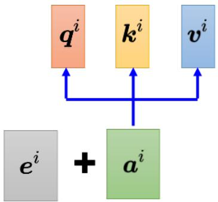

<details>
<summary>flowchart</summary>

```mermaid
graph TD
    A["q^i"] --> C
    B["k^i"] --> C
    D["v^i"] --> C
    E["e^i"] + F["a^i"] --> C
    style A fill:#f9f,stroke:#333
    style B fill:#f9f,stroke:#333
    style D fill:#f9f,stroke:#333
    style E fill:#ccf,stroke:#333
    style F fill:#ccf,stroke:#333
```
</details>

图 6.32 位置编码

最早的 Transformer 论文 “Attention Is All You Need” 用的 $e ^ { i }$ 如图 6.33 所示。图上面每一列就代表一个 $e$ ，第一个位置就是 $e ^ { 1 }$ ，第二个位置就是 $e ^ { 2 }$ ，第三个位置就是 $e ^ { 3 }$ ，以此类推。每一个位置的 a 都有一个专属的 $e _ { \circ }$ 。模型在处理输入的时候，它可以知道现在的输入的位置的信息，这个位置向量是人为设定的。人为设定的向量有很多问题，假设在定这个向量的时候只定到 128，但是序列的长度是 129，怎么办呢？在最早的 “Attention Is All You Need” 论文中，其位置向量是通过正弦函数和余弦函数所产生的，避免了人为设定向量固定长度的尴尬。

Q：为什么要通过正弦函数和余弦函数产生向量，有其他选择吗？为什么一定要这样产生手工的位置向量呢？

A：不一定要通过正、余弦函数来产生向量，我们可以提出新的方法。此外，不一定要这样产生手工的向量，位置编码仍然是一个尚待研究的问题，甚至位置编码是可以根据数据学出来的。有关位置编码，可以参考论文 “Learning to Encode Position forTransformer with Continuous Dynamical Model”，该论文比较了不同的位置编码方法并提出了新的位置编码。

如图 6.34a 所示，最早的位置编码是用正弦函数所产生的，图 6.34a 中每一行代表一个位置向量。如图 6.34b 所示，位置编码还可以使用循环神经网络生成。总之，位置编码可通过各种不同的方法来产生。目前还不知道哪一种方法最好，这是一个尚待研究的问题。所以不用纠结为什么正弦函数最好，我们永远可以提出新的做法。

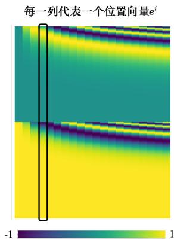

<details>
<summary>text_image</summary>

每一列代表一个位置向量e^i
-1
1
</details>

图 6.33 Transformer 中的自注意力

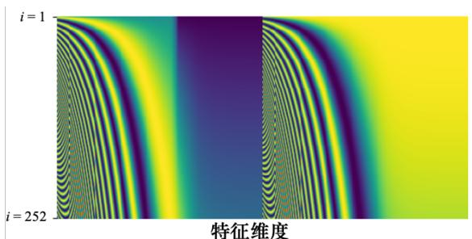

<details>
<summary>text_image</summary>

i = 1
特征维度
i = 252
</details>

(a) 正弦函数


<details>
<summary>heatmap</summary>

| i   | Value |
| --- | ----- |
| 1   | 0     |
| 252 | 0     |
</details>

(b) 循环神经网络  
图 6.34 产生位置编码的各种方法[2]

# 6.5 截断自注意力

自注意力的应用很广泛，在自然语言处理（Natural Language Processing，NLP）领域，除了 Transformer，还有 BERT 也用到了自注意力，所以自注意力在自然语言处理上面的应用是大家都较为熟悉的，但自注意力不是只能用在自然语言处理相关的应用上，它还可以用在很多其他的问题上。比如在做语音的时候，也可以用自注意力。不过将自注意力用于语音处理时，可以对自注意力做一些小小的改动。

举个例子，如果要把一段声音信号表示成一组向量，这排向量可能会非常长。在做语音识别的时候，把声音信号表示成一组向量，而每一个向量只代表了 10 毫秒的长度而已。所以如果是 1 秒钟的声音信号，它就有 100 个向量了，5 秒钟的声音信号就有 500 个向量，随便讲一句话都是上千个向量了。所以一段声音信号，通过向量序列描述它的时候，这个向量序列的长度是非常大的。非常大的长度会造成什么问题呢？在计算注意力矩阵的时候，其复杂度（complexity）是长度的平方。假设该矩阵的长度为 L，计算注意力矩阵 A′ 需要做 $L \times L$ 次的内积，如果 L 的值很大，计算量就很可观，并且需要很大内存（memory）才能够把该矩阵存下来。所以如果在做语音识别的时候，我们讲一句话，这一句话所产生的这个注意力矩阵可能会太大，大到不容易处理，不容易训练，

截断自注意力（truncated self-attention）可以处理向量序列长度过大的问题。截断自注意力在做自注意力的时候不要看一整句话，就只看一个小的范围就好，这个范围是人设定的。在做语音识别的时候，如果要辨识某个位置有什么样的音标，这个位置有什么样的内容，并不需要看整句话，只要看这句话以及它前后一定范围之内的信息，就可以判断。在做自注意力的时候，也许没有必要让自注意力考虑一整个句子，只需要考虑一个小范围就好，这样就可以加快运算的速度。这就是截断自注意力。


<details>
<summary>flowchart</summary>

```mermaid
graph TD
    b1["b¹"] -->|一定范围的注意力| a1["a¹"]
    b2["b²"] -->|一定范围的注意力| a2["a²"]
    b3["b³"] -->|一定范围的注意力| a3["a³"]
    b4["b⁴"] -->|一定范围的注意力| a4["a⁴"]
    a1 -->|权重映射| a3
    a2 -->|权重映射| a3
    a3 -->|权重映射| a4
    a1 -->|权重映射| a3
    a2 -->|权重映射| a3
    a3 -->|权重映射| a4
    a3 --> X["X"]
    a4 --> X
```
</details>

图 6.35 截断自注意力

# 6.6 自注意力与卷积神经网络对比

自注意力还可以被用在图像上。到目前为止，在提到自注意力的时候，自注意力适用的范围是输入为一组向量的时候。一张图像可以看作是一个向量序列，如图 6.36 所示，一张分辨率为 5×10 的图像（图 6.36a）可以表示为一个大小为 $5 \times 1 0 \times 3$ 的张量（图 6.36b），3 代表 RGB 这 3 个通道（channel），每一个位置的像素可看作是一个三维的向量，整张图像是5 × 10 个向量。所以可以换一个角度来看图像，图像其实也是一个向量序列，它既然也是一个向量序列，完全可以用自注意力来处理一张图像。自注意力在图像上的应用，读者可以参考 “Self-Attention Generative Adversarial Networks” 和 “End-to-End Object Detection withTransformers” 这两篇论文。


<details>
<summary>natural_image</summary>

Close-up of a bird's head with yellow beak and blue eye, enclosed in a green mesh fence (no text or symbols)
</details>

(a) 图像


<details>
<summary>text_image</summary>

这是一个向量
5
10
3
</details>

(b) 图像的张量表示  
图 6.36 使用自注意力处理图像[3]

自注意力跟卷积神经网络之间有什么样的差异或者关联? 如图 6.37(a) 所示，如果用自注意力来处理一张图像，假设红色框内的“1”是要考虑的像素，它会产生查询，其他像素产生键。

在做内积的时候，考虑的不是一个小的范围，而是整张图像的信息。如图 6.37(b) 所示，在做卷积神经网络的时候，卷积神经网络会“画”出一个感受野，每一个滤波器，每一个神经元，只考虑感受野范围里面的信息。所以如果我们比较卷积神经网络跟自注意力会发现，卷积神经网络可以看作是一种简化版的自注意力，因为在做卷积神经网络的时候，只考虑感受野里面的信息。而在做自注意力的时候，会考虑整张图像的信息。在卷积神经网络里面，我们要划定感受野。每一个神经元只考虑感受野里面的信息，而感受野的大小是人决定的。而用自注意力去找出相关的像素，就好像是感受野是自动被学出来的，网络自己决定感受野的形状。网络决定说以这个像素为中心，哪些像素是真正需要考虑的，哪些像素是相关的，所以感受野的范围不再是人工划定，而是让机器自己学出来。关于自注意力跟卷积神经网络的关系，读者可以读论文 “On the Relationship between Self-attention and Convolutional Layers”，这篇论文里面会用数学的方式严谨地告诉我们，卷积神经网络就是自注意力的特例。


<details>
<summary>text_image</summary>

1 0 0 0 0 1
0 1 0 0 1 0
0 0 1 1 0 0
1 0 0 0 1 0
0 1 0 0 1 0
0 0 1 0 1 0
</details>

(a) 自注意力


<details>
<summary>text_image</summary>

1 0 0 0 0 1
0 1 0 0 1 0
0 0 1 1 0 0
1 0 0 0 1 0
0 1 0 0 1 0
0 0 1 0 1 0
</details>

(b) 卷积神经网络  
图 6.37 自注意力和卷积神经网络的区别

自注意力只要设定合适的参数，就可以做到跟卷积神经网络一模一样的事情。卷积神经网络的函数集（function set）与自注意力的函数集的关系如图 6.38 所示。所以自注意力是更灵活的卷积神经网络，而卷积神经网络是受限制的自注意力。自注意力只要通过某些设计、某些限制就会变成卷积神经网络。


<details>
<summary>text_image</summary>

自注意力
CNN
</details>

图 6.38 卷积神经网络的函数集与自注意力的函数集的关系

既然卷积神经网络是自注意力的一个子集，说明自注意力更灵活。更灵活的模型需要更多的数据。如果数据不够，就有可能过拟合。而比较有限制的模型，它适合在数据少的时候使用，它可能比较不会过拟合。如果限制设的好，也会有不错的结果。谷歌的论文 “An Imageis Worth 16x16 Words: Transformers for Image Recognition at Scale” 把自注意力应用在图像上面，把一张图像拆成 16 × 16 个图像块（patch），它把每一个图像块就想像成是一个字（word）。因为一般自注意力比较常用在自然语言处理上面，所以我们可以想像每一个图像块就是一个字。如图 6.39 所示，横轴是训练的图像的量，对谷歌来说用的所谓的数据量比较少，也是我们没有办法用的数据量。这边有 1000 万张图，是数据量比较小的设置（setting），数据量比较大的设置呢，有 3 亿张图像。在这个实验里面，自注意力是浅蓝色的这一条线，卷积神经网络是深灰色的这条线。随着数据量越来越多，自注意力的结果越来越好。最终在数据量最多的时候，自注意力可以超过卷积神经网络，但在数据量少的时候，卷积神经网络是可以比自注意力得到更好的结果的。自注意力的弹性比较大，所以需要比较多的训练数据，训练数据少的时候就会过拟合。而卷积神经网络的弹性比较小，在训练数据少的时候结果比较好。但训练数据多的时候，它没有办法从更大量的训练数据得到好处。这就是自注意力跟卷积神经网络的比较。

Q：自注意力跟卷积神经网络应该选哪一个？

A：事实上可以都用，比如 conformer 里面同时用到了自注意力和卷积神经网络。


<details>
<summary>line</summary>

| JFT预训练样本的数量 | ViT-L/16 | ViT-B/32 | ResNet50x1 (BiT) | ViT-L/32 | ViT-b/32 | ResNet152x2 (BiT) |
| ------------------- | -------- | -------- | ---------------- | -------- | -------- | ----------------- |
| 10 M                | 42       | 38       | 48               | 37       | 37       | 53                |
| 30 M                | 58       | 53       | 51               | 54       | 41       | 67                |
| 100 M               | 70       | 55       | 52               | 64       | 41       | 70                |
| 300 M               | 72       | 56       | 52               | 66       | 42       | 70                |
</details>

图 6.39 自注意力与卷积神经网络对比[4]

# 6.7 自注意力与循环神经网络对比

我们来比较一下自注意力跟循环神经网络。目前，循环神经网络的角色很大一部分都可以用自注意力来取代了。但循环神经网络跟自注意力一样，都是要处理输入是一个序列的状况。如图 6.40b 所示，在循环神经网络里面有一个输入序列、一个隐状态的向量、一个循环神经网络的块（block）。循环神经网络的块“吃”记忆的向量，输出一个东西。这个东西会输入全连接网络来进行预测。

循环神经网络中的隐状态存储了历史信息，可以看作一种记忆（Memory）。

接下来当第二个向量作为输入的时候，前一个时间点“吐”出来的东西也会作为输入丢进循环神经网络里面产生新的向量，再拿去给全连接网络。输入第三个向量时，第三个向量跟前一个时间点的输出，一起丢进循环神经网络再产生新的输出。输入第四个向量输入时，把第四个向量跟前一个时间点产生出来的输出再一起做处理，得到新的输出再通过全连接网络的层，这就是循环神经网络。如图 6.40(a) 所示，循环神经网络的输入都是一个向量序列。自注意力输出是一个向量序列，该序列中的每一个向量都考虑了整个输入序列，再输入到全连接网络去做处理。循环神经网络也会输出一组向量，这排向量也会给全连接网络做进一步的处理。

自注意力跟循环神经网络有一个显而易见的不同，自注意力的每一个向量都考虑了整个输入的序列，而循环神经网络的每一个向量只考虑了左边已经输入的向量，它没有考虑右边的向量。但循环神经网络也可以是双向的，所以如果用双向循环神经网络（Bidirectional RecurrentNeural Network，Bi-RNN），那么每一个隐状态的输出也可以看作是考虑了整个输入的序列。

但是假设把循环神经网络的输出跟自注意力的输出拿来做对比，就算使用双向循环神经网络还是有一些差别的。如图 6.40(b) 所示，对于循环神经网络，如果最右边黄色的向量要考虑最左边的输入，它就必须把最左边的输入存在记忆里面，才能不“忘掉”，一路带到最右边，才能够在最后一个时间点被考虑。但自注意力输出一个查询，输出一个键，只要它们匹配（match）得起来，“天涯若比邻”。自注意力可以轻易地从整个序列上非常远的向量抽取信息。

自注意力跟循环神经网络还有另外一个更主要的不同是，循环神经网络在处理输入、输出均为一组序列的时候，是没有办法并行化的。比如计算第二个输出的向量，不仅需要第二个输入的向量，还需要前一个时间点的输出向量。当输入是一组向量，输出是另一组向量的时候，循环神经网络无法并行处理所有的输出，但自注意力可以。自注意力输入一组向量，输出的时候，每一个向量是同时并行产生的，因此在运算速度上，自注意力会比循环神经网络更有效率。很多的应用已经把循环神经网络的架构逐渐改成自注意力的架构了。如果想要更进一步了解循环神经网络跟自注意力的关系，可以阅读论文 “Transformers are RNNs: FastAutoregressive Transformers with Linear Attention”。


<details>
<summary>flowchart</summary>

```mermaid
graph TD
    A["能够并行化"] --> B["自注意力模型"]
    C["容易考虑"] --> B
    B --> D["黄色方块"]
    B --> E["绿色方块"]
    B --> F["蓝色方块"]
    B --> G["蓝色方块"]
```
</details>

(a) 使用自注意力处理序列


<details>
<summary>flowchart</summary>

```mermaid
graph TD
    A["记忆"] --> B["RNN"]
    B --> C["FC"]
    C --> D["RNN"]
    D --> E["FC"]
    E --> F["RNN"]
    F --> G["FC"]
    G --> H["RNN"]
    H --> I["FC"]
    I --> J["无法并行化"]
    J --> K["FC"]
    K --> L["不能被评估"]
    M["难以考虑"] --> N["可能被评估"]
    style A fill:#f9f,stroke:#333
    style B fill:#bbf,stroke:#333
    style C fill:#bfb,stroke:#333
    style D fill:#ffb,stroke:#333
    style E fill:#fbb,stroke:#333
    style F fill:#bbf,stroke:#333
    style G fill:#bbf,stroke:#333
    style H fill:#bbf,stroke:#333
    style I fill:#bbf,stroke:#333
    style J fill:#fbb,stroke:#333
    style K fill:#bbf,stroke:#333
    style L fill:#bbf,stroke:#333
```
</details>

(b) 使用循环神经网络处理序列  
图 6.40 自注意力与循环神经网络对比

图也可以看作是一堆向量，如果是一堆向量，就可以用自注意力来处理。但把自注意力用在图上面，会有些地方不一样。图中的每一个节点（node）可以表示成一个向量。但我们不只有节点的信息，还有边（edge）的信息。如果节点之间是有相连的，这些节点也就是有关联的。之前在做自注意力的时候，所谓的关联性是网络自己找出来的。但是现在既然有了图的信息，关联性就不需要机器自动找出来，图上面的边已经暗示了节点跟节点之间的关联性。所以当把自注意力用在图上面的时候，我们可以在计算注意力矩阵的时候，只计算有边相连的节点就好。

举个例子，如图 6.41 所示，在这个图上，节点 1 只和节点 5、6、8 相连，因此只需要计算节点 1 和节点 5、节点 6、节点 8 之间的注意力分数；节点 2 之和节点 3 相连，因此只需要计算节点 2 和节点 3 之间的注意力的分数，以此类推。如果两个节点之间没有相连，这两个节点之间就没有关系。既然没有关系，就不需要再去计算它的注意力分数，直接把它设为 0就好了。因为图往往是人为根据某些领域知识（domain knowledge）建出来的，所以从领域知识可知这两个向量之间没有关联，就没有必要再用机器去学习这件事情。当把自注意力按照这种限制用在图上面的时候，其实就是一种图神经网络（Graph Neural Network，GNN）。


<details>
<summary>scatter</summary>

| Node | 1 | 2 | 3 | 4 | 5 | 6 | 7 | 8 |
|---|---|---|---|---|---|---|---|---|
| 1 | Orange dot | Red circle | Yellow circle | Green circle | Green circle | Yellow circle | Green circle | Orange circle |
| 2 | Grey circle | Red circle | Grey circle | Green circle | Green circle | Yellow circle | Green circle | Orange circle |
| 3 | Grey circle | Red circle | Grey circle | Green circle | Green circle | Yellow circle | Green circle | Orange circle |
| 4 | Grey circle | Red circle | Grey circle | Green circle | Green circle | Yellow circle | Green circle | Orange circle |
| 5 | Grey circle | Red circle | Grey circle | Green circle | Green circle | Yellow circle | Green circle | Orange circle |
| 6 | Green circle | Red circle | Grey circle | Green circle | Green circle | Yellow circle | Green circle | Orange circle |
| 7 | Grey circle | Red circle | Grey circle | Green circle | Green circle | Yellow circle | Green circle | Orange circle |
| 8 | Orange dot | Red circle | Grey circle | Green circle | Green circle | Yellow circle | Green circle | Orange circle |
</details>

图 6.41 自注意力在图上的应用

自注意力有非常多的变形，论文 “Long Range Arena: A Benchmark for Efficient Trans-formers” 里面比较了各种不同的自注意力的变形。自注意力最大的问题是其运算量非常大，如何减少自注意力的运算量是未来可研究的重点方向。自注意力最早是用在 Transformer 上面，所以很多人讲 Transformer 的时候，其实指的是自注意力。有人说广义的 Transformer 指的就是自注意力，所以后来各种的自注意力的变形都叫做是 xxformer，比如 Linformer、Performer、Reformer 等等。这些新的 xxformer 往往比原来的 Transformer 性能差一点，但是速度会比较快。论文 “Efficient Transformers: A Survey” 介绍了各种自注意力的变形。

# 参考文献

[1] Shreyansh nanawati 的文章“Social Network Analytics”[Z].   
[2] LIU X, YU H F, DHILLON I S, et al. Learning to encode position for transformer with continuous dynamical model[C]//International Conference on Machine Learning(ICML). 2020: 6327–6335.   
[3] SINGH B P. Imaging applications of charge coupled devices (ccds) for cherenkov telescope [R]. 2015.   
[4] DOSOVITSKIY A, BEYER L, KOLESNIKOV A, et al. An image is worth 16x16 words: Transformers for image recognition at scale[C]//International Conference on Learning Representations(ICLR). 2021.