# 第 7 章 Transformer

Transformer 是一个基于自注意力的序列到序列模型，与基于循环神经网络的序列到序列模型不同，其可以能够并行计算。本章从两方面介绍了 Transformer，一方面介绍了 Trans-former 的结构，即编码器和解码器、编码器-解码器注意力，另一方面介绍了 Transformer 的训练过程以及 序列到序列 模型的训练技巧。

# 7.1 序列到序列模型

序列到序列模型输入和输出都是一个序列，输入与输出序列长度之间的关系有两种情况。第一种情况下，输入跟输出的长度一样；第二种情况下，机器决定输出的长度。序列到序列模型有广泛的应用，通过这些应用可以更好地了解序列到序列模型。

# 7.1.1 语音识别、机器翻译与语音翻译

序列到序列模型的常见应用如图 7.1 所示。

• 语音识别：输入是声音信号，输出是语音识别的结果，即输入的这段声音信号所对应的文字。我们用圆圈来代表文字，比如每个圆圈代表中文里面的一个方块字。输入跟输出的长度有一些关系，但没有绝对的关系，输入的声音信号的长度是 T，并无法根据 T 得到输出的长度 N。其实可以由机器自己决定输出的长度，由机器去听这段声音信号的内容，决定输出的语音识别结果。  
• 机器翻译：机器输入一个语言的句子，输出另外一个语言的句子。输入句子的长度是N，输出句子的长度是 N′。输入“机器学习”四个字，输出是两个英语的词汇：“machinelearning”，但是并不是所有中文跟英语的关系都是输出就是输入的二分之一。N 跟 N′之间的关系由机器决定。  
• 语音翻译：我们对机器说一句话，比如“machine learning”，机器直接把听到的英语的声音信号翻译成中文。

Q: 既然把语音识别系统跟机器翻译系统接起来就能达到语音翻译的效果，那么为什么要做语音翻译？

A: 世界上很多语言是没有文字的，无法做语音识别。因此需要对这些语言做语音翻译，直接把它翻译成文字。

以闽南语的语音识别为例，闽南语的文字不是很普及，一般人不一定能看懂。因此我们想做语音的翻译，对机器讲一句闽南语，它直接输出的是同样意思的白话文的句子，这样一般人就可以看懂。我们可以训练一个神经网络，该神经网络输入某一种语言的声音信号，输出是另外一种语言的文字，需要学到闽南语的声音信号跟白话文文字的对应关系。YouTube 上面有很多的乡土剧，乡土剧是闽南语语音、白话文字幕，所以只要下载它的闽南语语音和白话文字幕，这样就有闽南语声音信号跟白话文之间的对应关系，就可以训练一个模型来做闽南语的语音识别：输入闽南语，输出白话文。李宏毅实验室下载了 1500 个小时的乡土剧的数据，并用其来训练一个语音识别系统。这会有一些问题，比如乡土剧有很多噪声、音乐，乡土剧的字幕不一定跟声音能对应起来。可以忽略这些问题，直接训练一个模型，输入是声音信号，输出直接是白话文的文字，这样训练能够做一个闽南语语音识别系统。

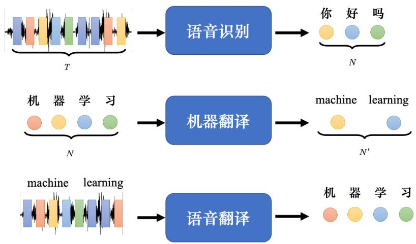

<details>
<summary>flowchart</summary>

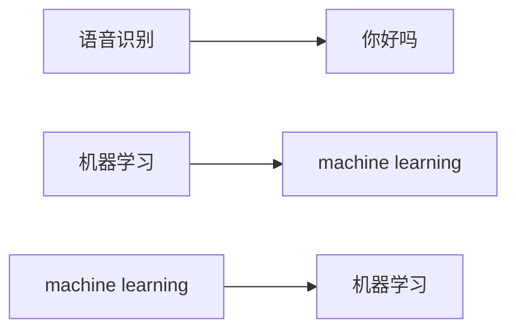
</details>

图 7.1 序列到序列的常见应用

# 7.1.2 语音合成

输入文字、输出声音信号就是语音合成（Text-To-Speech，TTS）。现在还没有真的做端到端（end-to-end）的模型，以闽南语的语音合成为例，其使用的模型还是分成两阶，首先模型会先把白话文的文字转成闽南语的拼音，再把闽南语的拼音转成声音信号。从闽南语的拼音转成声音信号这一段是通过序列到序列模型 echotron 实现的。

# 7.1.3 聊天机器人

除了语音以外，文本也很广泛的使用了序列到序列模型。比如用序列到序列模型可用来训练一个聊天机器人。聊天机器人就是我们对它说一句话，它要给出一个回应。因为聊天机器人的输入输出都是文字，文字是一个向量序列，所以可用序列到序列的模型来做一个聊天机器人。我们可以收集大量人的对话（比如电视剧、电影的台词等等），如图 7.2 所示，假设在对话里面有出现，一个人说：“Hi”，另外一个人说：“Hello! How are you today?”。我们可以教机器，看到输入是“Hi”，输出就要跟“Hello! How are you today?”越接近越好。

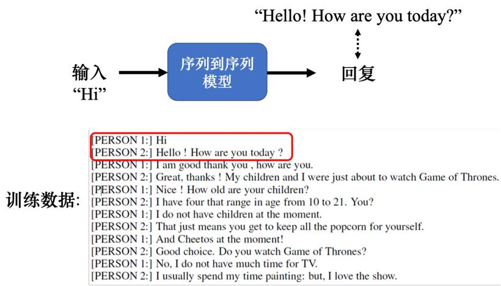

<details>
<summary>flowchart</summary>

```mermaid
graph TD
    A["输入 “Hi”"] --> B["序列到序列模型"]
    B --> C["Hello! How are you today?"]
    B --> D["回复"]
    E["训练数据:"] --> F["PERSON 1:"] Hi\n["PERSON 2:"] Hello! How are you today ?\n["PERSON 1:"] I am good thank you, how are you.\n["PERSON 2:"] Great, thanks! My children and I were just about to watch Game of Thrones.\n["PERSON 1:"] Nice! How old are your children?\n["PERSON 2:"] I have four that range in age from 10 to 21. You?\n["PERSON 1:"] I do not have children at the moment.\n["PERSON 2:"] That just means you get to keep all the popcorn for yourself.\n["PERSON 1:"] And Cheetos at the moment!\n["PERSON 2:"] Good choice. Do you watch Game of Thrones?\n["PERSON 1:"] No, I do not have much time for TV.\n["PERSON 2:"] I usually spend my time painting: but, I love the show.]
```
</details>

图 7.2 聊天机器人的例子

# 7.1.4 问答任务

序列到序列模型在自然语言处理的领域的应用很广泛，而很多自然语言处理的任务都可以想成是问答（Question Answering，QA）的任务，比如下面是一些例子。

• 翻译。机器读的文章是一个英语句子，问题是这个句子的德文翻译是什么？输出的答案就是德文。  
• 自动做摘要：给机器读一篇长的文章，让它把长的文章的重点找出来，即给机器一段文字，问题是这段文字的摘要是什么。  
• 情感分析：机器要自动判断一个句子是正面的还是负面的。如果把情感分析看成是问答的问题，问题是给定句子是正面还是负面的，希望机器给出答案。

问答就是给机器读一段文字，问机器一个问题，希望它可以给出一个正确的答案。

因此各式各样的自然语言处理的问题往往都可以看作是问答的问题，而问答的问题可以用序列到序列模型来解。序列到序列模型的输入是一篇文章和一个问题，输出就是问题的答案。问题加文章合起来是一段很长的文字，答案是一段文字。只要是输入一个序列，输出是一个序列，序列到序列模型就可以解。虽然各种自然语言处理的问题都能用序列到序列模型来解，但是对多数自然语言处理的任务或对多数的语音相关的任务而言，往往为这些任务定制化模型会得到更好的结果。序列到序列模型就像瑞士刀，瑞士刀可以解决各式各样的问题，砍柴可以用瑞士刀，切菜也可以用瑞士刀，但是它不一定是最好用的。因此针对各种不同的任务定制的模型往往比只用序列到序列模型的模型更好。谷歌 Pixel 4 手机用于语音识别的模型不是序列到序列模型，而是 RNN-Transducer 模型，这种模型是为了语音的某些特性所设计的，表现更好。

# 7.1.5 句法分析

很多问题都可以用序列到序列模型来解，以句法分析（syntactic parsing）为例，如图 7.3所示，给机器一段文字：比如“deep learning is very powerful”，机器要产生一个句法的分析树，即句法树（syntactic tree）。通过句法树告诉我们 deep 加 learning 合起来是一个名词短语，very 加 powerful 合起来是一个形容词短语，形容词短语加 is 以后会变成一个动词短语，动词短语加名词短语合起来是一个句子。

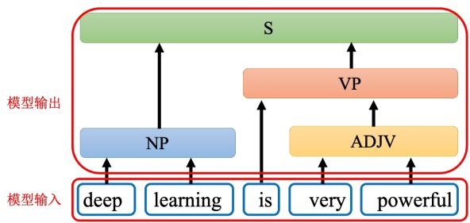

<details>
<summary>flowchart</summary>

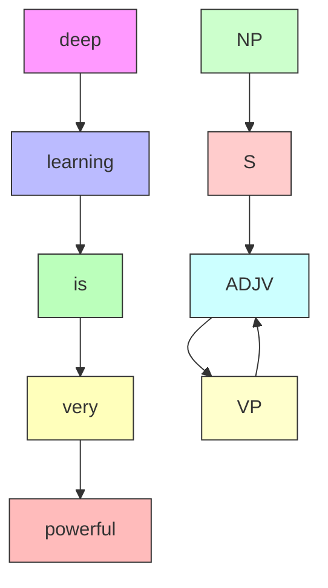
</details>

图 7.3 句法分析示例

在句法分析的任务中，输入是一段文字，输出是一个树状的结构，而一个树状的结构可以看成一个序列，该序列代表了这个树的结构，如图 7.4 所示。把树的结构转成一个序列以后，我们就可以用序列到序列模型来做句法分析，具体可参考论文“Grammar as a Foreign Language”

[1]。这篇论文放在 arXiv 上面的时间是 14 年的年底，当时序列到序列模型还不流行，其主要只有被用在翻译上。因此这篇论文的标题才会取“Grammar as a Foreign Language”，其把句法分析看成一个翻译的问题，把语法当作是另外一种语言直接套用。

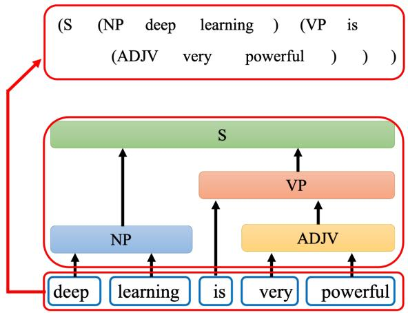

<details>
<summary>flowchart</summary>

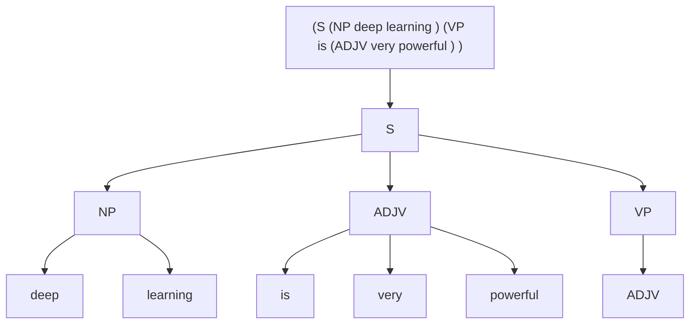
</details>

图 7.4 树状结构对应的序列

# 7.1.6 多标签分类

多标签分类（multi-label classification）任务也可以用序列到序列模型。多类的分类跟多标签的分类是不一样的。如图 7.5 所示，在做文章分类的时候，同一篇文章可能属于多个类，文章 1 属于类 1 和类 3，文章 3 属于类 3、9、17。

多分类问题（multi-class classification）是指分类的类别数大于 2。而多标签分类是指同一个东西可以属于多个类。

<table><tr><td>文章1 类1 类3</td><td>文章2 类1</td><td>文章3 类3 类9 类17</td><td>文章4 类10</td></tr></table>

图 7.5 多标签分类示例

多标签分类问题不能直接把它当作一个多分类问题的问题来解。比如把这些文章丢到一个分类器里面，本来分类器只会输出分数最高的答案，如果直接取一个阈值（threshold），只输出分数最高的前三名。这种方法是不可行的，因为每篇文章对应的类别的数量根本不一样。因此需要用序列到序列模型来做，如图 7.6 所示，输入一篇文章，输出就是类别，机器决定输出类别的数量。这种看起来跟序列到序列模型无关的问题也可以用序列到序列模型解，比如目标检测问题也可以用序列到序列模型来做，读者可参考论文“End-to-End Object Detectionwith Transformers”[2]。

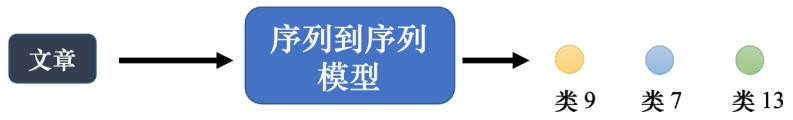

<details>
<summary>flowchart</summary>

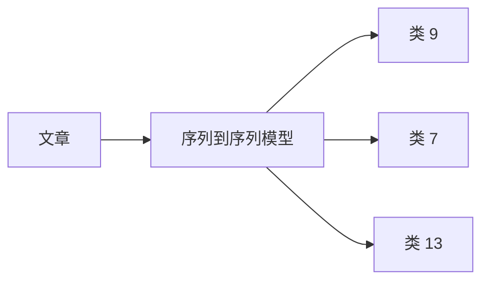
</details>

图 7.6 序列到序列模型来解多标签分类问题

# 7.2 Transformer 结构

一般的序列到序列模型会分成编码器和解码器，如图 7.7 所示。编码器负责处理输入的序列，再把处理好的结果“丢”给解码器，由解码器决定要输出的序列。

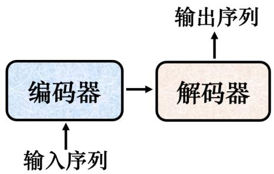

<details>
<summary>flowchart</summary>

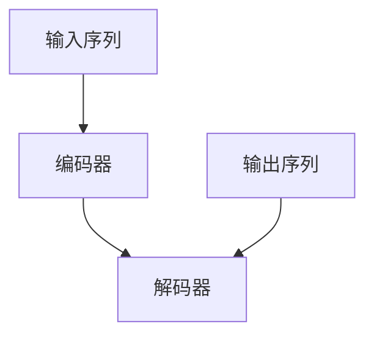
</details>

图 7.7 序列到序列模型结构

序列到序列模型的起源其实非常的早，在 14 年的 9 月就有一篇序列到序列模型用在翻译的论文：“Sequence to Sequence Learning with Neural Networks”[3]。序列到序列典型的模型就是 Transformer，其有一个编码器架构和一个解码器架构，如图 7.8 所示。

# 7.3 Transformer 编码器

接下来介绍下 Transformer 的编码器。如图7.9 所示，编码器输入一排向量，输出另外一排向量。自注意力、循环神经网络、卷积神经网络都能输入一排向量，输出一排向量。Transformer的编码器使用的是自注意力，输入一排向量，输出另外一个同样长度的向量。

如图 7.10 所示，编码器里面会分成很多的块（block），每一个块都是输入一排向量，输出一排向量。输入一排向量到第一个块，第一个块输出另外一排向量，以此类推，最后一个块会输出最终的向量序列。

Transformer 的编码器的每个块并不是神经网络的一层，每个块的结构如图 7.11 所示，在每个块里面，输入一排向量后做自注意力，考虑整个序列的信息，输出另外一排向量。接下来这排向量会“丢”到全连接网络网络里面，输出另外一排向量，这一排向量就是块的输出，事实上在原来的 Transformer 里面做的事情是更复杂的。

Transformer 里面加入了残差连接（residual connection）的设计，如图 7.12 所示，最左边的向量 b 输入到自注意力层后得到向量 a，输出向量 a 加上其输入向量 b 得到新的输出。得到残差的结果以后，再做层归一化（layer normalization）。层归一化比信念网络更简单，不需要考虑批量的信息，而批量归一化需要考虑批量的信息。层归一化输入一个向量，输出另外一个向量。层归一化会计算输入向量的平均值和标准差。

批量归一化是对不同样本不同特征的同一个维度去计算均值跟标准差，但层归一化是对同一个特征、同一个样本里面不同的维度去计算均值跟标准差，接着做个归一化。输入向量 x里面每一个维度减掉均值 m，再除以标准差 σ 以后得到 $\mathbf { x } ^ { \prime }$ 就是层归一化的输出，如式 (7.1)所示。得到层归一化的输出以后，该输出才是全连接网络的输入。输入到全连接网络，还有一个残差连接，把全连接网络的输入跟它的输出加起来得到新的输出。接着把残差的结果再做一次层归一化得到的输出才是 Transformer 编码器里面一个块的输出。

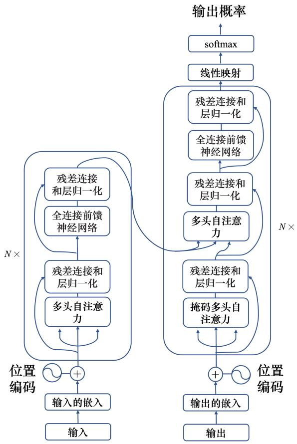

<details>
<summary>flowchart</summary>

```mermaid
graph TD
    A["输入"] --> B["输入的嵌入"]
    B --> C["位置编码"]
    C --> D["残差连接和层归一化"]
    D --> E["全连接前馈神经网络"]
    E --> F["残差连接和层归一化"]
    F --> G["多头自注意力"]
    G --> H["残差连接和层归一化"]
    H --> I["全连接前馈神经网络"]
    I --> J["残差连接和层归一化"]
    J --> K["多头自注意力"]
    K --> L["残差连接和层归一化"]
    L --> M["掩码多头自注意力"]
    M --> N["输出的嵌入"]
    N --> O["输出"]
    O --> P["位置编码"]
    P --> Q["位置编码"]
    Q --> R["N×"]
    R --> S["残差连接和层归一化"]
    S --> T["全连接前馈神经网络"]
    T --> U["残差连接和层归一化"]
    U --> V["多头自注意力"]
    V --> W["残差连接和层归一化"]
    W --> X["掩码多头自注意力"]
    X --> Y["输出的嵌入"]
    Y --> Z["输出"]
    Z --> AA["softmax"]
    AA --> AB["线性映射"]
    AB --> AC["残差连接和层归一化"]
    AC --> AD["全连接前馈神经网络"]
    AD --> AE["残差连接和层归一化"]
    AE --> AF["多头自注意力"]
    AF --> AG["残差连接和层归一化"]
    AG --> AH["掩码多头自注意力"]
    AH --> AI["输出的嵌入"]
    AI --> AJ["输出"]
```
</details>

图 7.8 Transformer 结构

$$
x _ {i} ^ {\prime} = \frac {x _ {i} - m}{\sigma} \tag {7.1}
$$

图 7.13 给出了 Transformer 的编码器结构，其中 N× 表示重复 N 次。首先，在输入的地方需要加上位置编码。如果只用自注意力，没有未知的信息，所以需要加上位置信息。多头自注意力就是自注意力的块。经过自注意力后，还要加上残差连接和层归一化。接下来还要经过全连接的前馈神经网络，接着再做一次残差连接和层归一化，这才是一个块的输出，这个块会重复 N 次。Transformer 的编码器其实不一定要这样设计，论文“On Layer Normalizationin the Transformer Architecture”提出了另一种设计，结果比原始的 Transformer 要好。原始的 Transformer 的架构并不是一个最优的设计，永远可以思考看看有没有更好的设计方式。

Q: 为什么 Transformer 中使用层归一化，而不使用批量归一化？

A: 论文“PowerNorm: Rethinking Batch Normalization in Transformers”解释了在Transformers 里面批量归一化不如层归一化的原因，并提出能量归一化（power nor-malization）。能量归一化跟层归一化性能差不多，甚至好一点。

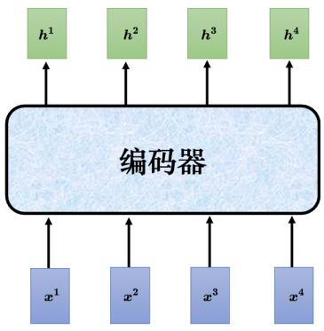

<details>
<summary>flowchart</summary>

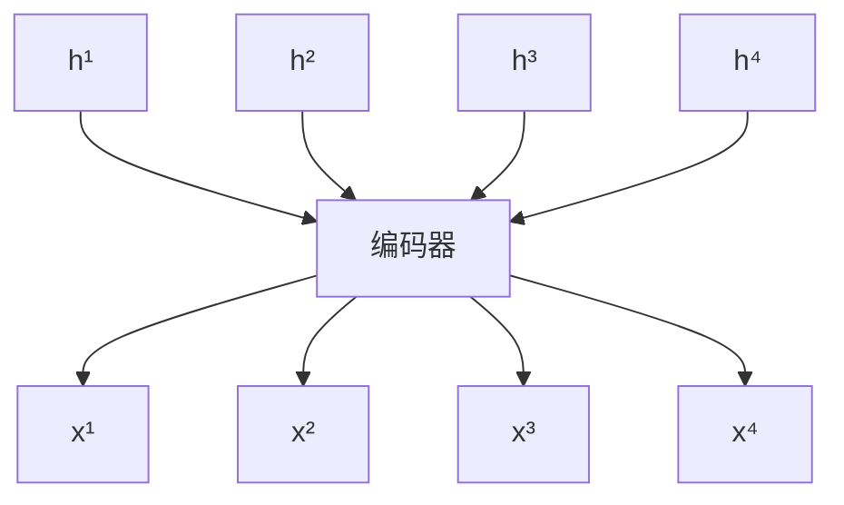
</details>

图 7.9 Transformer 编码器的功能

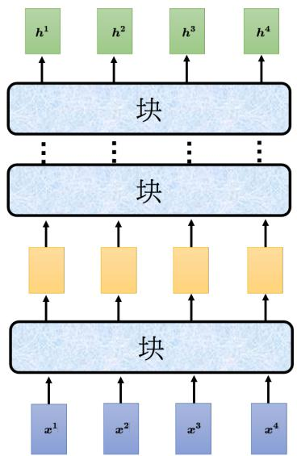

<details>
<summary>flowchart</summary>

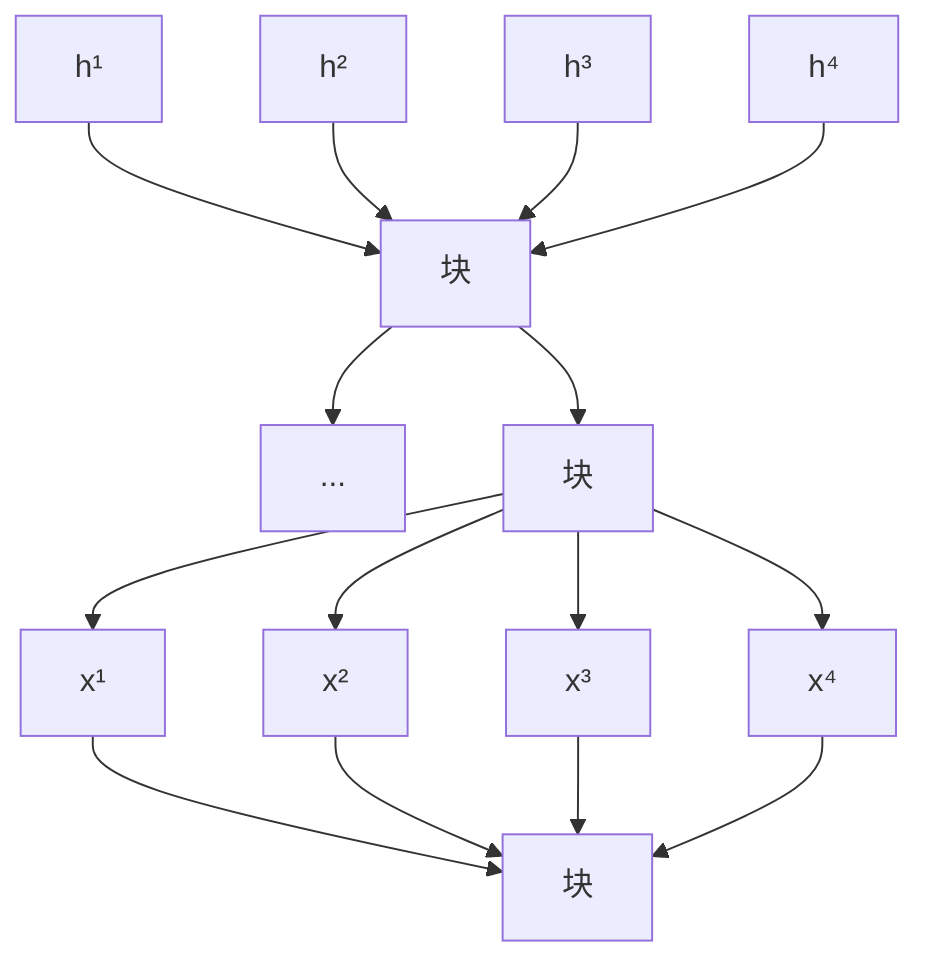
</details>

图 7.10 Transformer 编码器结构

# 7.4 Transformer 解码器

接下来介绍解码器，解码器比较常见的称为自回归的（autoregressive）解码器。

# 7.4.1 自回归解码器

以语音识别为例，输入一段声音，输出一串文字。如图 7.14 所示，把一段声音（“机器学习”）输入给编码器，输出会变成一排向量。接下来解码器产生语音识别的结果，解码器把编码器的输出先“读”进去。要让解码器产生输出，首先要先给它一个代表开始的特殊符号 <BOS>，即 Begin Of Sequence，这是一个特殊的词元（token）。在词表（vocabulary）里面，在本来解码器可能产生的文字里面多加一个特殊的符号 <BOS>。在机器学习里面，假设要处理自然语言处理的问题，每一个词元都可以用一个独热的向量来表示。独热向量其中一维是 1，其他都是 0，所以 ${ \mathrm { < B O S > } }$ 也是用独热向量来表示，其中一维是 1，其他是 0。接下来解码器会“吐”出一个向量，该向量的长度跟词表的大小是一样的。在产生这个向量之前，跟做分类一样，通常会先进行一个 softmax 操作。这个向量里面的分数是一个分布，该向量里面的值全部加起来，总和是 1。这个向量会给每一个中文字一个分，分数最高的中文字就是最终的输出。“机”的分数最高，所以“机”就当做是解码器的第一个输出。

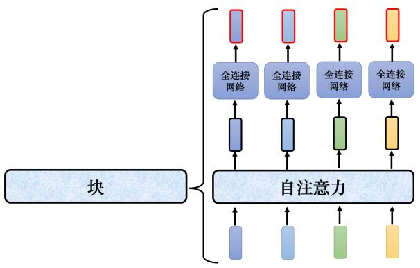

<details>
<summary>flowchart</summary>

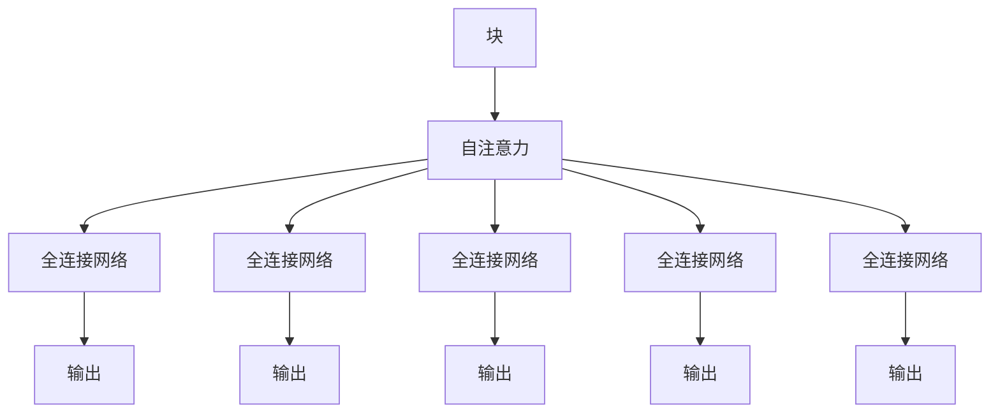
</details>

图 7.11 Transformer 编码器中每个块的结构

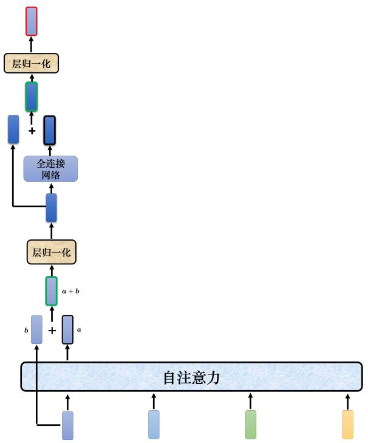

<details>
<summary>flowchart</summary>

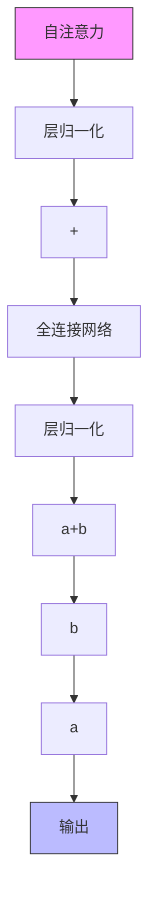
</details>

图 7.12 Transformer 中的残差连接

# Q: 解码器输出的单位是什么?

A: 假设做的是中文的语音识别，解码器输出的是中文。词表的大小可能就是中文的方块字的数量。常用的中文的方块字大概两三千个，一般人可能认得的四、五千个，更多都是罕见字。比如我们觉得解码器能够输出常见的 3000 个方块字就好了，就把它列在词表中。不同的语言，输出的单位不见不会不一样，这取决于对语言的理解。比如英语，选择输出英语的字母。但字母作为单位可能太小了，有人可能会选择输出英语的词汇，英语的词汇是用空白作为间隔的。但如果都用词汇当作输出又太多了，有一些方法可以把英语的字首、字根切出来，拿字首、字根当作单位。中文通常用中文的方块字来当作单位，这个向量的长度就跟机器可以输出的方块字的数量是一样多的。每一个中文的字都会对应到一个数值。

如图 7.15 所示，接下来把“机”当成解码器新的输入。根据两个输入：特殊符号 <BOS>和“机”，解码器输出一个蓝色的向量。蓝色的向量里面会给出每一个中文字的分数，假设“器”的分数最高，“器”就是输出。解码器接下来会拿“器”当作输入，其看到了 <BOS>、“机”、“器”，可能就输出“学”。解码器看到 <BOS>、“机”、“器”、“学”，它会输出一个向量。这个向量里面“习”的分数最高的，所以它就输出“习”。这个过程就反复地持续下去。

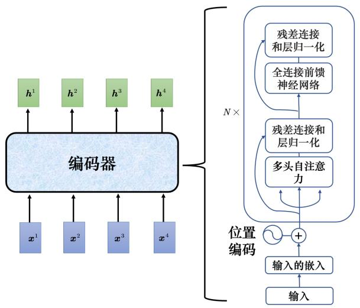

<details>
<summary>flowchart</summary>

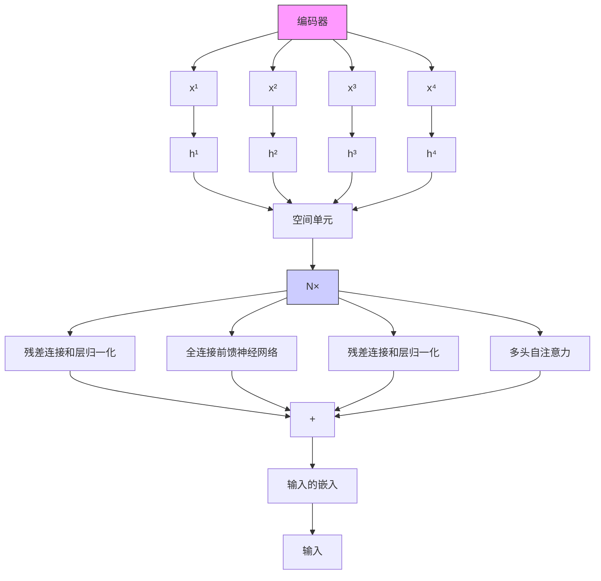
</details>

图 7.13 Transformer 编码器结构

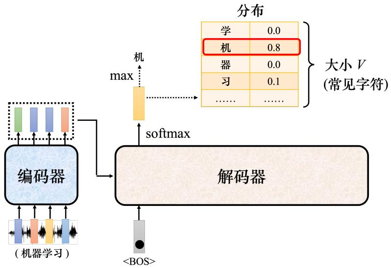

<details>
<summary>flowchart</summary>

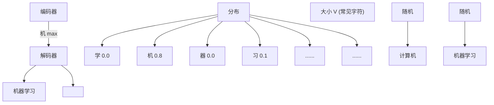
</details>

图 7.14 解码器的运作过程

解码器的输入是它在前一个时间点的输出，其会把自己的输出当做接下来的输入，因此当解码器在产生一个句子的时候，它有可能看到错误的东西。如图 7.16 所示，如果解码器有语音识别的错误，它把机器的“器”识别错成天气的“气”，接下来解码器会根据错误的识别结果产生它想要产生的期待是正确的输出，这会造成误差传播（error propagation）的问题，一步错导致步步错，接下来可能无法再产生正确的词汇。

Transformer 里面的解码器内部的结构如图 7.17 所示。类似于编码器，解码器也有多头注意力、残差连接和层归一化、前馈神经网络。解码器最后再做一个 softmax，使其输出变成一个概率。此外，解码器使用了掩蔽自注意力（masked self-attention），掩蔽自注意力可以通过一个掩码（mask）来阻止每个位置选择其后面的输入信息。

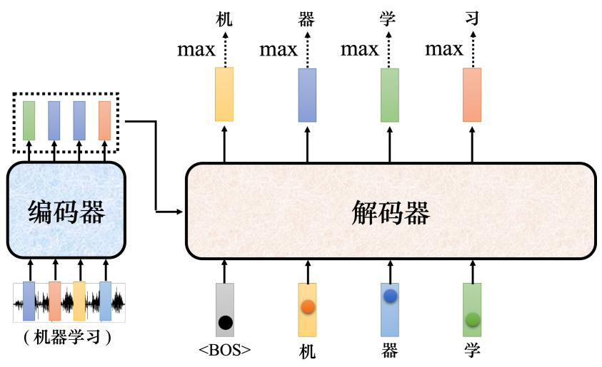

<details>
<summary>flowchart</summary>

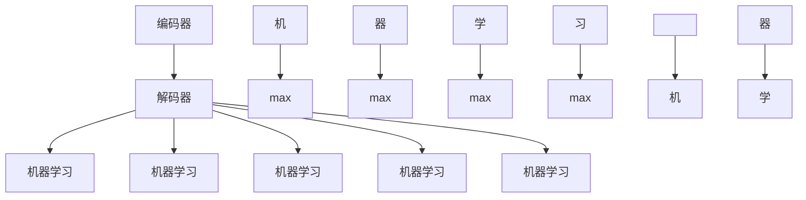
</details>

图 7.15 解码器示例

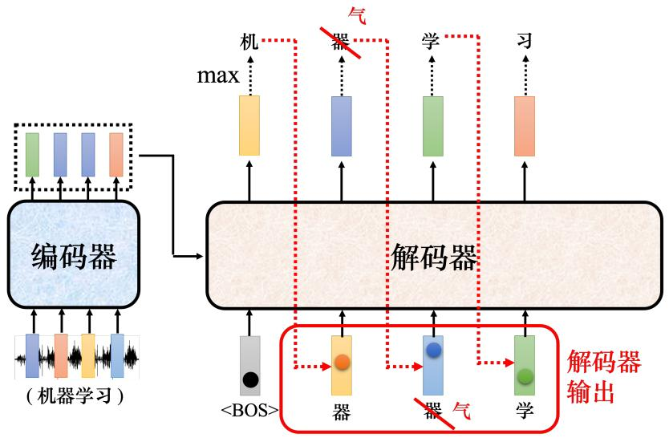

<details>
<summary>flowchart</summary>

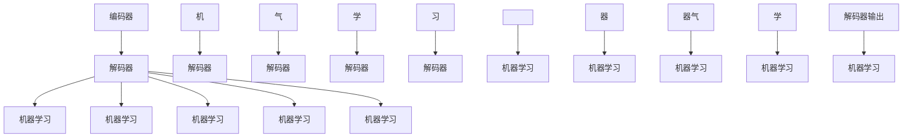
</details>

图 7.16 解码器中的误差传播

如图 7.18 所示，原来的自注意力输入一排向量，输出另外一排向量，这一排中每个向量都要看过完整的输入以后才做决定。根据 $\mathbf { a } ^ { 1 }$ 到 $\mathbf { \Delta } \mathbf { a } ^ { 4 }$ 所有的信息去输出 $\pmb { b } ^ { 1 }$ 。掩蔽自注意力的不同点是不能再看右边的部分，如图 7.19 所示，产生 ${ \pmb b } ^ { 1 }$ 的时候，只能考虑 $\mathbf { \delta } _  \mathbf { \alpha } \mathbf { \alpha } \mathbf { \alpha } \mathbf { \alpha } \mathbf { \alpha } \mathbf { \alpha } \mathbf { \alpha } \mathbf { \alpha } \mathbf { \alpha } \mathbf { \alpha } \mathbf { \alpha } \mathbf { \alpha } \mathbf { \alpha } \mathbf { \alpha } \mathbf { \alpha } \mathbf { \alpha } \mathbf { \alpha } \mathbf { \alpha } \mathbf { \alpha } \mathbf { \alpha } \mathbf { \alpha } \mathbf { \alpha } \mathbf { \alpha } \mathbf { \alpha } \mathbf { \alpha } \mathbf { \alpha } \mathbf { \alpha } \mathbf { \alpha } \mathbf { \alpha } \mathbf { \alpha } \mathbf { \alpha } \mathbf { \alpha } \mathbf { \alpha } \mathbf { \alpha } \mathbf { \alpha } \mathbf { \alpha } \mathbf { \alpha } \mathbf { \alpha } \mathbf { \alpha } \mathbf { \alpha \alpha } \mathbf { \alpha } \mathbf { \alpha \alpha } \mathbf { \alpha \alpha } \mathbf { \alpha \alpha } \mathbf { \alpha \alpha } \mathbf { \alpha \alpha } \mathbf { \alpha \alpha } \mathbf { \alpha \alpha } \mathbf { \alpha \alpha } \mathbf { \alpha \alpha } \mathbf { \alpha \alpha } \mathbf  \alpha \alpha \alpha \alpha \alpha \mathbf { \alpha } \alpha \alpha \alpha \mathbf \alpha \alpha \alpha \beta \alpha \alpha \beta \alpha \alpha \beta \alpha \alpha \beta \alpha \alpha \mathbf \alpha \alpha \alpha \beta \alpha \alpha \alpha \beta \alpha \alpha \beta \alpha \alpha \alpha \mathbf \alpha \alpha \alpha \alpha \alpha \beta \alpha \alpha \alpha \delta \alpha \delta \delta \delta \alpha \delta \delta \delta \alpha \delta \alpha \delta \alpha \delta \delta \delta \delta \alpha \delta \delta \delta \alpha \delta \delta \delta \alpha \delta \delta \delta \delta \delta \delta \delta \delta \delta \delta \delta \delta \delta \delta \delta \delta \delta \delta \delta \delta \delta \delta \delta \delta \delta \delta \delta \delta \delta \delta \delta \delta \delta \delta \delta \delta \delta \delta \delta \delta \delta \delta \delta \delta \delta \delta \delta \delta \delta \delta \delta \delta \delta \delta \delta \delta \delta \delta \delta \delta \delta \delta \delta \delta \delta \delta \delta \delta \delta \delta \delta \delta \delta \delta \delta \delta \delta \delta \delta \delta \delta \delta \delta \delta \delta \delta \delta \delta \delta \delta \delta \delta \delta \delta \delta \delta \delta \delta \delta \delta \delta \delta \delta \delta \delta \delta \delta \delta \delta \delta \delta \delta \delta \delta \delta \delta \delta $ 的信息，不能再考虑 $\mathbf { } \mathbf { \delta } \mathbf { a } ^ { 2 }$ 、 $\mathbf { \delta } _  \mathbf { { \alpha } } \mathbf { { \delta } } \mathbf { { \alpha } } \mathbf { { \delta } } \mathbf { { \alpha } } \mathbf { { \delta } } \mathbf { { \alpha } } \mathbf { { \delta } } \mathbf { { \alpha } } \mathbf { { \delta } } \mathbf { { \alpha } } \mathbf { { \delta } } \mathbf { { \alpha } } \mathbf { { \delta } } \mathbf { { \alpha } } \mathbf { { \delta } } \mathbf { { \alpha } } \mathbf { { \delta } } \mathbf { { \alpha } } \mathbf { { \delta } } \mathbf { { \alpha } } \mathbf { { \delta } } \mathbf { { \alpha } } \mathbf { { \delta \alpha } } \mathbf { { \delta } } \mathbf { { \alpha \delta } } \mathbf { { \alpha } } \mathbf { { \delta \alpha } } \mathbf { { \delta \alpha } } \mathbf { { \delta \alpha } } \mathbf { { \delta \alpha } } \mathbf { { \delta \alpha } } \mathbf { { \delta \alpha } } \mathbf { { \delta \alpha } } \mathbf { { \delta \alpha } } \mathbf { { \delta \alpha } } \mathbf { \delta } \mathbf { \alpha } \mathbf { \delta } \mathbf { \alpha } \mathbf { \delta } \mathbf { \delta } \mathbf { \alpha } \mathbf { \delta } \mathbf \mathbf { \delta } \mathbf { \delta \alpha } \mathbf \mathbf { \delta } \delta \mathbf \mathbf { \delta } \delta \mathbf \delta \delta \mathbf { } \delta \delta \delta \delta \mathbf \delta \delta \delta \mathbf \delta \delta \delta \delta \delta \delta \delta \delta \delta \delta \delta \delta \delta \delta \delta \delta \delta \delta \delta \delta \delta \delta \delta \delta \delta \delta \delta \delta \delta \delta \delta \delta \delta \delta \delta \delta \delta \delta \delta \delta \delta \delta \delta \delta \delta \delta \delta \delta \delta \delta \delta \delta \delta \delta \delta \delta \delta \delta \delta \delta \delta \delta \delta \delta \delta \delta \delta \delta \delta \delta \delta \delta \delta \delta \delta \delta \delta \delta \delta \delta \delta \delta \delta \delta \delta \delta \delta \delta \delta \delta \delta \delta \delta \delta \delta \delta \delta \delta \delta \delta \delta \delta \delta \delta \delta \delta \delta \delta \delta \delta \delta \delta \delta \delta \delta \delta \delta \delta \delta \delta \delta \delta \delta \delta \delta \delta \delta \delta \delta \delta \delta \delta \delta \delta \delta \delta \delta \delta \delta \delta$ 、 $ { \mathbf { { a } } } ^ { 4 }$ 。产生 $b ^ { 2 }$ 的时候，只能考虑 $\mathbf { \delta } _ { \mathbf { \alpha } \mathbf { \alpha } \mathbf { \alpha } \mathbf { \alpha } } \mathbf { \delta } _ { \mathbf { \alpha } \mathbf { \alpha } \mathbf { \alpha } \mathbf { \alpha } } \mathbf { \delta } _ { \mathbf { \alpha } \mathbf { \beta } \mathbf { \alpha } \mathbf { \alpha } \mathbf { \alpha } \mathbf { \beta } _ { \mathbf { \alpha \beta } \mathbf { \alpha } \mathbf { \alpha } } }$ 、 $\mathbf { { a } ^ { 2 } }$ 的信息，不能再考虑 $\mathbf { \delta } _ { \mathbf { { \alpha } } \mathbf { { \alpha } } \mathbf { { a } } ^ { 3 } }$ 、 $\mathbf { \delta } _ { \mathbf { { a } ^ { \alpha } } }$ 的信息。产生 ${ \pmb b } ^ { 3 }$ 的时候，不能考虑 $\mathbf { \Delta } \mathbf { a } ^ { 4 }$ 的信息。产生 $b ^ { 4 }$ 的时候，可以用整个输入序列的信息。

一般自注意力产生 ${ \pmb b } ^ { 2 }$ 的过程如图 7.20 所示。掩蔽自注意力的计算过程如图 7.21 所示，我们只拿 $q ^ { 2 }$ 和 $k ^ { 1 }$ 、 $k ^ { 2 }$ 计算注意力，最后只计算 $v ^ { 1 }$ 跟 $v ^ { 2 }$ 的加权和。不管 $\mathbf { \delta } _ { \mathbf { { a } ^ { 2 } } }$ 右边的地方，只考虑 $\mathbf { a } ^ { 1 }$ 、 $\mathbf { \delta } _  \mathbf { { \alpha } } \mathbf { { \delta } } \mathbf { { \alpha } } \mathbf { { \delta } } \mathbf { { \alpha } } \mathbf { { \delta } } \mathbf { { \alpha } } \mathbf { { \delta } } \mathbf { { \alpha } } \mathbf { { \delta } } \mathbf { { \alpha } } \mathbf { { \delta } } \mathbf { { \alpha } } \mathbf { { \delta } } \mathbf { { \alpha } } \mathbf { { \delta \alpha } } \mathbf { { \delta \alpha } } \mathbf { { \delta \alpha } } \mathbf { { \delta \alpha } } \mathbf { { \delta \alpha } } \mathbf { { \delta \alpha } } \mathbf { { \delta \alpha } } \mathbf { { \delta \alpha } } \mathbf { { \delta \alpha } } \mathbf { { \delta \alpha } } \mathbf { { \delta \alpha } } \mathbf { { \delta \alpha } } \mathbf { { \delta \alpha } } \mathbf { { \delta \alpha } } \mathbf { { \delta \alpha } } \mathbf { { \delta \alpha } } \mathbf { { \delta \alpha } } \mathbf { { \delta \alpha } } \mathbf { \delta } \mathbf { \alpha } \mathbf { \delta \alpha } \mathbf { \delta } \mathbf { \delta \alpha } \mathbf { \delta \alpha } \mathbf { \delta \alpha } \mathbf \mathbf { \delta \alpha } \delta \mathbf \delta \mathbf { \delta \alpha } \delta \delta \delta \mathbf \delta \delta \mathbf \delta \delta \delta \delta \delta \delta \delta \delta \delta \delta \delta \delta \delta \delta \delta \delta \delta \delta \delta \delta \delta \delta \delta \delta \delta \delta \delta \delta \delta \delta \delta \delta \delta \delta \delta \delta \delta \delta \delta \delta \delta \delta \delta \delta \delta \delta \delta \delta \delta \delta \delta \delta \delta \delta \delta \delta \delta \delta \delta \delta \delta \delta \delta \delta \delta \delta \delta \delta \delta \delta \delta \delta \delta \delta \delta \delta \delta \delta \delta \delta \delta \delta \delta \delta \delta \delta \delta \delta \delta \delta \delta \delta \delta \delta \delta \delta \delta \delta \delta \delta \delta \delta \delta \delta \delta \delta \delta \delta \delta \delta \delta \delta \delta \delta \delta \delta \delta \delta \delta \delta \delta \delta \delta \delta \delta \delta \delta \delta \delta \delta \delta \delta \delta \delta \delta \delta \delta \delta \delta \delta \delta \delta \delta \delta \delta \delta \delta \delta \delta \delta \delta \delta \delta \delta \delta \delta \delta \delta \delta \delta $ 、 $\pmb q ^ { 1 }$ 、 $q ^ { 2 }$ 、 $k ^ { 1 }$ 以及 $k ^ { 2 }$ 。输出 ${ \pmb b } ^ { 2 }$ 的时候，只考虑了 $\mathbf { \delta } _ { \mathbf { \alpha } \mathbf { \alpha } \mathbf { \alpha } \mathbf { \alpha } } \mathbf { \delta } _ { \mathbf { \alpha } \mathbf { \alpha } \mathbf { \alpha } \mathbf { \alpha } } \mathbf { \delta } _ { \mathbf { \alpha } \mathbf { \beta } \mathbf { \alpha } \mathbf { \alpha } \mathbf { \alpha } \mathbf { \beta } _ { \mathbf { \alpha \beta } \mathbf { \alpha } \mathbf { \alpha } } }$ 和 $\mathbf { { a } ^ { 2 } }$ ，没有考虑到 $\mathbf { \delta } _  \mathbf { { \alpha } } \mathbf { { \delta } } \mathbf { { \alpha } } \mathbf { { \delta } } \mathbf { { \alpha } } \mathbf { { \delta } } \mathbf { { \alpha } } \mathbf { { \delta } } \mathbf { { \alpha } } \mathbf { { \delta } } \mathbf { { \alpha } } \mathbf { { \delta } } \mathbf { { \alpha } } \mathbf { { \delta } } \mathbf { { \alpha } } \mathbf { { \delta } } \mathbf { { \alpha } } \mathbf { { \delta } } \mathbf { { \alpha } } \mathbf { { \delta } } \mathbf { { \alpha } } \mathbf { { \delta } } \mathbf { { \alpha } } \mathbf { { \delta \alpha } } \mathbf { { \delta } } \mathbf { { \alpha \delta } } \mathbf { { \alpha } } \mathbf { { \delta \alpha } } \mathbf { { \delta \alpha } } \mathbf { { \delta \alpha } } \mathbf { { \delta \alpha } } \mathbf { { \delta \alpha } } \mathbf { { \delta \alpha } } \mathbf { { \delta \alpha } } \mathbf { { \delta \alpha } } \mathbf { { \delta \alpha } } \mathbf { \delta } \mathbf { \alpha } \mathbf { \delta } \mathbf { \alpha } \mathbf { \delta } \mathbf { \delta } \mathbf { \alpha } \mathbf { \delta } \mathbf \mathbf { \delta } \mathbf { \delta \alpha } \mathbf \mathbf { \delta } \delta \mathbf \mathbf { \delta } \delta \mathbf \delta \delta \mathbf { } \delta \delta \delta \delta \mathbf \delta \delta \delta \mathbf \delta \delta \delta \delta \delta \delta \delta \delta \delta \delta \delta \delta \delta \delta \delta \delta \delta \delta \delta \delta \delta \delta \delta \delta \delta \delta \delta \delta \delta \delta \delta \delta \delta \delta \delta \delta \delta \delta \delta \delta \delta \delta \delta \delta \delta \delta \delta \delta \delta \delta \delta \delta \delta \delta \delta \delta \delta \delta \delta \delta \delta \delta \delta \delta \delta \delta \delta \delta \delta \delta \delta \delta \delta \delta \delta \delta \delta \delta \delta \delta \delta \delta \delta \delta \delta \delta \delta \delta \delta \delta \delta \delta \delta \delta \delta \delta \delta \delta \delta \delta \delta \delta \delta \delta \delta \delta \delta \delta \delta \delta \delta \delta \delta \delta \delta \delta \delta \delta \delta \delta \delta \delta \delta \delta \delta \delta \delta \delta \delta \delta \delta \delta \delta \delta \delta \delta \delta \delta \delta \delta$ 和 $ { \mathbf { { a } } } ^ { 4 }$ 。

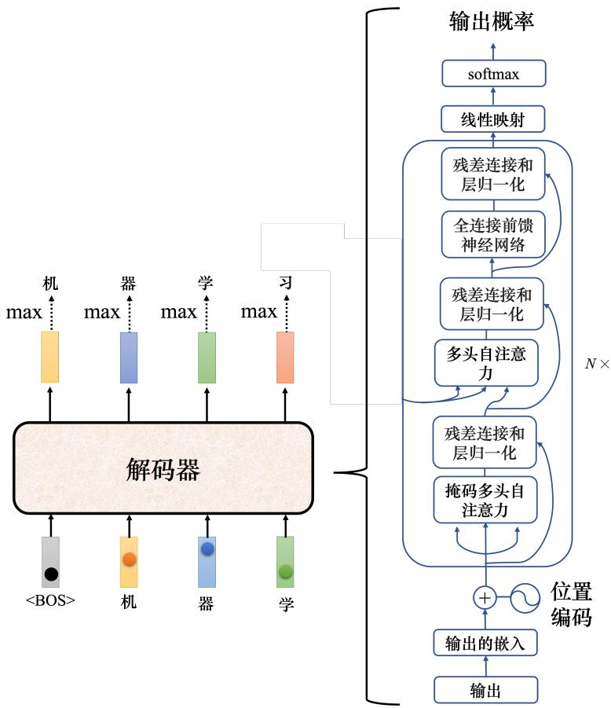

<details>
<summary>flowchart</summary>

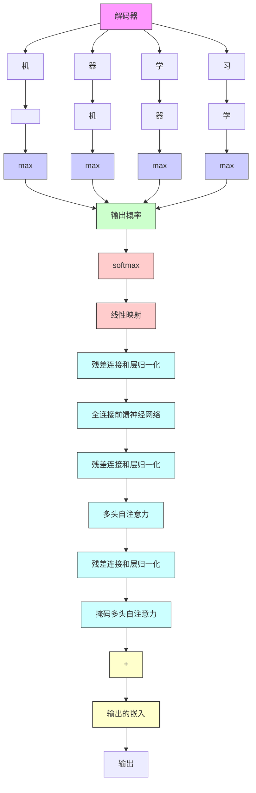
</details>

图 7.17 解码器内部结构

# Q: 为什么需要在注意力中加掩码?

$\mathrm { A } { : }$ 一开始解码器的输出是一个一个产生的，所以是先有 $\mathbf { a } ^ { 1 }$ 再有 $\mathbf { { a } ^ { 2 } }$ ，再有 $\mathbf { \Delta } \mathbf { a } ^ { 3 }$ ，再有$\mathbf { \Delta } \mathbf { a } ^ { 4 }$ 。这跟原来的自注意力不一样，原来的自注意力 $\mathbf { a } ^ { 1 }$ 跟 $ { \mathbf { { a } } } ^ { 4 }$ 是一次整个输进去模型里面的。编码器是一次把 $\mathbf { a } ^ { 1 }$ 跟 $ { \mathbf { { a } } } ^ { 4 }$ 都整个都读进去。但是对解码器而言，先有 $\mathbf { a } ^ { 1 }$ 才有$\mathbf { } \mathbf { \delta } \mathbf { a } ^ { 2 }$ ，才有 $\mathbf { \delta } _ { \mathbf { { \alpha } } \mathbf { { \alpha } } \mathbf { { a } } ^ { 3 } }$ 才有 $\mathbf { \Delta } \mathbf { a } ^ { 4 }$ 。所以实际上当我们有 $\mathbf { \delta } _  \mathbf { { \alpha } } \mathbf { { \delta } } \mathbf { { \alpha } } \mathbf { { \delta } } \mathbf { { \alpha } } \mathbf { { \delta } } \mathbf { { \alpha } } \mathbf { { \delta } } \mathbf { { \alpha } } \mathbf { { \delta } } \mathbf { { \alpha } } \mathbf { { \delta } } \mathbf { { \alpha } } \mathbf { { \delta } } \mathbf { { \alpha } } \mathbf { { \delta \alpha } } \mathbf { { \delta \alpha } } \mathbf { { \delta \alpha } } \mathbf { { \delta \alpha } } \mathbf { { \delta \alpha } } \mathbf { { \delta \alpha } } \mathbf { { \delta \alpha } } \mathbf { { \delta \alpha } } \mathbf { { \delta \alpha } } \mathbf { { \delta \alpha } } \mathbf { { \delta \alpha } } \mathbf { { \delta \alpha } } \mathbf { { \delta \alpha } } \mathbf { { \delta \alpha } } \mathbf { { \delta \alpha } } \mathbf { { \delta \alpha } } \mathbf { { \delta \alpha } } \mathbf { { \delta \alpha } } \mathbf { \delta } \mathbf { \alpha } \mathbf { \delta \alpha } \mathbf { \delta } \mathbf { \delta \alpha } \mathbf { \delta \alpha } \mathbf { \delta \alpha } \mathbf \mathbf { \delta \alpha } \delta \mathbf \delta \mathbf { \alpha } \delta \delta \delta \delta \mathbf \delta \mathbf  \alpha \delta \delta \delta \delta \delta \delta \delta \delta \delta \delta \delta \delta \delta \delta \delta \delta \delta \delta \delta \delta \delta \delta \delta \delta \delta \delta \delta \delta \delta \delta \delta \delta \delta \delta \delta \delta \delta \delta \delta \delta \delta \delta \delta \delta \delta \delta \delta \delta \delta \delta \delta \delta \delta \delta \delta \delta \delta \delta \delta \delta \delta \delta \delta \delta \delta \delta \delta \delta \delta \delta \delta \delta \delta \delta \delta \delta \delta \delta \delta \delta \delta \delta \delta \delta \delta \delta \delta \delta \delta \delta \delta \delta \delta \delta \delta \delta \delta \delta \delta \delta \delta \delta \delta \delta \delta \delta \delta \delta \delta \delta \delta \delta \delta \delta \delta \delta \delta \delta \delta \delta \delta \delta \delta \delta \delta \delta \delta \delta \delta \delta \delta \delta \delta \delta \delta \delta \delta \delta \delta \delta \delta \delta \delta \delta \delta \delta \delta \delta \delta \delta \delta \delta \delta \delta \delta \delta \delta \delta \delta $ ，要计算 $b ^ { 2 }$ 的时候，没有 $\mathbf { \delta } _ { \mathbf { { \alpha } } \mathbf { { \alpha } } \mathbf { { \alpha } } \mathbf { { a } } ^ { 3 } }$ 跟 $ { \mathbf { { a } } } ^ { 4 }$ 的，所以无法考虑 ${ \pmb a } ^ { 3 } \ { \pmb a } ^ { 4 }$ 。解码器的输出是一个一个产生的，所以只能考虑其左边的东西，没有办法考虑其右边的东西。

了解了解码器的运作方式，但这还有一个非常关键的问题：实际应用中输入跟输出长度的关系是非常复杂的，我们无法从输入序列的长度知道输出序列的长度，因此解码器必须决定输出的序列的长度。给定一个输入序列，机器可以自己学到输出序列的长度。但在目前的解码器运作的机制里面，机器不知道什么时候应该停下来，如图 7.22 所示，机器产生完“习”以后，还可以继续重复一模一样的过程，把“习”当做输入，解码器可能就会输出“惯”，接下来就一直持续下去，永远都不会停下来。

如图 7.23 所示，要让解码器停止运作，需要特别准备一个特别的符号 <EOS>。产生完“习”以后，再把“习”当作解码器的输入以后，解码器就要能够输出 <EOS>，解码器看到编码器输出的嵌入、<BOS>、“机”、“器”、“学”、“习”以后，其产生出来的向量里面 <EOS> 的概率必须是最大的，于是输出 <EOS>，整个解码器产生序列的过程就结束了。

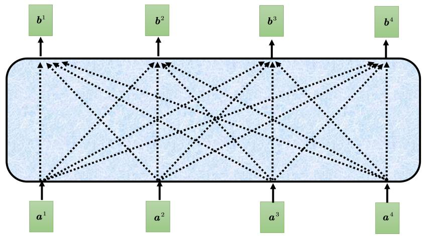

<details>
<summary>flowchart</summary>

```mermaid
graph TD
    a1["a¹"] --> h1["Hidden Layer"]
    a2["a²"] --> h1
    a3["a³"] --> h1
    a4["a⁴"] --> h1
    b1["b¹"] --> h1
    b2["b²"] --> h1
    b3["b³"] --> h1
    b4["b⁴"] --> h1
    h1 --> a1
    h1 --> a2
    h1 --> a3
    h1 --> a4
    h1 --> b1
    h1 --> b2
    h1 --> b3
    h1 --> b4
    h1 --> b5
    h1 --> b6
    h1 --> b7
    h1 --> b8
    h1 --> b9
    h1 --> b10
    h1 --> b11
    h1 --> b12
    h1 --> b13
    h1 --> b14
    h1 --> b15
    h1 --> b16
    h1 --> b17
    h1 --> b18
    h1 --> b19
    h1 --> b20
    h1 --> b21
    h1 --> b22
    h1 --> b23
    h1 --> b24
    h1 --> b25
    h1 --> b26
    h1 --> b27
    h1 --> b28
    h1 --> b29
    h1 --> b30
    h1 --> b31
    h1 --> b32
    h1 --> b33
    h1 --> b34
    h1 --> b35
    h1 --> b36
    h1 --> b37
    h1 --> b38
    h1 --> b39
    h1 --> b40
    h1 --> b41
    h1 --> b42
    h1 --> b43
    h1 --> b44
    h1 --> b45
    h1 --> b46
    h1 --> b47
    h1 --> b48
    h1 --> b49
    h1 --> b50
    h1 --> b51
    h1 --> b52
    h1 --> b53
    h1 --> b54
    h1 --> b55
    h1 --> b56
    h1 --> b57
    h1 --> b58
    h1 --> b59
    h1 --> b60
    h1 --> b61
    h1 --> b62
    h1 --> b63
    h1 --> b64
    h1 --> b65
    h1 --> b66
    h1 --> b67
    h1 --> b68
    h1 --> b69
    h1 --> b70
    h1 --> b71
    h1 --> b72
    h1 --> b73
    h1 --> b74
    h1 --> b75
    h1 --> b76
    h1 --> b77
    h1 --> b78
    h1 --> b79
    h1 --> b80
    h1 --> b81
    h1 --> b82
    h1 --> b83
    h1 --> b84
    h1 --> b85
    h1 --> b86
    h1 --> b87
    h1 --> b88
    h1 --> b89
    h1 --> b90
```
</details>

图 7.18 一般的自注意力示例

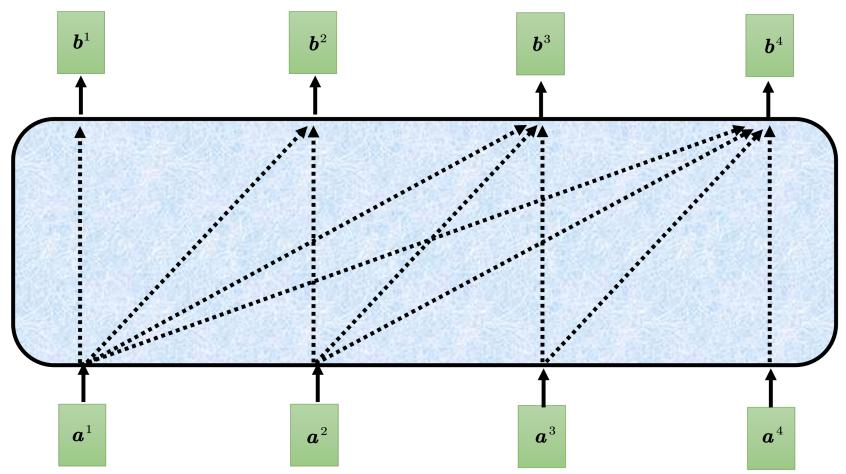

<details>
<summary>flowchart</summary>

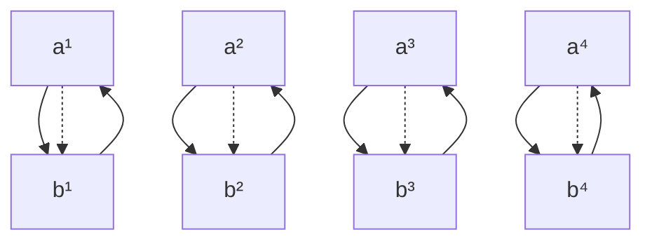
</details>

图 7.19 掩蔽自注意力示例

# 7.4.2 非自回归解码器

接下来讲下非自回归（non-autoregressive）的模型。如图 7.24 所示，自回归的模型是先输入 ${ \mathrm { < B O S > } }$ ，输出 ${ \pmb w } _ { 1 }$ ，再把 ${ \pmb w } _ { 1 }$ 当做输入，再输出 ${ \pmb w } _ { 2 }$ ，直到输出 ${ \mathrm { - E O S } } { \mathrm { > } }$ 为止。假设产生是中文的句子，非自回归不是一次产生一个字，它是一次把整个句子都产生出来。非自回归的解码器可能“吃”的是一整排的 ${ \mathrm { < B O S > } }$ 词元，一次产生产生一排词元。比如输入 4 个 ${ \mathrm { < B O S > } }$ 的词元到非自回归的解码器，它就产生 4 个中文的字。因为输出的长度是未知的，所以当做非自回归解码器输入的 ${ \mathrm { < B O S > } }$ 的数量也是未知的，因此有如下两个做法。

• 用分类器来解决这个问题。用分类器“吃”编码器的输入，输出是一个数字，该数字代表解码器应该要输出的长度。比如分类器输出 4，非自回归的解码器就会 $^ { \omega } \mathbb { I } _ { Z } ^ { \prime \prime } 4$ 个 ${ \mathrm { < B O S > } }$ 的词元，产生 4 个中文的字。  
• 给编码器一堆 ${ \mathrm { < B O S > } }$ 的词元。假设输出的句子的长度有上限，绝对不会超过 300 个字。给编码器 300 个 ${ \mathrm { < B O S > } }$ ，就会输出 300 个字，输出 ${ \mathrm { - E O S } } { \mathrm { > } }$ 右边的的输出就当它没有输出。

非自回归的解码器有很多优点。第一个优点是平行化。自回归的解码器输出句子的时候是一个一个字产生的，假设要输出长度一百个字的句子，就需要做一百次的解码。但是非自回归的解码器不管句子的长度如何，都是一个步骤就产生出完整的句子。所以非自回归的解码器会跑得比自回归的解码器要快。非自回归解码器的想法是在有 Transformer 以后，有这种自注意力的解码器以后才有的。以前如果用长短期记忆网络（Long Short-Term Memory Network，LSTM）或 RNN，给它一排 <BOS>，其无法同时产生全部的输出，其输出是一个一个产生的。

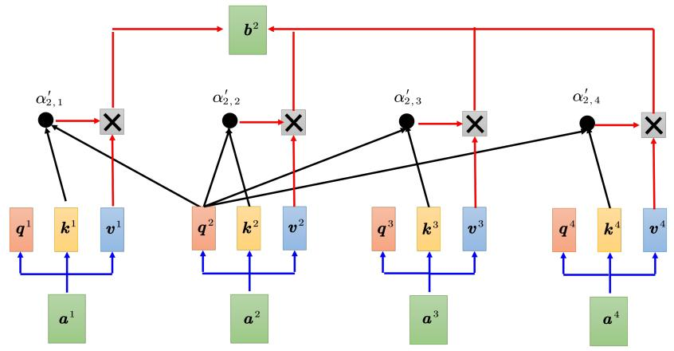

<details>
<summary>flowchart</summary>

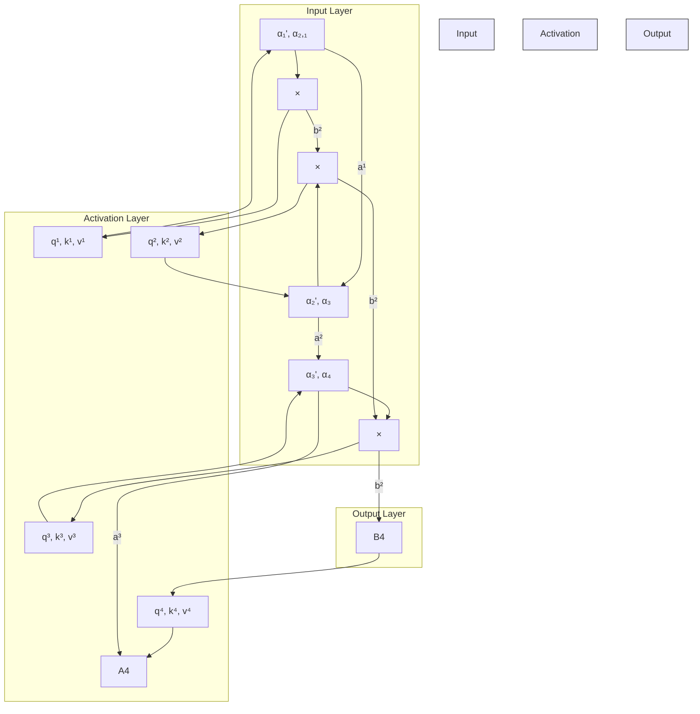
</details>

图 7.20 一般自注意力具体计算过程

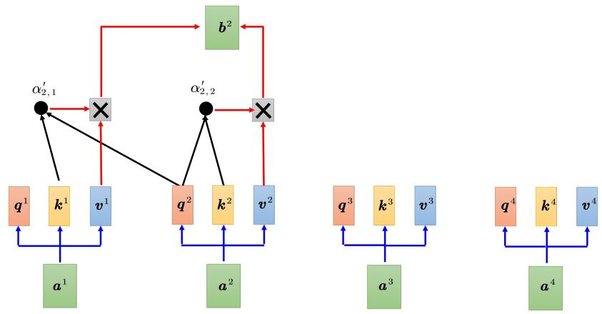

<details>
<summary>flowchart</summary>

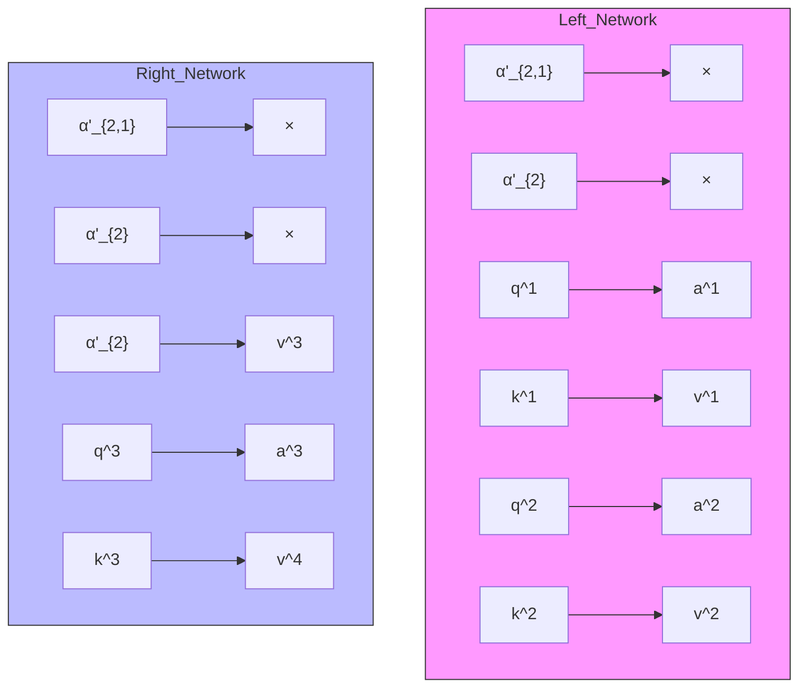
</details>

图 7.21 掩蔽自注意力具体计算过程

另外一个优点是非自回归的解码器比较能够控制它输出的长度。在语音合成里面，非自回归解码器算是非常常用的。非自回归的解码器可以控制输出的长度，可以用一个分类器决定非自回归的解码器应该输出的长度。在做语音合成的时候，如果想要让系统讲快一点，就把分类器的输出除以 2，系统讲话速度就变 2 倍快。如果想要讲话放慢速度，就把分类器输出的长度乘 2 倍，解码器说话的速度就变 2 倍慢。因此非自回归的解码器可以控制解码器输出的长度，做出种种的变化。

平行化是非自回归解码器最大的优势，但非自回归的解码器的性能（performance）往往都不如自回归的解码器。所以很多研究试图让非自回归的解码器的性能越来越好，去逼近自回归的解码器。要让非自回归的解码器跟自回归的解码器性能一样好，必须要使用非常多的技巧。

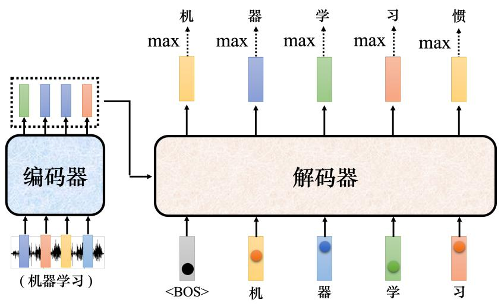

<details>
<summary>flowchart</summary>

```mermaid
graph TD
    A["编码器"] --> B["解码器"]
    B --> C["机器学习"]
    B --> D["机器学习"]
    B --> E["机器学习"]
    B --> F["机器学习"]
    B --> G["机器学习"]
    B --> H["机器学习"]
    B --> I["机器学习"]
    B --> J["机器学习"]
    B --> K["机器学习"]
    B --> L["机器学习"]
    B --> M["机器学习"]
    B --> N["机器学习"]
    B --> O["机器学习"]
    B --> P["机器学习"]
    B --> Q["机器学习"]
    B --> R["机器学习"]
    B --> S["机器学习"]
    B --> T["机器学习"]
    B --> U["机器学习"]
    B --> V["机器学习"]
    B --> W["机器学习"]
    B --> X["机器学习"]
    B --> Y["机器学习"]
    B --> Z["机器学习"]
    B --> AA["机器学习"]
    B --> AB["机器学习"]
    B --> AC["机器学习"]
    B --> AD["机器学习"]
    B --> AE["机器学习"]
    B --> AF["机器学习"]
    B --> AG["机器学习"]
    B --> AH["机器学习"]
    B --> AI["机器学习"]
    B --> AJ["机器学习"]
    B --> AK["机器学习"]
    B --> AL["机器学习"]
    B --> AM["机器学习"]
    B --> AN["机器学习"]
    B --> AO["机器学习"]
    B --> AP["机器学习"]
    B --> AQ["机器学习"]
    B --> AR["机器学习"]
    B --> AS["机器学习"]
    B --> AT["机器学习"]
    B --> AU["机器学习"]
    B --> AV["机器学习"]
    B --> AW["机器学习"]
    B --> AX["机器学习"]
    B --> AY["机器学习"]
    B --> AZ["机器学习"]
    B --> BA["机器学习"]
    B --> BB["机器学习"]
    B --> BC["机器学习"]
    B --> BD["机器学习"]
    B --> BE["机器学习"]
    B --> BF["机器学习"]
    B --> BG["机器学习"]
    B --> BH["机器学习"]
    B --> BI["机器学习"]
    B --> BJ["机器学习"]
    B --> BK["机器学习"]
    B --> BL["机器学习"]
    B --> BM["机器学习"]
    B --> BN["机器学习"]
    B --> BO["机器学习"]
    B --> BP["机器学习"]
    B --> BQ["机器学习"]
    B --> BR["机器学习"]
    B --> BS["机器学习"]
    B --> BT["机器学习"]
    B --> BU["机器学习"]
    B --> BV["机器学习"]
    B --> BW["机器学习"]
    B --> BX["机器学习"]
    B --> BY["机器学习"]
    B --> BZ["机器学习"]
    B --> CA["机器学习"]
    B --> CB["机器学习"]
    B --> CC["机器学习"]
    B --> CD["机器学习"]
    B --> CE["机器学习"]
    B --> CF["机器学习"]
    B --> CG["机器学习"]
    B --> CH["机器学习"]
    B --> CI["机器学习"]
    B --> CJ["机器学习"]
    B --> CK["机器学习"]
    B --> CR["机器学习"]
    B --> CS["机器学习"]
    B --> CT["机器学习"]
    B --> CU["机器学习"]
    B --> CV["机器学习"]
    B --> CW["机器学习"]
    B --> CX["机器学习"]
    B --> CY["机器学习"]
    B --> CZ["机器学习"]
    B --> DA["机器学习"]
    B --> DB["机器学习"]
    B --> DC["机器学习"]
    B --> DD["机器学习"]
    B --> DE["机器学习"]
    B --> DF["机器学习"]
    B --> DG["机器学习"]
    B --> DH["机器学习"]
    B --> DI["机器学习"]
    B --> DJ["机器学习"]
    B --> DK["机器学习"]
```
</details>

图 7.22 解码器运作的问题

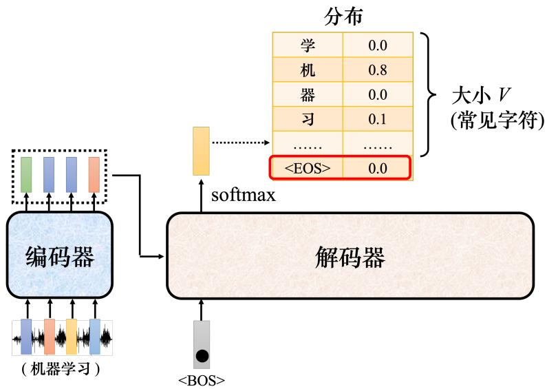

<details>
<summary>flowchart</summary>

```mermaid
graph TD
    A["编码器"] --> B["微分符"]
    B --> C["解码器"]
    C --> D["分布表"]
    D --> E["学: 0.0"]
    D --> F["机: 0.8"]
    D --> G["器: 0.0"]
    D --> H["习: 0.1"]
    D --> I["......"]
    D --> J["<EOS> 0.0"]
    C --> K["softmax"]
    K --> L["编码器"]
    L --> M["微分符"]
    M --> N["解码器"]
    N --> O["<EOS>"]
    style D fill:#f9f,stroke:#333
    style O fill:#ccf,stroke:#333
```
</details>

图 7.23 添加 <EOS> 词元

# 7.5 编码器-解码器注意力

编码器和解码器通过编码器-解码器注意力（encoder-decoder attention）传递信息，编码器-解码器注意力是连接编码器跟解码器之间的桥梁。如图 7.25 所示，解码器中编码器-解码器注意力的键和值来自编码器的输出，查询来自解码器中前一个层的输出。

接下来介绍下编码器-解码器注意力实际的运作过程。如图 7.26 所示，编码器输入一排向量，输出一排向量 $a ^ { 1 } , \ a ^ { 2 } , \ a ^ { 3 }$ 。接下来解码器会先“吃 ${ } ^ { \ ' } { < } \mathrm { B O S } { > }$ ，经过掩蔽自注意力得到一个向量。接下来把这个向量乘上一个矩阵，做一个变换（transform），得到一个查询 q， $\mathbf { a } ^ { 1 }$ 、 $\mathbf { { a } ^ { 2 } }$ 、$\mathbf { \delta } _ { \mathbf { { \alpha } } \mathbf { { \alpha } } \mathbf { { a } } ^ { 3 } }$ 也都产生键： $k ^ { 1 }$ 、 $k ^ { 2 }$ 、 $k ^ { 3 }$ 。把 q 跟 $k ^ { 1 }$ 、 $k ^ { 2 }$ 、 $k ^ { 3 }$ 去计算注意力的分数，得到 $\pmb { \alpha } _ { 1 }$ 、 $\alpha _ { 2 }$ 、 $\alpha _ { 3 }$ ，接下来做 softmax，得到 ${ \pmb { \alpha } } _ { 1 } ^ { \prime }$ 、 ${ \pmb { \alpha } } _ { 2 } ^ { \prime }$ 、 ${ \pmb { \alpha } } _ { 3 } ^ { \prime }$ 。接下来通过式 (7.2) 可得加权和 $v ,$ 。

$$
\boldsymbol {v} = \boldsymbol {\alpha} _ {1} ^ {\prime} \times \boldsymbol {v} ^ {1} + \boldsymbol {\alpha} _ {2} ^ {\prime} \times \boldsymbol {v} ^ {2} + \boldsymbol {\alpha} _ {3} ^ {\prime} \times \boldsymbol {v} ^ {3} \tag {7.2}
$$

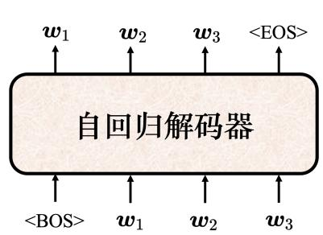

<details>
<summary>flowchart</summary>

```mermaid
graph TD
    A["自回归解码器"] --> B["w1"]
    A --> C["w2"]
    A --> D["w3"]
    A --> E["<EOS>"]
    A --> F["<BOS>"]
    A --> G["w1"]
    A --> H["w2"]
    A --> I["w3"]
```
</details>

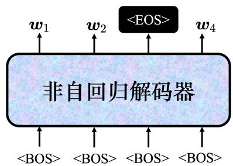

<details>
<summary>flowchart</summary>

```mermaid
graph TD
    A["非自回归解码器"] --> B["w1"]
    A --> C["w2"]
    A --> D["w4"]
    B --> E["<EOS>"]
    C --> F["<EOS>"]
    D --> G["<EOS>"]
    E --> H["<BOS>"]
    F --> I["<BOS>"]
    G --> J["<BOS>"]
```
</details>

图 7.24 自回归解码器与非自回归解码器对比  
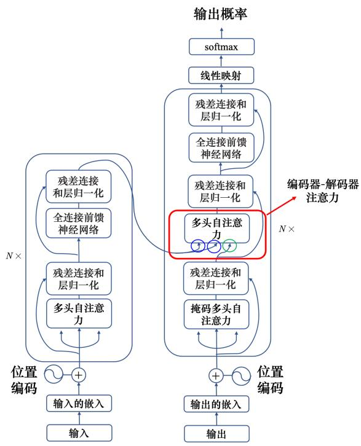

<details>
<summary>flowchart</summary>

```mermaid
graph TD
    A["输入嵌入"] --> B["残差连接和层归一化"]
    B --> C["全连接前馈神经网络"]
    C --> D["残差连接和层归一化"]
    D --> E["多头自注意力"]
    E --> F["输入嵌入"]
    G["编码器-解码器注意力"] --> H["编码器-解码器注意力"]
    H --> I["输出嵌入"]
    J["位置编码"] --> K["输入嵌入"]
    L["坐标系 N×"] --> M["线性映射"]
    M --> N["残差连接和层归一化"]
    N --> O["全连接前馈神经网络"]
    O --> P["残差连接和层归一化"]
    P --> Q["多头自注意力"]
    Q --> R["掩码多头自注意力"]
    R --> S["输出嵌入"]
    T["softmax"] --> U["输出概率"]
    V["输入嵌入"] --> W["输入嵌入"]
    X["编码器-解码器注意力"] --> Y["编码器-解码器注意力"]
```
</details>

图 7.25 编码器-解码器注意力

v 接下来会“丢”给全连接网络，这个步骤 q 来自于解码器，k 跟 v 来自于编码器，该步骤就叫做编码器-解码器注意力，所以解码器就是凭借着产生一个 $\pmb q$ ，去编码器这边抽取信息出来，当做接下来的解码器的全连接网络的输入。

如图 7.27 所示，假设产生“机”，输入 <BOS> 、“机”，产生一个向量。这个向量一样乘上一个线性变换得到一个查询 $\pmb q ^ { \prime }$ 。 $\pmb q ^ { \prime }$ 会跟 $k ^ { 1 }$ 、 $k ^ { 2 }$ 、 $k ^ { 3 }$ 计算注意力的分数。接着用注意力分数跟 $v ^ { 1 }$ 、 $v ^ { 2 }$ 、 $v ^ { 3 }$ 做加权和，加起来得到 $\mathbf { \nabla } \mathbf { \boldsymbol { v } } ^ { \prime }$ ，最后交给全连接网络处理。

编码器和解码器都有很多层，但在原始论文中解码器是拿编码器最后一层的输出。但不 一定要这样，读者可参考论文“Rethinking and Improving Natural Language Generation with Layer-Wise Multi-View Decoding”[4]。

# 7.6 Transformer 的训练过程

如图 7.28 所示，Transformer 应该要学到听到“机器学习”的声音信号，它的输出就是“机器学习”这四个中文字。把 <BOS> 丢给编码器的时候，其第一个输出应该要跟“机”越接近越好。而解码器的输出是一个概率的分布，这个概率分布跟“机”的独热向量越接近越好。因此我们会去计算标准答案（Ground Truth）跟分布之间的交叉熵，希望该交叉熵的值越小越好。每一次解码器在产生一个中文字的时候做了一次类似分类的问题。假设中文字有四千个，就是做有四千个类别的分类的问题。

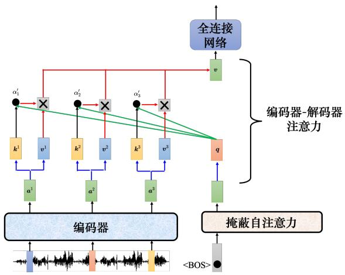

<details>
<summary>flowchart</summary>

```mermaid
graph TD
    A["全连接网络"] --> B["v"]
    B --> C["编码器"]
    C --> D["掩蔽自注意力"]
    D --> E["<BOS>"]
    F["编码器-解码器注意力"] --> G["α₁', α₂', α₃'"] --> H["k¹, v¹, k², v², k³, v³, a¹, a², a³"]
    F --> I["×"] --> J["×"]
    F --> K["×"] --> L["×"]
    F --> M["×"] --> N["q"]
    F --> O["×"] --> P["×"]
    F --> Q["×"] --> R["×"]
    F --> S["×"] --> T["×"]
    F --> U["×"] --> V["×"]
    F --> W["×"] --> X["×"]
    F --> Y["×"] --> Z["×"]
    F --> AA["×"] --> AB["×"]
    F --> AC["×"] --> AD["×"]
    F --> AE["×"] --> AF["×"]
    F --> AG["×"] --> AH["×"]
    F --> AI["×"] --> AJ["×"]
    F --> AK["×"] --> AL["×"]
    F --> AM["×"] --> AN["×"]
    F --> AO["×"] --> AP["×"]
    F --> AQ["×"] --> AR["×"]
    F --> AS["×"] --> AT["×"]
    F --> AU["×"] --> AV["×"]
    F --> AW["×"] --> AX["×"]
    F --> AY["×"] --> AZ["×"]
    F --> BA["×"] --> BB["×"]
    F --> BC["×"] --> BD["×"]
    F --> BE["×"] --> BF["×"]
    F --> BG["×"] --> BH["×"]
    F --> BI["×"] --> BJ["×"]
    F --> BK["×"] --> BL["×"]
    F --> BM["×"] --> BN["×"]
    F --> BO["×"] --> BP["×"]
    F --> BQ["×"] --> BR["×"]
    F --> BS["×"] --> BT["×"]
    F --> BU["×"] --> BV["×"]
    F --> BW["×"] --> BX["×"]
    F --> BY["×"] --> BZ["×"]
    F --> CA["×"] --> CB["×"]
    F --> CC["×"] --> CD["×"]
    F --> CE["×"] --> CF["×"]
    F --> CG["×"] --> CH["×"]
    F --> CI["×"] --> CJ["×"]
    F --> CK["×"] --> CL["×"]
    F --> CM["×"] --> CN["×"]
    F --> CO["×"] --> CP["×"]
    F --> CQ["×"] --> CR["×"]
    F --> CS["×"] --> CT["×"]
    F --> CU["×"] --> CV["×"]
    F --> CW["×"] --> CX["×"]
    F --> CY["×"] --> CZ["×"]
    F --> DA["×"] --> DB["×"]
    F --> DC["×"] --> DV["×"]
    F --> DW["×"] --> DX["×"]
    F --> DY["×"] --> DX
    F --> DYb["×"] --> DX
```
</details>

图 7.26 编码器-解码器注意力运作过程

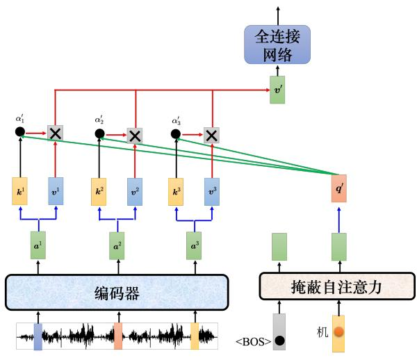

<details>
<summary>flowchart</summary>

```mermaid
graph TD
    A["编码器"] --> B["α₁'"]
    A --> C["α₂'"]
    A --> D["α₃'"]
    A --> E["α₄'"]
    B --> F["k¹"]
    C --> G["v¹"]
    D --> H["v²"]
    E --> I["v³"]
    F --> J["a¹"]
    G --> K["a²"]
    H --> L["a³"]
    I --> M["a⁴"]
    N["全连接网络"] --> O["v'"]
    O --> P["q'"]
    P --> Q["掩蔽自注意力"]
    Q --> R["机"]
    R --> S["<BOS>●"]
    style A fill:#f9f,stroke:#333
    style P fill:#ccf,stroke:#333
```
</details>

图 7.27 编码器-解码器注意力运作过程示例

如图 7.29 所示，实际训练的时候，输出应该是“机器学习”。解码器第一次的输出、第二次的输出、第三次的输出、第四次输出应该分别就是“机”、“器”、“学”、“习”这四个中文字的独热向量，输出跟这四个字的独热向量越接近越好。在训练的时候，每一个输出跟其对应的正确答案都有一个交叉熵。图 7.29 中做了四次分类问题，希望这些分类的问题交叉熵总和越小越好。训练的时候，解码器输出的不是只有“机器学习”这四个中文字，还要输出 <EOS>。所以解码器的最终第五个位置输出的向量跟 <EOS> 的独热向量的交叉熵越小越好。我们把标准答案给解码器，希望解码器的输出跟正确答案越接近越好。在训练的时候，告诉解码器在已经有<BOS>、“机”的情况下，要输出“器”，有 <BOS> 、“机”、“器”的情况下输出“学”，有 <BOS>、“机”、“器”、“学”的情况下输出“习”，有 <BOS> 、“机”、“器”、“学”、“习”的情况下，输出 <EOS>。在解码器训练的时候，在输入的时候给它正确的答案，这称为教师强制（teacher forcing）。

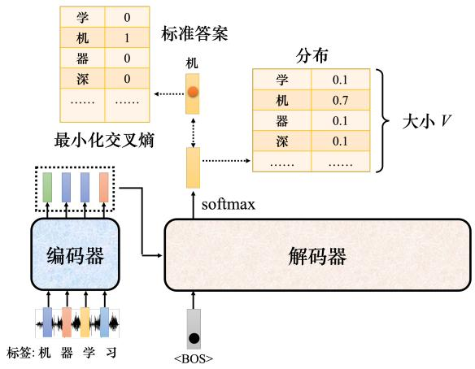

<details>
<summary>flowchart</summary>

```mermaid
graph TD
    A["学 0"] --> B["机 1"]
    B --> C["器 0"]
    C --> D["深 0"]
    D --> E["......"]
    F["机"] --> G["最小化交叉熵"]
    G --> H["编码器"]
    H --> I["标签: 机器学习"]
    J["分布"] --> K["学 0.1"]
    J --> L["机 0.7"]
    J --> M["器 0.1"]
    J --> N["深 0.1"]
    J --> O["......"]
    P["softmax"] --> Q["解码器"]
    Q --> R["<BOS>"]
    style A fill:#f9f,stroke:#333
    style F fill:#f9f,stroke:#333
    style J fill:#ccf,stroke:#333
    style P fill:#cfc,stroke:#333
```
</details>

图 7.28 Transformer 的训练过程

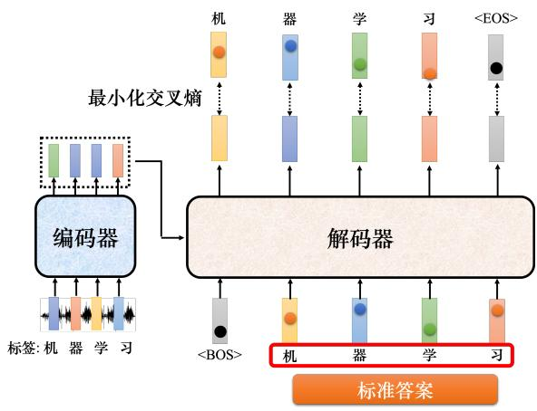

<details>
<summary>flowchart</summary>

```mermaid
graph TD
    A["编码器"] --> B["最小化交叉熵"]
    B --> C["解码器"]
    C --> D["机器学习"]
    C --> E["机器学习"]
    C --> F["机器学习"]
    C --> G["机器学习"]
    C --> H["机器学习"]
    C --> I["机器学习"]
    C --> J["机器学习"]
    C --> K["机器学习"]
    C --> L["机器学习"]
    C --> M["机器学习"]
    C --> N["机器学习"]
    C --> O["机器学习"]
    C --> P["机器学习"]
    C --> Q["机器学习"]
    C --> R["机器学习"]
    C --> S["机器学习"]
    C --> T["机器学习"]
    C --> U["机器学习"]
    C --> V["机器学习"]
    C --> W["机器学习"]
    C --> X["机器学习"]
    C --> Y["机器学习"]
    C --> Z["机器学习"]
    C --> AA["机器学习"]
    C --> AB["机器学习"]
    C --> AC["机器学习"]
    C --> AD["机器学习"]
    C --> AE["机器学习"]
    C --> AF["机器学习"]
    C --> AG["机器学习"]
    C --> AH["机器学习"]
    C --> AI["机器学习"]
    C --> AJ["机器学习"]
    C --> AK["机器学习"]
    C --> AL["机器学习"]
    C --> AM["机器学习"]
    C --> AN["机器学习"]
    C --> AO["机器学习"]
    C --> AP["机器学习"]
    C --> AQ["机器学习"]
    C --> AR["机器学习"]
    C --> AS["机器学习"]
    C --> AT["机器学习"]
    C --> AU["机器学习"]
    C --> AV["机器学习"]
    C --> AW["机器学习"]
    C --> AX["机器学习"]
    C --> AY["机器学习"]
    C --> AZ["机器学习"]
    C --> BA["机器学习"]
    C --> BB["机器学习"]
    C --> BC["机器学习"]
    C --> BD["机器学习"]
    C --> BE["机器学习"]
    C --> BF["机器学习"]
    C --> BG["机器学习"]
    C --> BH["机器学习"]
    C --> BI["机器学习"]
    C --> BJ["机器学习"]
    C --> BK["机器学习"]
    C --> BL["机器学习"]
    C --> BM["机器学习"]
    C --> BN["机器学习"]
    C --> BO["机器学习"]
    C --> BP["机器学习"]
    C --> BQ["机器学习"]
    C --> BR["机器学习"]
    C --> BS["机器学习"]
    C --> BT["机器学习"]
    C --> BU["机器学习"]
    C --> BV["机器学习"]
    C --> BW["机器学习"]
    C --> BX["机器学习"]
    C --> BY["机器学习"]
    C --> BZ["机器学习"]
    C --> CA["机器学习"]
    C --> CB["机器学习"]
    C --> CC["机器学习"]
    C --> CD["机器学习"]
    C --> CE["机器学习"]
    C --> CF["机器学习"]
    C --> CG["机器学习"]
    C --> CH["机器学习"]
    C --> CI["机器学习"]
    C --> CJ["机器学习"]
    C --> CK["机器学习"]
    C --> CR["机器学习"]
    C --> CS["机器学习"]
    C --> CT["机器学习"]
    C --> CU["机器学习"]
    C --> CV["机器学习"]
    C --> CW["机器学习"]
    C --> CX["机器学习"]
    C --> CY["机器学习"]
    C --> CZ["机器学习"]
    C --> DA["机器学习"]
    C --> DB["机器学习"]
    C --> DC["机器学习"]
    C --> DD["机器学习"]
    C --> DE["机器学习"]
    C --> DF["机器学习"]
    C --> DG["机器学习"]
    C --> DH["机器学习"]
    C --> DI["机器学习"]
    C --> DJ["机器学习"]
    C --> DK["机器学习"]
    C --> DL["机器学习"]
    C --> DV["机器学习"]
    C --> DW["机器学习"]
    C --> DX["机器学习"]
    C --> DY["机器学习"]
    C --> DYD["机器学习"]
    C --> DYR["机器学习"]
    C --> DYK["机器学习"]
    C --> DYL["机器学习"]
    C --> DYM["机器学习"]
    C --> DYN["机器学习"]
    C --> DYO["机器学习"]
    C --> DYP["机器学习"]
    C --> DYQ["机器学习"]
    C --> DYR
```
</details>

图 7.29 教师强制

# 7.7 序列到序列模型训练常用技巧

接下来介绍下训练序列到序列模型的一些技巧。

# 7.7.1 复制机制

第一个技巧是复制机制（copy mechanism）。对很多任务而言，解码器没有必要自己创造输出，其可以从输入的东西里面复制一些东西。以聊天机器人为例，用户对机器说：“你好，我是库洛洛”。机器应该回答：“库洛洛你好，很高兴认识你”。机器其实没有必要创造“库洛洛”这个词汇，“库洛洛”对机器来说一定会是一个非常怪异的词汇，所以它可能很难在训练数据里面出现，可能一次也没有出现过，所以它不太可能正确地产生输出。但是假设机器在学的时候，学到的并不是它要产生“库洛洛”，它学到的是看到输入的时候说“我是某某某”，就直接把“某某某”复制出来，说“某某某你好”。这种机器的训练会比较容易，显然比较有可能得到正确的结果，所以复制对于对话任务可能是一个需要的技术。机器只要复述这一段它听不懂的话，它不需要从头去创造这一段文字，它要学的是从用户的输入去复制一些词汇当做输出。

在做摘要的时候，我们可能更需要复制的技巧。做摘要需要搜集大量的文章，每一篇文章都有人写的摘要，训练一个序列到序列的模型就结束了。要训练机器产生合理的句子，通常需要百万篇文章，这些文章都要有人标的摘要。在做摘要的时候，很多的词汇就是直接从原来的文章里面复制出来的，所以对摘要任务而言，从文章里面直接复制一些信息出来是一个很关键的能力，最早有从输入复制东西的能力的模型叫做指针网络（pointer network），后来还有一个变形叫做复制网络（copy network）。

# 7.7.2 引导注意力

序列到序列模型有时候训练出来会产生莫名其妙的结果。以语音合成为例，机器念 4 次的“发财”，重复 4 次没问题，但叫它只念一次“发财”，它把“发”省略掉只念“财”。也许在训练数据里面，这种非常短的句子很少，所以机器无法处理这种非常短的句子。这个例子并没有常出现，用序列到序列学习出来，语音合成没有这么差。类似于语音识别、语音合成这种任务最适合使用引导注意力。因为像语音识别，很难接受，我们讲一句话，识别出来居然有一段机器没听到。或者像语音合成这种任务，输入一段文字，语音合出来居然有一段没有念到。引导注意力要求机器在做注意力的时候有固定的方式。对语音合成或语音识别，我们想像中的注意力应该就是由左向右。如图 7.30 所示，红色的曲线来代表注意力的分数，越高就代表注意力的值越大。以语音合成为例，输入就是一串文字，合成声音的时候，显然是由左念到右。所以机器应该是先看最左边输入的词汇产生声音，再看中间的词汇产生声音，再看右边的词汇产生声音。如果做语音合成的时候，机器的注意力是颠三倒四的，它先看最后面，接下来再看前面，再胡乱看整个句子，显然这样的注意力是有问题的，没有办法合出好的结果。因此引导注意力会强迫注意力有一个固定的样貌，如果我们对这个问题本身就已经有理解，知道对于语音合成这样的问题，注意力的位置都应该由左向右，不如就直接把这个限制放进训练里面，要求机器学到注意力就应该要由左向右。

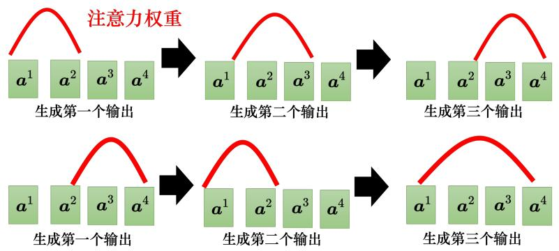

<details>
<summary>flowchart</summary>

```mermaid
graph TD
    A["a¹ a² a³ a⁴"] --> B["生成第一个输出"]
    B --> C["注意力权重"]
    C --> D["a¹ a² a³ a⁴"]
    D --> E["生成第二个输出"]
    E --> F["注意力权重"]
    F --> G["a¹ a² a³ a⁴"]
    G --> H["生成第三个输出"]
    H --> I["注意力权重"]
    I --> J["a¹ a² a³ a⁴"]
    J --> K["生成第四个输出"]
    K --> L["注意力权重"]
    L --> M["注意力权重"]
```
</details>

图 7.30 引导注意力

# 7.7.3 束搜索

如图 7.31 所示，假设解码器就只能产生两个字 A 和 B，假如世界上只有两个字 A 跟 B，即词表 $\mathcal { V } = \{ A , B \}$ 。对解码器而言，每一次在第一个时间步（time step），它在 A、B 里面决定一个。比如解码器可能选 B 当作输入，再从 A、B 中选一个。在上文中，每一次解码器都是选分数最高的那一个。假设 A 的分数是 0.6，B 的分数是 0.4，解码器的第一次就会输出 A。接下来假设 B 的分数为 0.6，A 的分数为 0.4，解码器就会输出 $\mathrm { { B } _ { \circ } }$ 。再假设把 B 当做输入，现在输入已经有 A、B，接下来 A 的分数是 0.4，B 的分数是 0.6，解码器就会选择输出 B。因此输出就是 A 、B 、B。这种每次找分数最高的词元来当做输出的方法称为贪心搜索（greedysearch），其也被称为贪心解码（greedy decoding）。红色路径就是通过贪心解码得到的路径。

但贪心搜索不一定是最好的方法，第一步可以先稍微舍弃一点东西，第一步虽然 B 是 0.4，但先选 B。选了 B，第二步时 B 的可能性就大增就变成 0.9。到第三步时，B 的可能性也是0.9。绿色路径虽然第一步选了一个较差的输出，但是接下来的结果是好的。比较下红色路径与绿色路径，红色路径第一步好，但全部乘起来是比较差的，绿色路径一开始比较差，但最终结果其实是比较好的。

如何找到最好的结果是一个值得考虑的问题。穷举搜索（exhaustive search）是最容易想到的方法，但实际上并没有办法穷举所有可能的路径，因为每一个转折点的选择太多了。对中文而言，中文有 4000 个字，所以树每一个地方的分叉都是 4000 个可能的路径，走两三步以后，就会无法穷举。

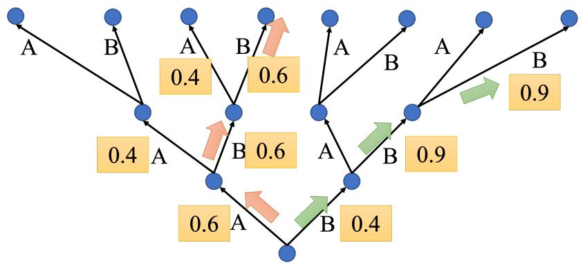

<details>
<summary>flowchart</summary>

```mermaid
graph TD
    A1["A"] --> B1["B"]
    B1 --> A2["A"]
    A2 --> B2["B"]
    B2 --> A3["A"]
    A3 --> B3["B"]
    B3 --> A4["A"]
    A4 --> B4["B"]
    B4 --> A5["A"]
    A5 --> B5["B"]
    B5 --> A6["A"]
    A6 --> B6["B"]
    B6 --> A7["A"]
    A7 --> B7["B"]
    B7 --> A8["A"]
    A8 --> B8["B"]
    B8 --> A9["A"]
    A9 --> B9["B"]
    B9 --> A10["A"]
    A10 --> B10["B"]
    B10 --> A11["A"]
    A11 --> B11["B"]
    B11 --> A12["A"]
    A12 --> B12["B"]
    B12 --> A13["A"]
    A13 --> B13["B"]
    B13 --> A14["A"]
    A14 --> B14["B"]
    B14 --> A15["A"]
    A15 --> B15["B"]
    B15 --> A16["A"]
    A16 --> B16["B"]
    B16 --> A17["A"]
    A17 --> B17["B"]
    B17 --> A18["A"]
    A18 --> B18["B"]
    B18 --> A19["A"]
    A19 --> B19["B"]
```
</details>

图 7.31 解码器搜索示例

接下来介绍下束搜索（beam search），束搜索经常也称为集束搜索或柱搜索。束搜索是用比较有效的方法找一个近似解，在某些情况下效果不好。比如论文“The Curious Case OfNeural Text Degeneration”[5]。这个任务要做的事情是完成句子（sentence completion），也就是机器先读一段句子，接下来它要把这个句子的后半段完成，如果用束搜索，会发现说机器不断讲重复的话。如果不用束搜索，加一些随机性，虽然结果不一定完全好，但是看起来至少是比较正常的句子。有时候对解码器来说，没有找出分数最高的路，反而结果是比较好的，这个就是要看任务本身的特性。假设任务的答案非常明确，比如语音识别，说一句话，识别的结果就只有一个可能。对这种任务而言，通常束搜索就会比较有帮助。但如果任务需要机器发挥一点创造力，束搜索比较没有帮助。

# 7.7.4 加入噪声

在做语音合成的时候，解码器加噪声，这是完全违背正常的机器学习的做法。在训练的时候会加噪声，让机器看过更多不同的可能性，这会让模型比较鲁棒，比较能够对抗它在测试的时候没有看过的状况。但在测试的时候居然还要加一些噪声，这不是把测试的状况弄得更困难，结果更差。但语音合成神奇的地方是，模型训练好以后。测试的时候要加入一些噪声，合出来的声音才会好。用正常的解码的方法产生出来的声音听不太出来是人声，产生出比较好的声音是需要一些随机性的。对于语音合成或句子完成任务，解码器找出最好的结果不一定是人类觉得最好的结果，反而是奇怪的结果，加入一些随机性的结果反而会是比较好的。

# 7.7.5 使用强化学习训练

接下来还有另外一个问题，我们评估的标准用的是 BLEU（BiLingual Evaluation Under-study）分数。虽然 BLEU 最先是用于评估机器翻译的结果，但现在它已经被广泛用于评价许多应用输出序列的质量。解码器先产生一个完整的句子，再去跟正确的答案一整句做比较，拿两个句子之间做比较算出 BLEU 分数。但训练的时候，每一个词汇是分开考虑的，最小化的是交叉熵，最小化交叉熵不一定可以最大化 BLEU 分数。但在做验证的时候，并不是挑交叉熵最低的模型，而是挑 BLEU 分数最高的模型。一种可能的想法：训练的损失设置成 BLEU分数乘一个负号，最小化损失等价于最大化 BLEU 分数。但 BLEU 分数很复杂，如果要计算两个句子之间的 BLEU 分数，损失根本无法做微分。我们之所以采用交叉熵，而且是每一个中文的字分开来算，就是因为这样才有办法处理。遇到优化无法解决的问题，可以用强化学习训练。具体来讲，遇到无法优化的损失函数，把损失函数当成强化学习的奖励，把解码器当成智能体，可参考论文“Sequence Level Training with Recurrent Neural Networks”。

# 7.7.6 计划采样

如图7.32所示，测试的时候，解码器看到的是自己的输出，因此它会看到一些错误的东西。但是在训练的时候，解码器看到的是完全正确的，这种不一致的现象叫做曝光偏差（exposurebias）。


<details>
<summary>flowchart</summary>

```mermaid
graph TD
    subgraph Left_Circuit
        A["机"] --> B["解码器"]
        C["气"] --> B
        D["学"] --> B
        B --> E["<BOS>"]
        B --> F["机"]
        B --> G["气"]
    end
    subgraph Right_Circuit
        H["机"] --> I["解码器"]
        J["器"] --> I
        K["学"] --> I
        I --> L["<BOS>"]
        I --> M["机"]
        I --> N["气"]
    end
    style Left_Circuit fill:#f9f,stroke:#333
    style Right_Circuit fill:#bbf,stroke:#333
    note right of Left_Circuit: 标准答案
    note right of Right_Circuit: 气泡指向左端
```
</details>

图 7.32 曝光偏差

假设解码器在训练的时候永远只看过正确的东西，在测试的时候，只要有一个错，就会一步错步步错。因为解码器从来没有看过错的东西，它看到错的东西会非常的惊奇，接下来它产生的结果可能都会错掉。有一个可以的思考的方向是：给解码器的输入加一些错误的东西，不要给解码器都是正确的答案，偶尔给它一些错的东西，它反而会学得更好，这一技巧称为计划采样（scheduled sampling）[6]，它不是学习率调整（schedule learning rate）。很早就有计划采样，在还没有 Transformer、只有 LSTM 的时候，就已经有计划采样。但是计划采样会伤害到 Transformer 的平行化的能力，所以 Transformer 的计划采样另有招数，其跟原来最早提在这个 LSTM 上被提出来的招数也不太一样。读者可参考论文“Scheduled Sampling forTransformers”[7]、“Parallel Scheduled Sampling”[8]。

# 参考文献

[1] VINYALS O, KAISER Ł, KOO T, et al. Grammar as a foreign language[J]. Advances in neural information processing systems, 2015, 28.   
[2] CARION N, MASSA F, SYNNAEVE G, et al. End-to-end object detection with transformers[C]//European conference on computer vision. Springer, 2020: 213-229.   
[3] SUTSKEVER I, VINYALS O, LE Q V. Sequence to sequence learning with neural networks[J]. Advances in neural information processing systems, 2014, 27.   
[4] LIU F, REN X, ZHAO G, et al. Rethinking and improving natural language generation with layer-wise multi-view decoding[J]. arXiv preprint arXiv:2005.08081, 2020.   
[5] HOLTZMAN A, BUYS J, DU L, et al. The curious case of neural text degeneration[J]. arXiv preprint arXiv:1904.09751, 2019.   
[6] BENGIO S, VINYALS O, JAITLY N, et al. Scheduled sampling for sequence prediction with recurrent neural networks[C]//volume 28. 2015.   
[7] MIHAYLOVA T, MARTINS A F. Scheduled sampling for transformers[J]. arXiv preprint arXiv:1906.07651, 2019.   
[8] DUCKWORTH D, NEELAKANTAN A, GOODRICH B, et al. Parallel scheduled sampling[J]. arXiv preprint arXiv:1906.04331, 2019.